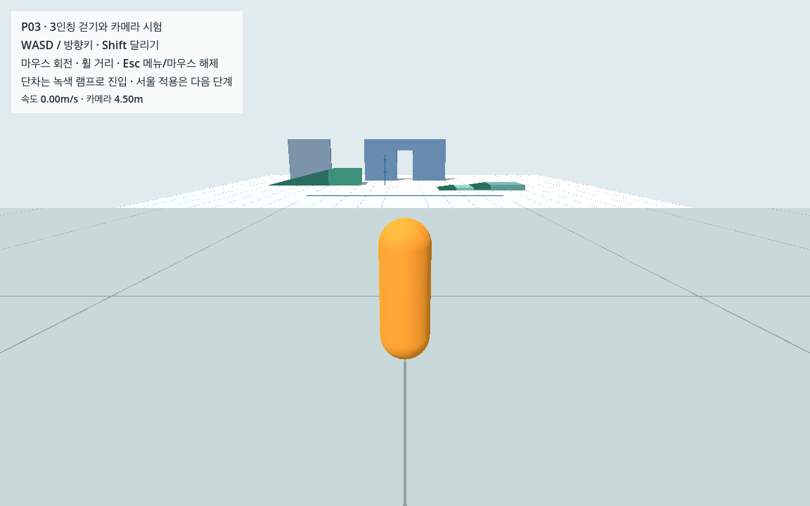
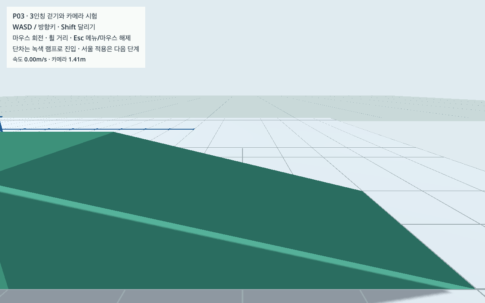
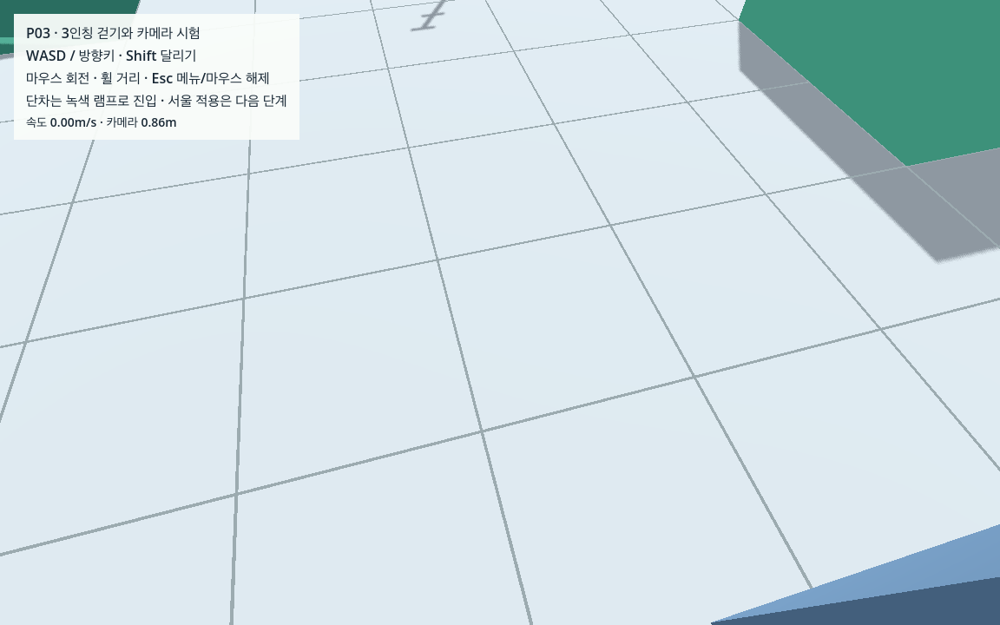

# P03 · 시험장 3인칭 카메라와 벽/문 가림

2026-10-13 · 완료 · 시작 커밋 `904d0c5ce1094a90e26f59e787dd3d9ed5d01c5c` · 다음 **P04**

P02 시험장을 상속해 캐릭터를 따라오는 카메라, 마우스 회전, 휠 거리 조절, 벽/문에서 거리 축소, 메뉴의 마우스 해제/복구를 구현했다. 기존 P01/P02 파일과 실제 서울 표시·좌표·자료는 그대로다. **합성 시험장의 결과이며 서울 보행 완료는 아니다.**

## 실행과 직접 확인

같은 Godot 4.7.2와 저장소만 있으면 지도 가공이나 Python 환경 없이 실행할 수 있다.

```sh
sh tools/run_camera_test.sh run
sh tools/run_camera_test.sh editor
```

WASD/방향키로 걷기, Shift로 달리기, 마우스로 회전, 휠로 거리 조절, Esc로 메뉴/마우스 해제를 한다. 메뉴의 돌아가기·다시 시작·종료를 사용할 수 있다. 다른 창으로 이동하면 일시 정지하며, 돌아온 뒤 직접 재개한다. 이동키를 계속 누른 채 메뉴를 닫거나 시작점으로 복귀했으면 키를 놓은 뒤 다시 움직인다. 가까운 벽/문에서는 임시 몸체가 잠시 숨겨진다. 단차는 녹색 진입 램프로 오른다.

직접 판단이 유용한 항목은 **마우스/트랙패드 회전 감도, 문 접근 때 시야가 줄어드는 느낌, Esc 후 재개가 자연스러운지**다. 자동 검증을 사람의 조작감 확인으로 기록하지 않는다. 최신 시험 창을 열어 검토할 수 있게 했으며 사용자 응답 전까지 직접 확인은 미검증으로 둔다.



## 구조와 기본값

[camera_test.tscn](../../game/scenes/tests/camera_test.tscn)은 P02를 상속한다. [camera_rig.tscn](../../game/scenes/player/camera_rig.tscn)과 [camera_rig.gd](../../game/scripts/player/camera_rig.gd)는 Presentation 아래에 있고 Player의 이동 기준 카메라도 새 Camera로 연결했다. P02의 고정 시점은 이 장면에서만 비활성화한다. L자 모서리 보조벽 하나를 추가한 합성 정적 구조는 총13개다. 실제 도시 main/PlayerSlot에는 아직 연결하지 않았다.

| 항목 | 구현 기본안 |
|---|---|
| 추적 위치 | 캐릭터 발 +1.3m |
| 기본/휠 요청 거리 | 4.5m / 2~6m, 한 단계0.35m |
| 회전 | 감도0.0025rad/화면pixel, 상하−55~+15°, 기본−15° |
| 투영 | 원근 FOV65°, near0.05m, far200m |
| 장애물 탐색 | SpringArm의 반경0.20m 구, margin0.08m, mask1 |
| 자기 충돌 | 플레이어 RID 명시 제외 |
| 거리 변화 | 충돌 시 즉시 축소, 여유 공간에서 최대6m/s 확장 |
| 가까운 몸체 | 거리<1.5m 숨김, >1.8m 복원 |
| 물리 처리 | Player priority0 → SpringArm1 → 최종 카메라2, 60Hz |

마우스 이벤트는 요청 각도만 바꾸고 물리 이동 뒤 리그 위치/각도를 적용한다. 회전 중 탐색 전 위치가 잠깐 화면에 게시되는 일을 피한다. SpringArm 탐색 후 최종 구 겹침 질의를 더 실행한다. 실제 모서리 시험에서 한 tick 접촉이 발견되어 14회 이분 탐색과 추가5mm 여유를 넣었다. 탐색 시작 pivot이 구조 안에 놓이는 배치는 이번 검증 범위 밖이다.

1152×720에서 실제 near plane 네 모서리의 카메라 중심 거리 최댓값0.078180507m가 탐색 구0.20m 안에 들어간다. 극단적인 화면 비율이나 임의 창 크기에 대한 보장은 아니다. 가까운 곳에서는 전신을 항상 보이게 하는 대신 몸체가 진행 시야를 가리는 현상을 줄였다.

메뉴는 Actor와 리그를 멈추고 마우스를 해제한다. 창 포커스가 돌아와도 자동 재개하지 않는다. 재잠금 첫 마우스 움직임을 무시하며 P02의 키 중립 대기도 유지한다. 낙하/영역 복귀는 새 위치에서 yaw0/pitch−15°/요청거리4.5m로 초기화한 뒤 다시 안전 거리를 찾는다.

## 검증 결과와 해석

현재 M1 Pro 16GB, Godot `4.7.2.stable.official.ed1daf0bf`, Forward+/Metal, 논리 화면1152×720에서 수행했다. 지도·생성 자료·초기 캐시 없는 **13개 authored game 파일의 별도 사본**으로 실행하고 프로세스 네트워크를 차단했다. 엔진 측정과 별도 표준 Python 검사기의 판정을 구분했다.

| 시험 | 실제 결과 | 증거 |
|---|---|---|
| 가속 headless 전체/반복 | 각각13,367개 통과, 선택 경로 표본·계약 동일 | [원측정](camera/headless_engine.json), [반복](camera/repeat_engine.json), [계약12개](camera/contract_check.json) |
| 실제 GPU 30fps | 8,788개 통과, 물리60Hz | [원측정](camera/gpu_30_engine.json), [독립 판정](camera/gpu_30_engine_check.json) |
| 실제 GPU 60fps | 8,788개 통과, 물리60Hz | [원측정](camera/gpu_60_engine.json), [독립 판정](camera/gpu_60_engine_check.json) |
| GPU 사본/환경/소스 | 5개 통과 | [GPU 종합](camera/gpu_check.json) |
| 실제 설정/소스 오류6종 | 모두 관련 검사에서 실패 판정 | [설정 오류5종](camera/contract_check.json), [코너 보완 제거1종](camera/regression/guard_regression.json) |
| 소스/자료/공유 증거 인수 | 현행 소스·검증 해시, P02/서울 자료 보존 | [인수 결과](p03_verification.json) |

검사 개수는 표본별 질의/계산을 포함한 assertion 수이며 독립 장면 수나 사용자 수가 아니다. 각 정상 실행은 연속 구간30개와 이벤트7개의 **37개 사례**다. headless 구간 물리9,572ticks 중 열린 곳 정지3,600ticks/60초를 포함한다. GPU는 열린 곳 정지120ticks/2초와 동일 이동/회전 사례를 실행해 각6,092ticks다. 가속 headless의 물리60초를 실제 벽시계60초나 GPU 성능으로 주장하지 않는다. P02 실제60초 정지는 원래 증거를 유지했다.

### 거리·프레임·입력

| 구간 | 물리 시간/ticks | GPU30 벽시계/렌더 frames | GPU60 벽시계/렌더 frames | 수평 거리 |
|---|---|---|---|---|
| 걷기 | 10초 /600 | 10.001429초 /300 | 9.998742초 /600 | 14.000009m |
| 달리기 | 10초 /600 | 10.000589초 /300 | 9.998766초 /600 | 35.000019m |
| 열린 곳 정지 | 2초 /120 | 1.998643초 /60 | 2.000072초 /120 | 0m |

실제/물리 시간 차이2% 이내, 렌더 제한 대비 frame 수 오차20% 이내와 P02 속도 거리2% 기준을 통과했다. 이 표는 시험장 실행 조건 확인이며 실제 서울의 최대 성능 평가가 아니다.

주입 마우스120/40pixel에서 yaw−0.3rad/pitch 변화−0.1rad, 첫 움직임 무시와 상하/거리 한계를 확인했다. 실제 GPU에서 메뉴를 열면 native mouse mode0, 닫으면2다. 메뉴 중 Actor/리그 신호0·위치/각도 변화0, 계속 누른 키 이동0, 중립 후0.5초 약0.70m 이동이다. headless는 native capture를 지원하지 않아 mode0인 상태에서 **모의 잠금 의도**만 검사했다.

포커스 검사는 실제 `NOTIFICATION_WM_WINDOW_FOCUS_OUT` 알림 경로에 주입해 메뉴/마우스 해제·수동 재개 정책을 확인했다. 사람이 앱을 전환하거나 OS가 발생시킨 포커스 이벤트를 재현한 시험은 아니다.

### 벽·문·코너·단차

각 물리tick에서 카메라 구의 실제 static overlap, 카메라→near plane 네 모서리 ray, 추적 오차·안전 길이·처리 순서를 질의한다. **매 tick 극값/횟수**는 `all_tick_stats`, 경로 원표본은 첫/6tick 간격/마지막의 약10Hz다. 원표본 사이의 한 tick 접촉도 집계 검사에서 거부한다. Box에 대한 거리/near plane 계산은 Python에서 독립 재계산하고 Convex 램프는 실제 엔진 질의로 확인한다.

- 정상30개 연속 구간의 모든 관측tick: camera overlap0, near-corner ray hit0, 추적/길이 초과/처리 tick 불일치0.
- 벽 앞3초: 거리1.40625m, 거리 범위0·camera 최대 이동0으로 정지 떨림 기준5mm를 통과했다.
- 코너 회전3초: 거리0.38671875~4.5m. 문 위 회전3초: 거리0.861328125m. 가까운 몸체 숨김이 적용된 최종 화면을 직접 확인했다.
- 열린 곳 복원2초: 설정한0.3m에서4.5m까지 안전하게 확장, 최대 한 tick 약0.100001m로6m/s 제한을 통과했다. 코너 회전의 좌표 이동은 회전과 축소도 포함하므로 이 확장 속도와 혼동하지 않는다.
- 문 양방향 각10회, 총20회: 각172ticks 동안 약4.013m 횡단하며 카메라 회전을 병행했다. 합성 빈 폭/높이1.20×2.20m이며 실제 대한문이 아니다.
- P02 단차 진입 램프/경사에서 각각222/270ticks 지면 접촉과 카메라 안전 질의를 확인했다. 자동 계단 오르기나 실제 보도턱의 검증은 아니다.
- 열린 곳 정지/걷기/달리기의 보존 표본에서 머리/발이1152×720 화면 안이고 카메라 앞에 있음을 교차 확인했다. 임의 회전/가림 중 전신 항상 표시의 검증은 아니다.





추가 화면: [코너](camera/view_corner.png), [문 통과](camera/view_door.png), [메뉴](camera/view_menu.png). 선택 시점의 PNG와 물리 질의 근거이며 모든 렌더 프레임의 픽셀/검은 화면 검사나 동영상 검증은 아니다.

## 발견한 문제와 수정

1. headless에서 capture setter를 써도 native mode가0이었다. 의도 시험과 실제 Mac mode2 시험을 분리했다.
2. 최초 모서리에서 매 tick 질의는1건 접촉을 발견했지만10Hz 표본에는 남지 않았다. 최종 overlap 보완을 추가하고, 보완을 실제 제거한 사본에서 같은 실패를 다시 검출했다. [이전 측정](camera/development/before_corner_guard.json), [보완 제거 측정](camera/regression/guard_disabled.json).
3. 확장 시험이 current 거리만0.3m로 설정하고 실제 카메라 위치를4.5m에 남겨 가짜4.1m 이동을 만들었다. 설정 시 두 값을 같이 바꿨다.
4. 자기 제외 해제만으로 반드시 카메라가 짧아진다는 가정은 초기 overlap 처리 때문에 성립하지 않았다. 명시 RID 등록 여부를 API 반환값으로 확인하고 mask3 조건에서도 정상4.5m를 확인했다. 등록 해제가 항상 화면 관통을 만든다고 주장하지 않는다.
5. 벽/문 위 캡처에서 큰 임시 몸체가 시야를 가려 숨김/복원 기준을1.5/1.8m로 조정했다. 이전 결과·화면은 [이전 스냅샷](camera/development/before_visibility_refinement/gpu_check.json)에 보존하고 최종 소스로 contract/GPU/코너 회귀를 모두 재실행했다.

[개발 실패 요약](camera/development/failures.json). 정상 반복에 최종 source hash가 일치하며 예전 결과를 현재 인수 증거로 사용하지 않는다. 짧은 문맥의 Sol이 독립 검사기를 작성하고 near plane 계산·tick 누락·고장 감지·화면 투영을 교차 검토했다. [검사기 증거 변형8종](camera/independent_review.json)은 JSON 증거 변형이며 위 **실제 엔진 오류6종**과 구분한다.

## 재현과 다음 행동

```sh
sh tools/run_camera_test.sh observe
python3 tools/check_camera_contract.py --mode contract
python3 tools/check_camera_contract.py --mode gpu
python3 tools/check_camera_guard_regression.py
```

기본 출력은 Git 제외 캐시다. `observe`는 실제60fps 전체 시험·문 왕복·6개 PNG를 약100~110초에 기록한다. `contract`의 가속 물리/정상 반복/오류5종과 `gpu`의 실제30/60fps 시험은 서로 다르다. 마지막 도구는 코너 최종 보완을 실제 제거한 별도 사본1종을 검사한다. 표준 Python만 필요하다. 공유 증거를 덮어쓰려는 경우에만 명시적으로 `--output data/reports/camera` 등을 사용한다. 다른 Mac 절차는 [CROSS_MAC](../../docs/CROSS_MAC.md)을 따른다.

**다음 P04**: E03 도형·G03/G04 보류 상태와 C07을 읽고 정적 월드/플레이어/NPC/차량/카메라 레이어·마스크 행렬을 구성한다. 기존 물리/카메라 검사와 입력/복귀를 유지하며 실제 도시 정적 충돌을 연결한다. 보기용 지면/이동 후보를 최종 통행 허가로 자동 승격하지 않는다. 실제 대한문 개구부와 세 경로 완주는 W 단계다.

사람의 직접 조작감, OS 발생 포커스 전환, M4의 RAM/OS/실행, 극단적 화면 비율, 실제 도시 충돌·대한문/필수 경로·도시 성능, W0/V0는 아직 미검증/미완료다. 새 다운로드·외부 모델/설치·사용자 범위 변경은 없다.

기술 참고: [Godot SpringArm3D](https://docs.godotengine.org/en/stable/classes/class_springarm3d.html), [3인칭 SpringArm 안내](https://docs.godotengine.org/en/stable/tutorials/3d/spring_arm.html), [마우스 화면 이동량](https://docs.godotengine.org/en/stable/classes/class_inputeventmousemotion.html). 수치와 통과 판정은 저장한 실제 엔진 결과가 기준이다.
