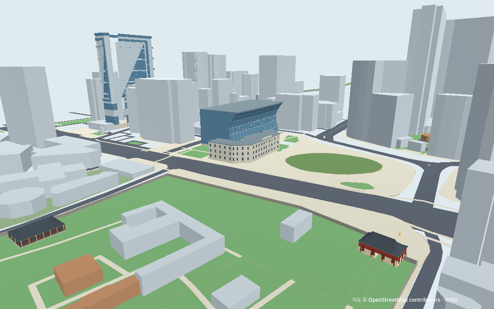

# L03 도시 외형·기존 모델 수정 비교

2026-10-15 · 기준 M1 Pro 16GB / Godot 4.7.2 / Forward+ Metal. 사용자 지시대로 **실제 기존 모델 취득·가져오기·수정 비교를 먼저 수행**하고 시청·서울도서관·서울광장·주변 빌딩 표시를 구성했다. 최종 고정 소스의 실제 GPU 전체 회귀까지 통과해 L03을 완료했다.

## 제작 방식의 선택

| 방법 | 실제 실행과 판단 |
|---|---|
| Kenney CC0 모델 수정 | 공식 ZIP/동봉 라이선스 확인, GLB와 상대 PNG를 Godot GLTFDocument로 실제 수입했다. 원형의 밝은 색/큰 창과 수정본을 같은 카메라에서 비교했다. 낮은 색과 원본 외곽 절삭·얇은 층 분할을 적용해 배경 빌딩1곳에 사용한다 |
| 정확한 시청 모델 후보 | 3D Warehouse 후보는 상세 접근403·파일/재배포 조건 미확보. 가져왔다고 주장하지 않는다. 시청과 도서관은 독립 제작한 단순 외형을 사용한다 |
| OSM2World | 공식0.4.0 기능/배포 규모 확인까지다. 약431MiB 도구의 설치/실행·성능 비교는 하지 않았다 |
| 기존 단순 부피 | SFC44삼각형 원본과 비교했다. 가볍지만 특징이 적어 수정 모델을 한 곳에 제한 적용하고 롤백용 원본은 유지한다 |

원본 GLB는1재질/2,118정점/1,292삼각형이다. 배포 단위가 실제 건물 미터값이라는 근거가 없어 지도에 맞춰 비균일하게 변환했다. 수정한 SFC 표시5부품/6,600삼각형 중 원본 연결을 보존한 부분은2,024삼각형이다. 나머지는 원본 외곽의 낮은 석재부와 실제 모델 면 위 얇은 층 분할이다. **서울파이낸스센터를 정확히 재현한 모델은 아니다.** 기존124m/높이 분류는 유지한다.

전체 ZIP4,096,974B는 캐시에만 두고 원본 GLB111,336B·PNG11,002B·License708B·취득 해시를 공유한다. 최초 import+정점/재질 추출 단일 관측11,561µs는 장면 로딩/제작 노동/성능 벤치마크가 아니다. 수작업 전체 시간은 계측하지 않았다. 실제 수정과 두 번의 화면 검토/수치 오류 해결이 필요했으므로 기존 모델이 항상 더 싼 방식이라는 결론은 내리지 않았다. [실제 취득·메시·변환 기록](landmarks/l03/reuse_acquisition.json), [후보 비교](../../docs/ASSET_REUSE_OPTIONS.md), [출처/사용 조건](../../docs/ATTRIBUTION.md).

## 실제 화면

이름표와 큰 조작 패널을 숨긴 동일1152×720/주간 조명이다. 카메라 후보는 관찰용이며 보행 위치/허가가 아니다. 고정 화면의 사람 인지성은 아직 직접 승인받지 않았다.



| 대상 | 교체 전 | 교체 후 |
|---|---|---|
| 시청 | [원본](landmarks/l03/views_view_city_hall_before.png) | [곡선 유리/긴 처마](landmarks/l03/views_view_city_hall_after.png) |
| 서울도서관 | [원본](landmarks/l03/views_view_library_before.png) | [석재/창/중앙부](landmarks/l03/views_view_library_after.png) |
| 서울광장 | [원본](landmarks/l03/views_view_plaza_before.png) | [외곽 유지·잔디/포장 대조](landmarks/l03/views_view_plaza_after.png) |
| SFC 위치의 배경 빌딩 | [기존 부피](landmarks/l03/views_view_sfc_before.png) | [수정 모델](landmarks/l03/views_view_sfc_after.png) |

실제 모델 비교: [원래 텍스처의 전체 높이](landmarks/l03/views_view_sfc_isolated_native.png) / [수정 후 전체 높이](landmarks/l03/views_view_sfc_isolated_modified.png) / [원래 모델의 주변 배치](landmarks/l03/views_view_sfc_native_fit_original_texture.png). 전체 높이를 가리지 않도록 별도 고정 검사 시점에서는 다른 표시를 잠시 끈다. 일반 게임에는 이 비교 모드/검사 카메라가 없다. [대한문 3인칭](landmarks/l03/views_view_gate_third_person.png).

## 변경과 보존

| 대상 | 표시 부품 | 삼각형 | 표현·근거 |
|---|---:|---:|---|
| 시청 | 5 | 1,215 | 높이별 후퇴/전진 유리 단면·노출 프레임·긴 처마. 곡률/간격은 제작 가정 |
| 도서관 | 6 | 2,136 | 낮은 석재·창 반복·중앙부 강조. 구멍과 기존18.5m 유지 |
| 광장 | 2 | 73 | 기존 외곽/단일Y=0.017 유지. 안쪽0.6m 포장 테두리는 표현 가정 |
| 배경 빌딩 | 5 | 6,600 | CC0 실제 모델 수정·색 단순화·저층부/층 분할. 원본124m 유지 |
| 합계 | 18 | 10,024 | 새 충돌/경로0. 원본 위치와 충돌을 바꾸지 않는 표시 층 |

새 `city_landmarks.tscn`은 L02 장면을 상속한다. 도시 원본4개의 표시만 교체하고 기존 궁궐401부품·10,766삼각형, 생성692/활성687body·지원면·경계·3×3m 대한문·모든 보행 경로는 유지한다. 나머지 주변 건물은 기존 부피다. 유리는 불투명 단색이며 사실적 반사/실내/식생/가구는 추가하지 않았다.

자료 차이도 유지했다. 시청 공식13층과 기존12층→40.2m 추정은 미터 측량값으로 자동 병합하지 않았다. SFC 공식130m/30층/주소136/완공2000과 기존124m/28층/주소36/시작2001도 기준 차이 미해결이다. 광장2025년 목재 길·식재 변경은 확인했지만 좌표/축척이 확보되지 않아 추가하지 않았다. 현재 빈 잔디 타원을 정확한2026년 내부 배치로 설명하지 않는다. [판단과 공식 URL](../manual/l03_city_decisions.json).

## 실패와 해결

- 첫 화면에서 시청이 상자처럼 보이고 격자가 유리 몸체에 묻혀 점선으로만 나타났다. 유리 정면을8개 높이 단면으로 바꾸고 프레임을 앞에 노출했다. 검사의 기하 존재만으로 화면 인상을 통과시키지 않았다.
- 외부 모델 절삭으로 생긴 미세 면이 float32에서 붕괴하거나 법선과 어긋났다. 실제 저장 좌표 기준으로 미세 면을 제거하고 법선을 계산했다. clipping epsilon 경계에서 원삼각형 밖 barycentric 외삽도 발견해 보간값을0..1로 제한했다. 공간/보행 허용치를 넓히지 않았다.
- 초기 검사기는 역할 이름과 곡면 위치를 잘못 가정했다. 평면 지붕에 여러 상향 법선을 요구하는 대신 실제 곡선 유리의3개 수직 단면×7높이에서 깊이 변화/비선형성을 검사한다. 긴 처마의 면적/폭 기준은 유지했다. 추가한 SFC 층 분할 역할도 허용 목록에 명시했다.
- [첫 실패 관측/화면/판정](landmarks/l03/development/first_views/views_visual_check.json)과 [두 번째 검사 가정 실패](landmarks/l03/development/second_views/views_visual_check.json)를 원시 관측/화면과 함께 보존했다. 중간 생성기 소스 바이트까지 보존했다고 주장하지 않는다. [보존 범위](landmarks/l03/development/README.json).

## 검증

최종 결과: 실제 GPU 고정 시점 도시58개/L02궁궐76개, headless 전체334구간/3,508개, 실제 엔진 결함4종과 lineage 변조 거부, prepared14입력 다른 폴더2회 동일 생성/거부 검사8개를 통과했다. L02의 실행 소스/자료/검증91파일도 바이트가 같다. 실제 GPU짧은874개와 전체3,520개/334구간·11단계·57,116tick·물리951.933333초/실제952.105510초도 통과했다. 목표점 최대오차0.058265m, 캡슐/카메라 침투2.177564/0.000697mm, 단계 시간차 최대0.302422%다. 여정 중 순간이동/복귀/영역이탈0·전tick지면 접촉을 유지했다. [최종 요약](landmarks/l03/gpu_summary.json), [검사](landmarks/l03/gpu_check.json), [전체 인수](l03_verification.json).

수정한 각 모델 면에는 원본 GLB 삼각형 번호와 barycentric 연결이 있다. 별도 struct GLB 판독기가 원본을 읽고 변환 좌표를1µm 이내로 재계산한다. 실제 엔진 정점/재질은float32, 법선은uint16 octahedral 왕복을 독립 대조한다. 모든 삼각형 전체 투영/원본 구멍·수직 범위·전체1,233원본/7조각 가시성·신규충돌0을 확인한다.

W04 원시 관측은 바꾸지 않는다. 기존 검사와 비교할 때 대한문 표시3개만 W04 기준으로, 도시 원본 표시4개만 L02 기준으로 되돌린 복사본을 사용하고 차이 목록을 남긴다. body/경로/시간/침투 판정은 정규화하지 않는다. 기존5mm/2% 기준을 유지한다. [검증 계획](../../docs/VALIDATION_PLAN.md).

## 재현·다음 행동

```sh
.venv-data/bin/python tools/prepare_city_landmarks.py
.venv-data/bin/python tools/prepare_city_landmarks.py --check
sh tools/run_city_landmarks.sh run
```

W04/L01/L02 입력 준비가 먼저다. [다른 Mac 준비·검사 명령](../../docs/CROSS_MAC.md)을 따른다. 원본 CC0 자산은 공유하고 생성 JSON·.godot·캐시·앱/가상환경·국가 지도는 제외한다. 일반 실행에는 probe를 넣지 않는다.

다음은 **L04 결합 배치·보행 재검수**다. 지정 시점과 사람 눈높이에서 궁궐/시청/도서관의 인상·거리·카메라 가림과 과장된 부분을 검토한다. 이미 확인한 보행 검사를 이유 없이 반복하지 않고 새 변경에 필요한 회귀를 수행한다. 사람이 직접 볼 때 가장 도움이 되는 항목은 시청 곡선과 구청사의 대비, 빌딩의 창 크기다. 확인을 다음 진행의 대기 조건으로 만들지는 않는다.

직접 사람 조작/OS포커스·실측 외관/지형/현장 접근·M4·NPC/차량·도시 성능/패키지·V0는 미검증/미완료다. 자동 보행 통과나 한 장의 화면을 이 항목의 완료로 바꾸지 않는다.

일반 GPU 실행도 자동 probe 없이 `W03_READY`/`L02_READY`/`L03_READY`와 정상 종료를 확인했다. [일반 기동 로그](landmarks/l03/normal_start.log). 현재 실행 기기의 RAM16GB·macOS27.0을 재확인했고 M4는 별도다. [환경 기록](landmarks/l03/environment.json), [독립 검토 범위](landmarks/l03/independent_review.json).
