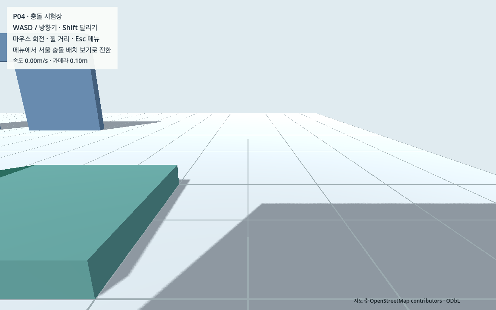
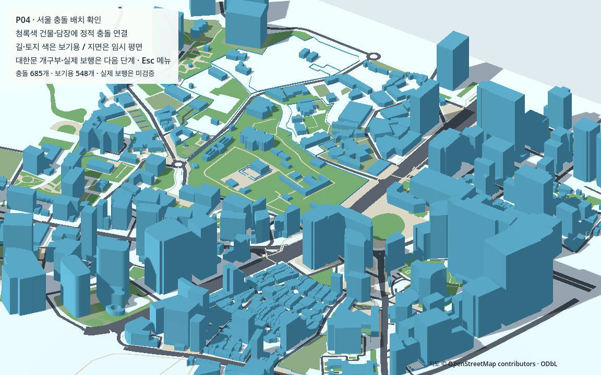
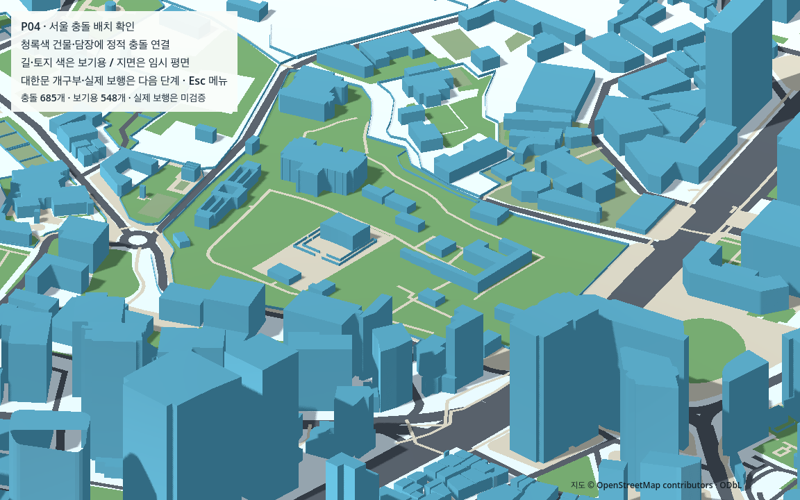

# P04 충돌 계층과 관통 검사

2026-10-13 · **완료** · 현재 M1 Pro 16GB / Godot 4.7.2 / Forward+·Metal / 논리 화면 1152×720 / 물리60Hz. 실제 서울 도형에 정적 충돌을 연결하고, 독립 시험장의 이동·카메라·문 통과를 새 행렬로 재검증했다. **대한문 개구부와 실제 서울 보행은 다음 W01부터**다.

## 만든 결과와 선택 이유

P03을 상속한 [충돌 시험장](../../game/scenes/tests/collision_test.tscn)과 E03을 상속한 [도시 충돌 장면](../../game/scenes/world/collision_world.tscn)을 추가했다. 기존 P01–P03의13개 게임 소스, E03 loader/main·region·world 바이트를 유지했다. 새로운 지도 다운로드·설치·유료 도구는 없다.

| 실제 정적 충돌 선택 | 개수 | 근거 / 제한 |
|---|---:|---|
| Buildings | 635 | G03에서 단순 본체로 선택한 E03 삼각형을 그대로 사용. 추정 높이와 원천 ID 유지 |
| Barriers | 49 | E03 담장 삼각형. 기존 임시 두께0.35m는 표현 가정 |
| temporary_support | 1 | G03의 y=0 기술적 지지 평면. 실제 지형·통행 허가 아님 |
| 합계 | **685** | **20,302삼각형**, source mesh와 identity 변환/float32 정점 일치 |
| 충돌 제외 | **548** | 토지 참조178 + 길/도로 표시370. 보기만으로 최종 보행 지면으로 승격하지 않음 |

각 selected mesh 자식에 StaticBody3D/ConcavePolygonShape3D를 붙였다. 기존 표시 자료의 `collision_generated=false`와 `runtime_permission=null`은 변경하지 않고 별도의 [규칙](../../game/resources/collision/rules.json)·기기별 `generated.json`으로 물리 적용을 명시한다. 생성 계획은 E03 world·region·규칙·생성기 hash와 메시 ID/삼각형 hash를 연결하며 오래된 자료는 생성 전/실행 전 거부한다.

Concave는 원본의 구멍과 분리 면을 보존하기 위해 정적 월드에만 사용한다. 양쪽에서 표면을 막도록 backface_collision=true로 두었다. 이는 삼각형 껍질이며 이미 그 내부에 놓인 캐릭터의 체적 겹침 검사를 대신하지 않는다. W01에서 확인한 지면/시작점과 추가 겹침 검증이 필요하다. 움직이는 보행자·차량은 단순 모양을 사용할 예정이다. [공식 shape 설명](https://docs.godotengine.org/en/stable/classes/class_concavepolygonshape3d.html), [실제 이동/접촉 API](https://docs.godotengine.org/en/stable/classes/class_physicsbody3d.html).

대한문 `osm:way:377289797:building`과 중화문 `osm:way:181574580:building`은 현재 본체가 막혀 있으며 W01 개구부 검토 목록에 넣었다. 문 노드만 보고 건물을 자동으로 뚫지 않았다. 플레이 경계·도시 스폰·통행 권한은 계속 null이다.

## 이름별 충돌 행렬

번호와 실제 bit 값을 구분하며 규칙 파일에서 이름으로 관리한다.

| 역할 | 레이어 번호 | 레이어 값 | 마스크 값 | 탐색 대상 |
|---|---:|---:|---:|---|
| static_world | 1 | 1 | 14 | player / pedestrian / vehicle |
| player | 2 | 2 | 13 | static_world / pedestrian / vehicle |
| pedestrian | 3 | 4 | 15 | 네 역할 |
| vehicle | 4 | 8 | 15 | 네 역할 |
| camera_query | 없음 | 없음 | 1 | static_world만, player RID 명시 제외 |

Player/NPC/vehicle의 실제 kinematic test_move12쌍과 camera ray4역할을 role-tagged 구형 대리 물체로 검사했다. 접촉 차단 행렬 검증이며 실제 NPC/차량의 경로·정지·우회 controller 구현은 N 단계다. 기존 카메라의 mask1·자기 제외·근접면 안전·메뉴·복귀 계약은 유지했다.

## 실제 엔진과 독립 채점

네트워크를 차단한 새 game 사본에 authored22개 + 런타임4개만 담았다. 원본 지도·국가 자료·Python 패키지·시작 `.godot` 캐시는 없다. P03 측정 도구의 바이트 사본만 test_support에 제공한다. 엔진 관측과 표준 Python 독립 채점, 정상 검사와 고장 주입을 구분한다.

| 증거 | 결과 |
|---|---|
| [정상 headless](collision/headless_engine_check.json) / [반복](collision/repeat_engine_check.json) | 각각17,904개 PASS. 인벤토리/선택 경로 반복 일치 |
| [GPU30](collision/gpu_30_engine_check.json) / [GPU60](collision/gpu_60_engine_check.json) | 각각13,333개 PASS |
| [계약 driver](collision/contract_check.json) / [GPU driver](collision/gpu_check.json) | 17개 / 5개 PASS |
| 실제 엔진 도형·설정 고장10종 | 관련 검사 실패를 모두 검출. 정상 통과 집계에 포함하지 않음 |
| [잘못된 런타임 계획10종](collision/rejections/rejection_check.json) | 실제 loader 거부, 충돌체 생성0 |
| [독립 재대조](collision/independent_review.json) | 99개 PASS, 실제 고장10종과 증거 JSON 변형13종을 분리 |
| [실제 메뉴 전환/복귀](collision/mode_engine.json) | 실제 연결된 버튼 신호로 fixture→city→fixture, 재접촉 확인 |
| [사본 재생성](collision/portability_check.json) | 이미 준비된 G/E03 입력32개 사본에서 P04 두 번 생성, hash 일치 |

P03의37사례(연속30구간+이벤트7개)를 유지하고 wall 정면/사선/모서리·building 걷기/달리기8구간을 추가했다. 각 추가 구간은2초/120ticks이며 전부 실제 solid contact>0다. headless 연속 합계10,532ticks, GPU 각각7,052ticks에서 camera sphere overlap/near-corner ray hit0을 확인했다. 저장 경로는 약10Hz이며 매 tick 안전/극값 집계와 구분한다.

전체 구간의 capsule-vs-axis-aligned box 최대 수치 관통은 약**2.175mm**, 추가8구간은 최대약1.665mm로 기존5mm 수치 허용 이내다. Convex 램프는 이 box 계산에서 제외하고 실제 floor/높이·카메라 질의를 유지했다. 5mm는 물리 수치 기준이며 실제 서울 측량 정확도나 모든 표면의 체적 검증이 아니다. 문 양방향 각10회에 카메라 회전을 병행했고 낙하/영역/수동 복귀·키 중립·메뉴/포커스 알림 주입도 유지했다.

도시1,233개 실제 ArrayMesh를 읽어 selected685개 body/shape·identity·실제 float32 face hash·backface와 excluded548개 충돌0을 대조했다. 별도 원천 선택 표면44ray가 모두 적중, G02 원천 구멍24곳의 cap ray는 적중0, 바깥에서 안쪽으로 이동한 실제1.70m/반경0.30m 캡슐8개가 선택 건물에서 정지하고 끝점은 외곽 밖이었다. 각 질의는 다른 도시 충돌을 제외해 선택 표면의 검사임을 명시했다. 이 검사로 전체 도시 자유 보행이나 실제 경로 완주를 주장하지 않는다.

## 실제 GPU 시간과 실패 보존

| 조건 | 10초 걷기 실제 시간 / frames | 10초 달리기 실제 시간 / frames |
|---|---|---|
| 30fps 제한 | 9.999727초 / 300 | 9.966946초 / 299 |
| 60fps 제한 | 9.998942초 / 600 | 9.999779초 / 600 |

두 조건 모두 물리600ticks/10초, 거리14.000009m/35.000019m, 시간차이≤2%·렌더 조건을 통과했다. headless 열린 곳60초/3,600ticks는 가속 물리다. P04 GPU 열린 곳은2초/120ticks이고 기존 P02의 실제60초 정지 증거를 그대로 보존했다. 이 결과는 도시 전체 성능·안정30fps 달성 검증이 아니다.

첫 GPU30에서 door_reverse_2의 물리2.866667초/실제3.750487초/84frames가 시간·렌더 기준을 실패했다. 당시 다른 엔진 검사가 병행되고 있었으나 원인은 독립적으로 확정하지 못했다. [실패 전체 스냅샷](collision/development/gpu_parallel_timing_failure/gpu_check.json)을 보존한 뒤 다른 엔진 종료 후 GPU30만 동일 source/runtime/probe·동일 기준으로 재측정해 통과했다. 기준을 완화하거나 최초 실패를 지우지 않았다. [전체 개발 실패/해결](collision/development/failures.json)에는 UI 참조·JSON 숫자 동등성·null metadata·로그 경로 등의 수정도 남겼다.

## 보기 화면과 모드







선택한 건물/담장만 청록색으로 강조한다. 서울 보기에서는 player/리그의 조작·일반 물리 갱신을 멈추고 입력을 해제하며 고정 시점을 사용한다. 합성 시험장 충돌은 layer/mask0, 도시 충돌은1/14로 바뀐다. 시험장으로 돌아오면 도시0/0·시험장1/14, 검증한 합성 시작점/지면과 중립 입력·카메라를 복원한다. 임시 지원 평면의 ray hit y=0/normal UP도 확인했다. headless 메뉴 검사는 native 마우스 capture 지원이 없어 의도 검증이며, GPU fixture의 실제 capture/menu 결과와 구분한다. 실제 사람의 버튼/키/마우스 조작은 미검증이다.

선택 PNG9개는 열린 시야·벽·모서리·문 위·문·메뉴·합성 건물·서울 전체·덕수궁이다. 모든 렌더 frame의 픽셀이나 영상 검사가 아니다. [벽](collision/view_wall.png)·[문](collision/view_door.png)·[메뉴](collision/view_menu.png). 가까운 건물에서 카메라 실제 거리가0.10m까지 줄 수 있고 임시 몸체는 숨겨지며 요청 거리2m와 충돌 후 거리를 구분한다.

## 다시 실행하기 / 다음 작업

이미 G/E03 준비가 된 Mac에서 한 번 생성한다. 새 Mac은 [CROSS_MAC](../../docs/CROSS_MAC.md)의 지역 입력 준비부터 따른다.

```sh
.venv-data/bin/python tools/prepare_collision.py
python3 tools/check_collision_bundle.py
sh tools/run_collision_test.sh run
sh tools/run_collision_test.sh editor
sh tools/run_collision_test.sh observe
python3 tools/check_collision_contract.py --mode contract
python3 tools/check_collision_contract.py --mode gpu
python3 tools/check_collision_rejections.py
```

생성은 기존 Shapely 환경을 사용하고 실행 도구의 최신성 검사는 표준 Python이다. 준비된 game을 Godot으로 실행하는 동안 원본/Python/인터넷은 필요 없다. `observe`는60fps 제한의 전체 시험/PNG/JSON/log를 Git 제외 캐시에 남긴다. 생성 계획과 test_support는 Git에서 제외한다. M1 기존 인터프리터의 이미 준비된32입력 재생성은 새 가상환경·전체 G 파이프라인·실제 M4 검증을 대신하지 않는다.

다음 **W01** 첫 행동은 G04 R1 원천/대한문 노드·G03 예외·공식 출입 근거와 P04 gate 목록을 대조해 대한문 건물/담장·앞뒤 지면 연결을 설계하는 것이다. 출처 있는 임시 치수를 분리하고 확인한 시작점/안전 복귀를 준비한 뒤 양방향 이동·담장 차단·카메라를 실제 도시에서 검증한다. 세 경로 완주·W0/V0·랜드마크 상세·NPC/차량 controller·실제 지형/권한/경계·M4·도시 성능은 남아 있다. 사용자 P03 응답은 “아직 확인하지 못함”이므로 직접 조작감을 완료로 기록하지 않는다.

[최종 인수](p04_verification.json) · [문서/파일 검사](collision/document_check.json) · [현재 상태](../../docs/WORK_STATUS.md)
