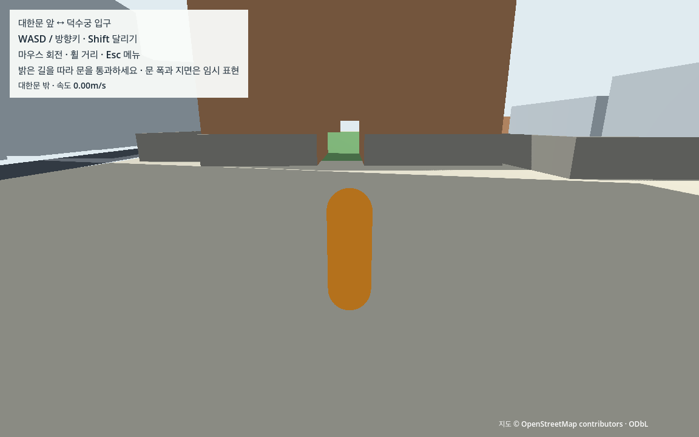
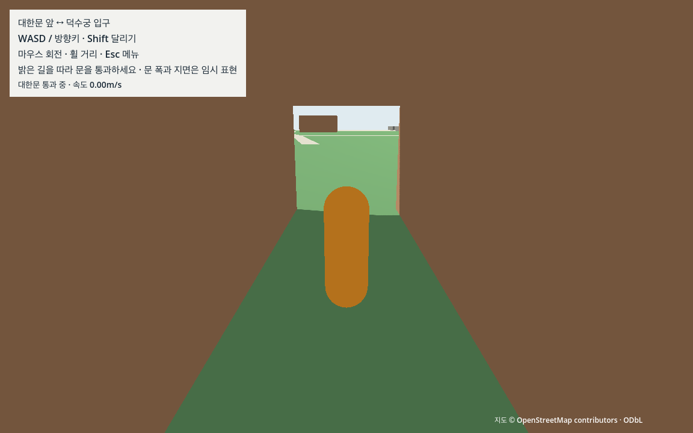
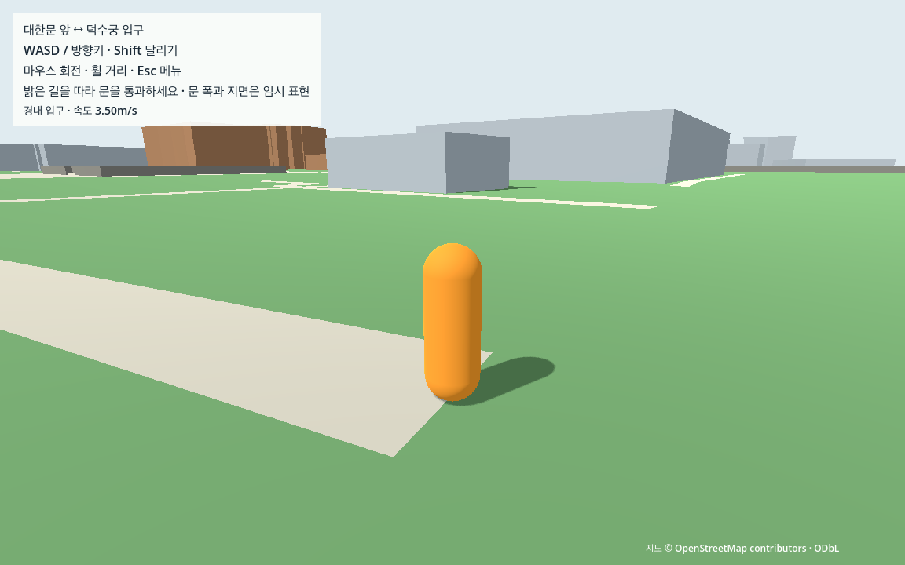

# W01 대한문 밖과 경내 입구 연결

2026-10-13 · **완료** · M1 Pro 16GB / Godot4.7.2 / Forward+·Metal / 1152×720 / 물리60Hz. 실제 배치에 3인칭 캐릭터를 연결해 **대한문 밖→문 통과→경내 입구→문 밖 복귀**를 구현했다. 이번 지역 연결의 자동 보행 검증이며 전체 R1/R2/R3·W0/V0는 아직 완료하지 않았다.

## 입력과 수동 결정

[수동 결정](../../data/manual/daehanmun_connection.json)은 원본 위치와 임시 치수를 구분한다. 기존 G04 R1·[공식 출입 근거](../../docs/evidence/D03_PALACE_ROUTE_SOURCES.md)를 재사용했고 새 지도/사진 다운로드·유료 도구는 없다.

| 원천 | 사용 |
|---|---|
| 대한문 w/377289797 | 본체의 원래 footprint와 G03 임시 높이0~10m 유지 |
| 통과선 w/377289807 | 밖 n/3806615944→gate n/3851434686, **11.340946m**, building_passage/permissive |
| 외측 w/1530764334 | 원문 n/14113953845→밖 노드 연결 |
| 내측 w/377289813 | gate→n/921242931까지의 첫 경내 연결 |
| 덕수궁 담장 w/26658458 | 문 밖 끝점을 가로막는 부분만 통과선 주변에서 절삭 |

전체4점 길은 **65.608256m**, 좌표는 G01 원점/축/1m 계약을 유지한다. 밖(31.613148,10.083805)→gate(20.569628,7.503550)의 원문 방향을 사용했고 스폰은 실제 외측 보행선 노드(49.052535,13.578888)에 게임용 y=0.08m를 더했다. 원점/조사 bbox를 스폰/플레이 영역으로 사용하지 않았다.

폭·높이·문턱 실측이 없어 **개구부3×3m**, 양끝 절삭 연장1m를 `W01-engineering-opening-v1`로 명시했다. 기존1.70m/반경0.30m 사람과 카메라의 여유를 확보하는 구현 기본안이며 실제 대한문 치수라고 주장하지 않는다. 지원면은 원문 경로를 따르는 폭6m·상단y0/깊이0.2m의 임시 평면, 양끝2m 연장·이동 영역 여유0.4m다. 현실 지형·문턱/교량 높이·현재 공사 가림막을 재현한 것은 아니다. 게임에서는 이번 연결을 개방하며 실제 입장권·운영시간을 적용하지 않는다. 공식 자료는 정성 근거이며 날짜가 있는 현장 조건과 게임의 허용 범위를 구분한다.

## 개구부·지면·캐릭터 연결

[장면](../../game/scenes/world/daehanmun_connection.tscn)은 P04를 상속한다. 대한문 전체를 삭제하지 않고 0~3m의 footprint에서 통과선 폭만 비운 양쪽 본체2개와 원래 footprint의3~10m 상부1개를 만들었다. 담장은 같은 국소 절삭을 적용한 나머지 전체를 유지했다. 별도 지원면1개를 합해 교체5개/500삼각형이다.

기존 gate·담장·광역 temporary_support3개는 이 장면에서만 layer/mask0·숨김이다. 나머지 **682개 원천 충돌을 유지**, 교체5개를 더해 **활성687개**다. P04 보기용548개와 G04 후보/권한null을 전체 보행 지면으로 승격하지 않았다. E03/P04 생성 파일과 이전 P01–P04 게임 소스는 바이트 그대로다. 보정은 별도 W01 생성자료이며 원천 ID/footprint와 상부 높이를 보존한다. source cap 삼각형과 독립 clipping/면적·float32 face hash로 원래 형태를 통째 지우지 않았음을 검사했다.

[보행 장면](../../game/scenes/tests/daehanmun_walk.tscn)은 기존 이동·카메라를 재사용하고 합성 시험장 구조를 제거한다. Player2/13, static1/14, camera query1/RID제외다. 새 플레이어는 제한 연결 폴리곤 내부인지 검사하고 시작점의 실제 지면 ray/캡슐 겹침과 별도 압출 폴리곤 체적 검사로 안전 복귀를 확인한다. Concave 껍질 안에 놓인 잘못된 시작점도 거부한다. 낙하·영역 이탈·수동 복귀 때 속도/키 중립·기본 거리/pitch와 문 쪽 yaw를 복원한다. 이는 W01 지역 경계이며 전체 플레이 경계는 계속 미정이다.

## 실제 검사와 범위

| 증거 | 결과 |
|---|---|
| [정상](daehanmun/headless_engine_check.json) / [반복](daehanmun/repeat_engine_check.json) | 각각904개 PASS, 인벤토리/경로 일치 |
| [실제GPU30](daehanmun/gpu_30_engine_check.json) / [GPU60](daehanmun/gpu_60_engine_check.json) | 935개 / 935개 PASS |
| [계약](daehanmun/contract_check.json) / [GPU](daehanmun/gpu_check.json) | 21개 / 7개 PASS |
| 실제 고장6종 | 원래 본체로 다시 막힘·담장 삭제·지면 비활성·player/camera mask0·상부 잘못된 변환의 관련 실패 감지 |
| [실제 자료 거부12종](daehanmun/rejections/rejection_check.json) | 잘못된 checksum/버전/치수/지형 주장/형식/숫자를 원천·교체 body 생성0으로 거부 |
| [인수](w01_verification.json) / [독립 검토](daehanmun/independent_review.json) | 현재 코드·기록·한계 대조 |
| [사본 재생성](daehanmun/portability_check.json) | 이미 준비된 작은 G/E03/P04 입력 사본, 두 번 동일 W01 hash |

31개 연속 사례는 전체4점 동선 왕복의6leg·문 양방향각10회·입구 앞뒤 좌우 차단4개·정지1개다. 전체65.6m 동선은3.5m/s 달리기, 문 첫 양방향은1.4m/s 걷기, 나머지는 달리기이며 카메라 회전을 병행했다. 각 통과는 실제 입구 양끝을 지나 도착, 복귀0·지면 접촉 유지다. 막힌 옆 구간은 실제 접촉>0, 문 중앙ray는 비어 있고 상부/양옆 담장은 막힘, 지원면 밖ray는 지지 없음이다. 껍질 ray만으로 실제 보행을 완료 처리하지 않고 이동 경로를 함께 측정했다.

매 tick 실제 카메라 sphere overlap/near-corner ray와 floor/접촉·극값을 기록했다. 독립 Python은 약10Hz 표본의 capsule/sphere와 **원천 및 교체 압출 폴리곤** 거리를 다시 계산한다. 매 tick의 독립 원표본을 저장했다는 뜻은 아니다. 이동 최대 침투 약2.178mm·카메라 침투0은 기존5mm 수치 허용 안이고, 정지60초/3,600ticks의 높이 범위≤1mm도 유지했다. headless60초는 가속 물리, GPU60은 실제60초 관측이다. GPU30 정지는2초다. 화면의 임시 몸체는 가까운 시점에서 잠시 숨길 수 있으며 모든 순간 전신 표시/임의 화면비·사람 조작감을 보장하지 않는다.

| 실제 화면 조건 | 물리 시간 / ticks | 실제 시간 / frames |
|---|---|---|
| 30fps / gate_forward_0 | 10.966667초 / 658 | 10.966396초 / 329 |
| 30fps / gate_forward_1 | 4.383333초 / 263 | 4.400117초 / 132 |
| 30fps / idle | 2.000000초 / 120 | 2.000173초 / 60 |
| 60fps / gate_forward_0 | 10.966667초 / 658 | 10.970987초 / 658 |
| 60fps / gate_forward_1 | 4.383333초 / 263 | 4.383585초 / 263 |
| 60fps / idle | 60.000000초 / 3600 | 59.761479초 / 3585 |

GPU의 물리/실제 시간차이≤2%, 렌더 frames/time 조건을 통과했다. 독립사본은 authored27개+runtime7개·P03 측정도구와 W01 입력 보호 helper만 사용했고 프로세스 네트워크를 차단했다. 원본 지도·가상환경·시작 캐시는 런타임에 없다. 자동 메뉴 키는 실제 authored 바인딩을 복제해 Input.parse_input_event와 원래 라우터로 전달하며, 시험 전용 표식 없는 메뉴 키는 보호 helper가 무시한다. 일반 실행에는 helper를 붙이지 않는다. 실제 native capture/메뉴/복귀 결과와 headless의 잠금 의도를 구분한다. OS 입력·사람의 직접 사용성 검증은 별도다.

## 실패와 수정

[개발 실패/해결](daehanmun/development/failures.json)에는 절대 script경로, 좌표 숫자 거부 보완, 검사기 보완 중 판정 버전 혼재와 최초 실패 archive를 남겼다. 검사기는 기존 이동5mm/정지1mm 계약을 적용했고 최종 실행은 시작 시 bytes/hash를 고정해 종료 때 불변을 확인한다.

첫GPU30은 예정된 메뉴 검사 전에 일시 정지되어330초 timeout, 완료JSON이 없었다. native 화면의 메뉴를 확인했으나 입력의 발생 원인은 독립 확정하지 못했다. [실패 로그](daehanmun/development/gpu_unplanned_pause.log)는 보존하며 성공 측정으로 집계하지 않는다. 시험 전용 외부 메뉴 입력 분리를 넣고, 직접 만든 키 이벤트와 바인딩의 불일치도 짧은 진단으로 확인한 뒤 **기존 바인딩 복제+metadata 표식**으로 해결했다. 외부 이벤트 무시/표식 이벤트 메뉴 열림을 확인했고 정상·반복·고장6종과 GPU 전체를 최종 도구로 다시 수행했다. 초기 device 원인 추측은 정정해 기록했다. 일반 플레이의 키 바인딩과 라우터는 변경하지 않았다.

추가로 첫GPU30의 한 구간이 물리5.083333초/실제6.010185초로 기존2% 시간을 초과했고, 30fps 캡처 경로가 빠져8개 화면이 없었다. 실패 JSON/판정/로그를 보존했다. 시간 지연의 정확한 원인은 확정하지 못했고 기준을 완화하지 않았다. GPU30에도 별도 캡처 경로를 전달했다.

GPU60 최초 화면 저장은330초 제한까지 완료되지 않았고, 다음GPU30도 첫 저장 단계에서 진행이 없어56초 후 해당 시험만 종료했다. 별도 저장 진단은 성공해 렌더러의 정확한 정지 원인은 미확정이다. 최종 W01 측정도구는 main process frame에서 [Godot의 명시적 화면 갱신](https://docs.godotengine.org/en/stable/classes/class_renderingserver.html#class-renderingserver-method-force-draw)을 실행한 뒤 이미지를 읽고 저장한다. 저장은 측정구간 밖에서 수행한다. 같은 subprocess 조건의 짧은 진단과 최종GPU전체로 확인했다. 기존 P03 측정 소스는 유지했으며 이전 결과파일을 실행 전에 제거해 새JSON이 없는 실패가 과거JSON을 재사용하지 못하게 했다. 관련 로그와 수정은 실패이력에 추가했다.

화면 저장을 보완한 뒤 완료된 첫 30/60fps 시험에서도 시간과 정지 오류가 있었다. 30fps의 2초 정지는 실제 1.944362초, 문 달리기 한 구간은 물리 4.383333초/실제 5.318394초였다. 60fps는 모든 시간 조건을 통과했으나 정지 중 총 약 9.3cm의 네 번 걷기 step이 기록돼 실패했다. [원기록·판정·PNG 16개와 당시 측정 소스](daehanmun/development/gpu_capture_clock_idle_failure/)를 보존했다. 과거 측정 소스는 최종 보완을 역으로 적용해 복원한 뒤 당시 실행기가 기록한 SHA와 정확히 일치함을 확인했다. 실제 입력 혼입과 초기 렌더링/이미지 읽기 시간의 영향은 가설이며 확정 원인으로 쓰지 않는다.

최종 자동 시험은 프로세스 안에서 이동/Shift의 물리 키 바인딩만 제거하고 `Input.action_press`·원래 router/controller를 그대로 사용한다. Esc의 기존 바인딩 복제 검사는 유지한다. 실제 키 문자나 전체 사용자 입력을 기록하지 않고 이동 바인딩에 해당하는 외부 이벤트 개수만 집계한다. 일반 게임에는 이 격리가 없다. 측정 전 경로 4점×카메라 3방향의 12시점을 그리고 중립 정지로 안정시킨다. 초기 PNG 뒤 1초도 별도 준비이며 측정에 포함하지 않는다. raw의 `warmup`/각 case의 `pipelines`에 준비 시간과 실제 pipeline count를 남긴다. 최종 PASS는 **준비 후 정상 보행** 범위이며 초기 기동 시간·첫 렌더링 끊김/전체 도시 성능을 보장하지 않는다. 정지 1mm·이동 5mm·시간 2%·렌더 20% 기준은 동일하다.

## 화면과 실행







GPU30·GPU60에서 각각 PNG 8개를 저장했다. 본문에 표시한 것은 60fps 화면이며, 30fps 파일은 `view_30_*.png`다. 시작·경내 입구·밖 복귀·문 양방향·문 아래·벽 접촉·메뉴를 포함한다. 모든 렌더 frame의 픽셀이나 영상 검사는 아니다. 전각 지붕/세부 외형은 L단계이며 현재 문은 원래 위치/축척의 단순 임시 외형이다.

기존 G/E03/P04 준비를 재사용하고 W01 자료만 생성한다. 새 Mac은 [CROSS_MAC](../../docs/CROSS_MAC.md)부터 따른다.

```sh
.venv-data/bin/python tools/prepare_daehanmun.py
python3 tools/check_daehanmun_bundle.py
sh tools/run_daehanmun_walk.sh run
sh tools/run_daehanmun_walk.sh editor
sh tools/run_daehanmun_walk.sh observe
python3 tools/check_daehanmun_contract.py --mode contract
python3 tools/check_daehanmun_contract.py --mode gpu
python3 tools/check_daehanmun_rejections.py
.venv-data/bin/python tools/check_daehanmun_portability.py
```

WASD/방향키·Shift·마우스 회전/휠·Esc, 메뉴의 **대한문 밖으로 복귀**를 사용한다. 현재는 문 밖과 경내 입구의 제한된 연결이며 영역 밖으로 나가면 시작점으로 돌아온다. 생성은 Shapely 환경, 실행 전 최신성 검사는 표준Python, 준비된 game 런타임은 원본/Python/인터넷이 필요 없다. observe는 자동 시험이고 run은 직접 확인용이다. 사본 재생성은 M1 기존 인터프리터·이미 준비된 입력이며 새 설치/M4/전체G 재생성 결과가 아니다.

다음 **W02**는 이번 안쪽 끝점부터 기존G04 R1 길·마당을 전각 앞까지 잇는다. 중화문/금천교·계단/기단·분수/잔디·건물 내부 보류를 대조하고 원천에 근거한 경로/지원면·안전 복귀를 확장한다. 실제 지형/치수·현재 현장 접근, 전체R1/R2/R3·W0/V0·NPC/차량·M4·도시 성능·사람 조작감은 미검증이다. [문서 검사](daehanmun/document_check.json).

최종 준비 시간은 GPU30 8.510570초/GPU60 7.481626초였다. 준비 이후 최대 실제/물리 시간 편차는 각각 1.213%/0.398%였다. pipeline 및 무시한 외부 이동 이벤트의 원자료를 보존했으며, 준비 단계로 최초 실패의 단일 원인이 확정됐다는 뜻은 아니다.
