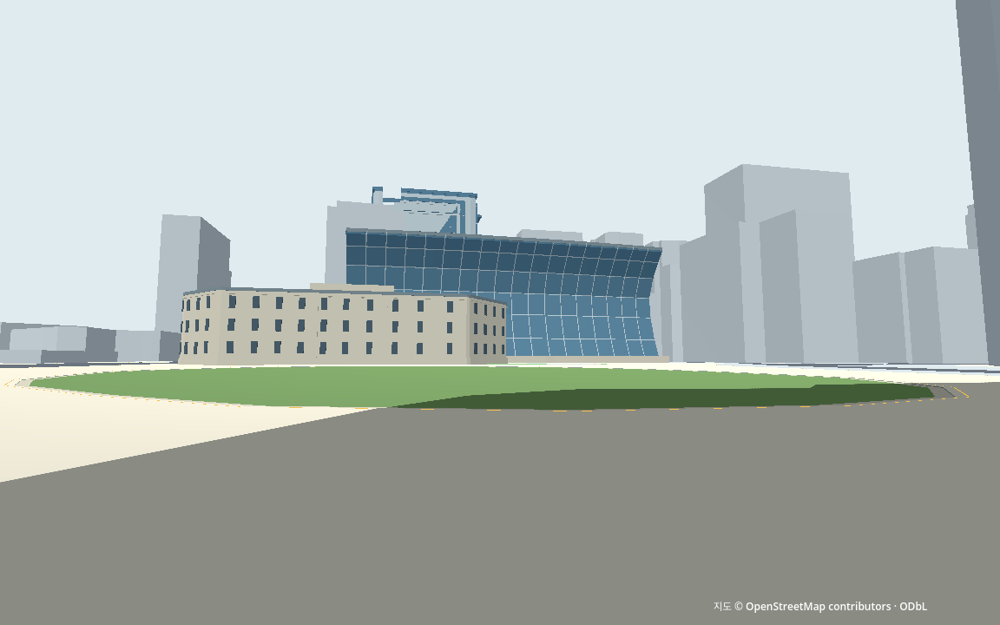
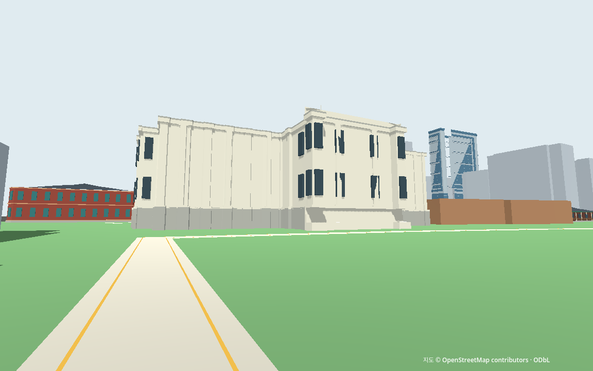

# L04 랜드마크 배치·보행 재검수

2026-10-15 · 기준 커밋 `29f316f74905dcb8ec5528e2fa49b2f519337153` · M1 Pro16GB/macOS27.0 · Godot4.7.2/Forward+/Metal · 네트워크 차단

**자동 보행·축척 보존과 내부 시각 검수를 완료했다.** 대한문·중화전·석조전, 신청사·구청사·서울광장의 형태 대비는 확인했다. 돈덕전·정관헌은 현재 경로에서 가리며, 중화문은 닫힌 벽 인상이 강하다. 이3곳의 눈높이 인지 보완은 남아 있다. 모든10곳의 식별이나 사용자의 실제 장소 인상을 통과시켰다는 뜻은 아니다.

일반 게임의 모델·충돌·경로·입력은 L03와 동일하다. 이번 변경은 검수 계획·검사 도구·화면/관측·인수 기록이다. 낮 고정 조명을 이번 비교의 구현 기본안으로 확정했고 낮밤 시스템은 추가하지 않았다. 건물 이름표와 미확인 숫자를 화면에서 숨겼다.

## 결합 화면과 판정

광장 남측에서 신청사의 유리 곡면과 구청사의 석재색, 열린 잔디가 함께 보인다. 이는 단순화한 외형의 대비에 대한 내부 검토이며 현장 사진과 픽셀 단위로 일치하는 재현은 아니다.



석조전 기존 지점은 벽에 너무 가까웠다. 원래 경내 경로의 정점10으로 물러나 전체 밝은 부피와 기둥·창 대비를 확인했다. 중화문은 정점18에서 정면을 보충해도 긴 닫힌 벽처럼 보인다. 새 길·개구부를 만들거나 건물을 옮기지 않았다.



아래 `전`은 같은 장면에서 L02/L03 외형을 잠시 끄고 원본 단순체를 표시한 비교다. L04에서 새로 만든 모델이라는 뜻이 아니다. `후`는 현재 일반 게임 외형이며, 눈높이는 지면 위1.6m의 검사 전용 카메라다. 실제 플레이는 기존3인칭 카메라를 유지한다.

| 시점 / 대상 | 같은3인칭 전후 | 검사 전용1.6m | 내부 판정 |
|---|---|---|---|
| V_GATE / daehanmun | [전](landmark_review/review_V_GATE_before.png) · [후](landmark_review/review_V_GATE_after.png) | [눈높이](landmark_review/review_V_GATE_eye.png) | 중앙 개구부·붉은 기둥·기와 지붕 확인 |
| V_COURT_HALL / junghwajeon | [전](landmark_review/review_V_COURT_HALL_before.png) · [후](landmark_review/review_V_COURT_HALL_after.png) | [눈높이](landmark_review/review_V_COURT_HALL_eye.png) | 중화전 겹지붕·기단과 열린 앞마당 대비 확인 |
| V_COURT_GATE / junghwamun | [전](landmark_review/review_V_COURT_GATE_before.png) · [후](landmark_review/review_V_COURT_GATE_after.png) | [눈높이](landmark_review/review_V_COURT_GATE_eye.png) | 뒤쪽 닫힌 벽 인상; 아래 정면 보충에도 문 인지는 약함 |
| V_STONE / seokjojeon | [전](landmark_review/review_V_STONE_before.png) · [후](landmark_review/review_V_STONE_after.png) | [눈높이](landmark_review/review_V_STONE_eye.png) | 너무 가까워 전체 외형 판정에 부족; 원경 보충 |
| V_STONE_BRICK / dondeokjeon | [전](landmark_review/review_V_STONE_BRICK_before.png) · [후](landmark_review/review_V_STONE_BRICK_after.png) | [눈높이](landmark_review/review_V_STONE_BRICK_eye.png) | 석조전에 가림; 돈덕전 전체 인지 보류 |
| V_CITY_NEW / city_hall | [전](landmark_review/review_V_CITY_NEW_before.png) · [후](landmark_review/review_V_CITY_NEW_after.png) | [눈높이](landmark_review/review_V_CITY_NEW_eye.png) | 근접 곡면·유리 격자 확인; 광장 남측으로 전체 대비 보충 |
| V_CITY_OLD / library | [전](landmark_review/review_V_CITY_OLD_before.png) · [후](landmark_review/review_V_CITY_OLD_after.png) | [눈높이](landmark_review/review_V_CITY_OLD_eye.png) | 구청사 석재색·창 반복 확인 |
| V_PLAZA / plaza | [전](landmark_review/review_V_PLAZA_before.png) · [후](landmark_review/review_V_PLAZA_after.png) | [눈높이](landmark_review/review_V_PLAZA_eye.png) | 잔디·밝은 포장 대비; 실제2026 조경 재현은 미확인 |
| V_SKYLINE / sfc | [전](landmark_review/review_V_SKYLINE_before.png) · [후](landmark_review/review_V_SKYLINE_after.png) | [눈높이](landmark_review/review_V_SKYLINE_eye.png) | 창 반복·빌딩 규모의 배경 역할 확인; 정확한 SFC 식별은 주장 안 함 |
| V_PALACE_CITY_GATE / daehanmun | [전](landmark_review/review_V_PALACE_CITY_GATE_before.png) · [후](landmark_review/review_V_PALACE_CITY_GATE_after.png) | [눈높이](landmark_review/review_V_PALACE_CITY_GATE_eye.png) | 경내 쪽 문과 배경 도시의 공존 확인 |
| V_PALACE_CITY_NEW / city_hall | [전](landmark_review/review_V_PALACE_CITY_NEW_before.png) · [후](landmark_review/review_V_PALACE_CITY_NEW_after.png) | [눈높이](landmark_review/review_V_PALACE_CITY_NEW_eye.png) | 궁궐 쪽에서 도심 배경을 검토; 주변 단순체 가림 존재 |
| V_JEONG / jeonggwanheon | [전](landmark_review/review_V_JEONG_before.png) · [후](landmark_review/review_V_JEONG_after.png) | [눈높이](landmark_review/review_V_JEONG_eye.png) | 주변 단순 본체에 가려 정관헌 인지 미확인 |
| V_BRICK_WEST / dondeokjeon | [전](landmark_review/review_V_BRICK_WEST_before.png) · [후](landmark_review/review_V_BRICK_WEST_after.png) | [눈높이](landmark_review/review_V_BRICK_WEST_eye.png) | 붉은2층 외형 일부 노출; 돈덕전 전체 특징 판정 보류 |
| V_PLAZA_SOUTH / city_hall | [전](landmark_review/review_V_PLAZA_SOUTH_before.png) · [후](landmark_review/review_V_PLAZA_SOUTH_after.png) | [눈높이](landmark_review/review_V_PLAZA_SOUTH_eye.png) | 신청사 곡면·구청사·열린 잔디의 결합 대비 확인 |
| V_STONE_FAR / seokjojeon | [전](landmark_review/review_V_STONE_FAR_before.png) · [후](landmark_review/review_V_STONE_FAR_after.png) | [눈높이](landmark_review/review_V_STONE_FAR_eye.png) | 밝은 전체 부피·기둥/창 대비로 근접 시점의 한계 보완 |
| V_COURT_GATE_FRONT / junghwamun | [전](landmark_review/review_V_COURT_GATE_FRONT_before.png) · [후](landmark_review/review_V_COURT_GATE_FRONT_after.png) | [눈높이](landmark_review/review_V_COURT_GATE_FRONT_eye.png) | 전통 지붕·기둥 확인; 긴 닫힌 벽 인상과 약한 문 인지 유지 |

16시점×전/후/눈높이3장과 각 시점의3인칭/눈높이 마스크2장, 총80PNG다. 지점의 출처·좌표는 [수동 검수 계획](../manual/landmark_review_plan.json)에 있다. 시점 배치는 연속 보행이나 실제 현장 접근의 증거가 아니다. 흑백 [노출량](landmark_review/exposure.json)은 대상 외형이 몇 픽셀 보이는지만 뜻하며 사람의 장소 식별 점수가 아니다.

## 새 실행과 재사용한 증거

| 검증 | 실제 결과 |
|---|---|
| 최종 headless / GPU | 실행 계약 64/66그룹 PASS |
| 독립 국소 관측 검사 | headless 230 / GPU 248개 PASS |
| 새 국소 이동 | 회전6회×6초 + 대한문6구간 + 광장6구간, 계획 보행 393.678625m |
| 국소 물리/실제 시간 | 8,912tick / 148.533333초 / 148.507565초 |
| 국소 시간차 최대 / 도착점 오차 | 0.529283% / 0.057992m |
| 국소 capsule/camera 최대 침투 | 2.177564/0.000000mm (기존5mm 이내) |
| 복귀·영역 이탈 | 0 / 0, 모든tick 지면 접촉 |
| 실제 표시·충돌 | 도시58개/궁궐76개 PASS,692생성/687활성body 동일 |
| 축척 | 실제1.7m 인체와 카메라 행렬/FOV 화면 비례16곳 대조, 원점/footprint/높이·분류 동일 |

원시 [GPU](landmark_review/gpu.json.gz)·[headless](landmark_review/headless.json.gz), [국소 독립 판정](landmark_review/gpu_local_check.json), [최종 계약](landmark_review/gpu_check.json), [요약](landmark_review/gpu_summary.json)을 보존했다. 회전/대한문/광장 그룹 사이에는 준비 배치가 있고 각 보행 그룹 내부는 배치 없이 이어진다. 따라서 이번 국소 결과를 새3.3km 연속 완주라고 설명하지 않는다.

L03의 전체334구간·3,327.048107m·57,116tick·실제952.105510초·3,520검사 합격 증거는 **소스45/실행자산22/입력11/기존검사40파일의 해시 일치**와 원관측/판정/요약4파일의 기존 인수 해시 일치를 확인해 재사용했다. 하나라도 달라지면 이 검사기는 재사용을 거부한다. [L03 전체 결과](city_landmarks.md)·[저장 해시](l03_verification.json). 새 관측과 과거 전체 결과의 범위를 분리했다.

## 발견한 문제와 수정

1. 첫14시점 실행은 자동 검사를 통과했지만 석조전은 너무 가깝고 중화문은 뒤쪽만 보였다. 기존 경로의 보충2시점을 추가했다. 돈덕전/정관헌 가림과 중화문 인지 약함은 그대로 남겼다. [첫 관측·선택 화면·당시 소스](landmark_review/development/initial_review/finding.json).
2. 독립 검토에서 같은 지점 회전 기록 복사, 도착점1tick 정지 기록을 기존 검사기가 통과시키는 것을 재현했다. 시작점/계획시간/실제 이동량·그룹 이음점·tick 순서·실제 basis와 yaw/pitch를 묶어 두 변조를 거부했다. 정상 관측은 그대로 통과했다. [수정 전/후와 원시 변형](landmark_review/development/checker_false_acceptance/summary.json).
3. 고정 버전 검사가 CLI와 엔진 API 문자열의 구분자를 혼동해 한 번 실패했다. 실제 API `4.7.2-stable (official)`과 정확히 비교하도록 고쳤다. 엔진/물리/허용치는 바꾸지 않았다. [첫 실패](landmark_review/development/version_string/finding.json).
4. camera mask0·이동 영역 밖 표본 변조도 최종 검사에서 거부했다. 이4종은 **저장 관측 변조**이며 실제 엔진 결함 주입4종으로 부르지 않는다. 자동 승인 검토 시간 초과로 실행되지 않은 호출1회는 재시도해 정상 착수했다.

## 다른 Mac에서 재개

먼저 [CROSS_MAC](../../docs/CROSS_MAC.md)의 기존 W04/L01/L02/L03 준비를 따른다. 새 다운로드·국가 지도·새 패키지·게임 데이터 복사는 필요 없고 기존 공유 입력에서 실행 자료를 재생성한다. 동일 Godot4.7.2가 필요하다.

```sh
sh tools/run_city_landmarks.sh run
.venv-data/bin/python tools/check_landmark_review.py --output data/cache/l04_headless
.venv-data/bin/python tools/check_landmark_review.py --gpu --output data/cache/l04_gpu
.venv-data/bin/python data/reports/landmark_review/development/checker_false_acceptance/reproduce.py --root "$PWD"
```

GPU는 약3분의 국소 물리 시험과 캡처/기하 감사가 추가된다. 측정 중 다른 엔진/무거운 검사를 동시에 실행하지 않는다. 검수 도구의 `--engine`으로 동일 버전의 설치 위치를 지정할 수 있다. 원시 기록은 공유하지만 가공 실행 JSON·캐시·Godot 앱·가상환경은 공유하지 않는다.

## 범위와 다음 행동

직접 사람 조작·장소 인상·OS 포커스·M4, 현장 외관/지형/출입, 도시 성능과 V0 완성은 미검증이다. 시청 층수·SFC 높이/주소·광장 최신 조경의 기존 자료 차이도 그대로다. 형상을 보기 위해 경계나 건물 위치를 임의 수정하지 않았다. 필요한 후속 시각 보완은 돈덕전/정관헌 가림과 중화문 형태이며 N01 경로와 혼동하지 않는다.

사용자의 건물 정보·실내·층별 엘리베이터 질문은 [프로젝트 맥락](../../docs/PROJECT_CONTEXT.md)에 제안/미정으로 남겼다. 기존635본체의 이름 태그148개 등 [기존 정보 집계](landmark_review/building_metadata_inventory.json)는 최신 정확도나 정보 UI 구현의 증거가 아니다. 공개 로비·전시 공간의 선택 재현과 명시적 가상 내부가 후속 대안이며 회사 사무실의 사실적 내부 재현은 확정하지 않았다.

다음은 **N01 경로와 교차 처리 규칙**이다. G04 보행/주행 후보·W03 실제 게임 경계/차도 접속부를 읽고, 짧은 NPC/차량 반복 경로와 정지/우선순위 규칙을 정한다. 사람/차량 구현과 실내 확장을 이번 작업에 추가하지 않았다. [현재 상태](../../docs/WORK_STATUS.md)·[인수 검증](l04_verification.json).
