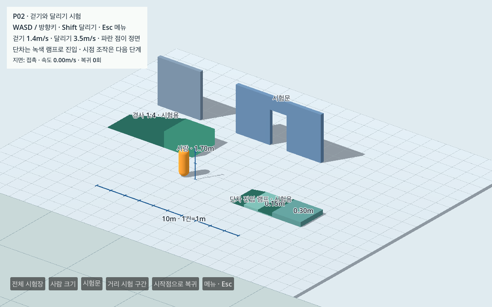
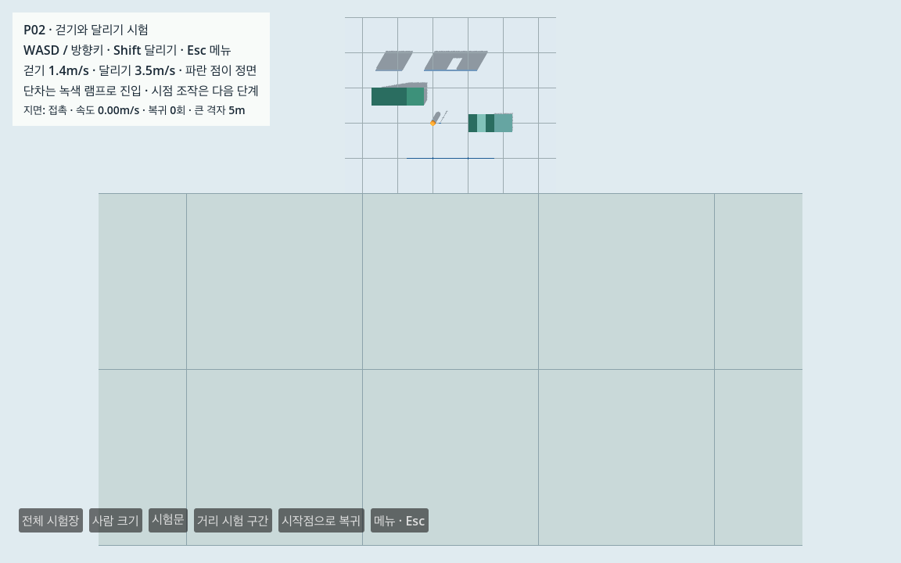

# P02 · 시험장 걷기·달리기·회전과 지면 복귀

2026-10-13 · **P02 완료 / 다음 P03**. P01 사람 크기와 충돌 시험장을 보존하고 별도 상속 장면에서 이동·중력·지면 접촉·안전 복귀를 구현했다. 실제 서울 장면은 표시 전용이며 도시 보행·3인칭 카메라 조작·대한문 통과는 후속이다.

## 직접 실행

Godot **4.7.2.stable.official.ed1daf0bf / Forward+ / Metal**와 저장소만 필요하다. 지도 가공·Python 환경·인터넷은 시험장 실행에 필요 없다.

```sh
sh tools/run_movement_test.sh run
sh tools/run_movement_test.sh editor
sh tools/run_movement_test.sh observe
```

- WASD/방향키: 걷기. Shift: 달리기. 파란 정면 표시가 이동 방향으로 돌아간다.
- Esc/메뉴: 일시 정지. 닫은 후 이동키와 Shift를 놓았다가 다시 눌러야 이동한다.
- 시작점으로 복귀: 안전 지면 확인 후 위치·몸체 방향·속도를 초기화한다.
- 전체/사람/시험문/거리 시험 보기: 고정 시점 선택. 카메라 추적·마우스 회전은 P03이다.
- 녹색 진입 램프로 두 단차를 오르내린다. 기본 작은 격자는 1m, 거리 구간 큰 격자는 5m다.

`observe`는 렌더60fps 제한에서 걷기/달리기를 각각 물리10초 관측하고 화면·JSON·로그를 Git 제외 `data/cache/movement/`에 저장한다. 단독 `observe`는 전체 P02/60초 정지 검사와 구분한다. 다른 Mac은 [CROSS_MAC](../../docs/CROSS_MAC.md)을 따른다.





## 구현과 출처 경계

[movement_test.tscn](../../game/scenes/tests/movement_test.tscn)은 P01 scene을 상속한다. [movement_controller.gd](../../game/scripts/player/movement_controller.gd)는 P01의 중력/관측 신호 기반을 상속하고 기존 [InputRouter](../../game/scripts/input_router.gd)를 연결한다. P01의 원본5개 파일과 InputRouter/프로젝트 입력·main/도시 표시·region·E03 geometry는 변경하지 않았다.

걷기1.4m/s·달리기3.5m/s·중력9.8m/s²·물리60Hz. 정규화 입력을 카메라의 수평 기준으로 변환하며 `velocity`는 m/s이고 `move_and_slide`에 delta를 다시 곱하지 않는다. Visual은 TAU rad/s(360도/초) 이내로 회전하고 충돌 루트는 회전하지 않는다. Capsule 전체 높이1.70m·반경.30m는 P01과 같다. 정면 표시 구는 충돌 없는 장식이다.

[추가 구조](../../game/scripts/movement_test.gd)는 직접 작성한 합성 자료다. 기존7개 구조에 80×40m 거리 평면, 단차 진입 램프2개, 1:4 경사와 높이1m 도착 평면을 추가해 정적 구조12개다. 정적 layer1/mask2, player layer2/mask1을 유지한다. 거리 평면은 10초 달리기35m와 대각 이동을 시험장 밖 이탈 없이 측정하기 위해 추가했다.

0.15m 단차 진입 램프는 x2→3/y0→.15m, 0.30m 단차 진입은 x4→5/y.15→.30m, 폭은 각각2m다. 원래 단차 박스를 보존한 명시적 시험 대체안이다. 자동 계단 오르기·측면 보도턱 진입·실제 서울 지형/표고를 확인한 결과는 아니다.

시작점 `(-2,.08,2)`/identity 회전과 시험 영역 합집합은 지도 bbox·좌표 원점·실제 서울 스폰/경계와 별개다. 발 y<−3m 또는 영역 이탈, 수동 복귀 시 지면 ray의 법선/높이 간격과 캡슐 겹침0을 다시 확인한다. 확인 실패 시 복귀/이동을 중지한다. 확인 성공 시 위치·Visual 회전·속도를 초기화하며 계속 눌린 이동키/Shift의 입력을 중립까지 막는다. Actors는 PAUSABLE, InputRouter/UI는 ALWAYS다.

## 실제 거리와 프레임 조건

독립 검사기는 속도×측정 물리시간과 실제 시작/끝 XZ 거리를 비교한다. 거리 허용≤2%, 실제 GPU 물리/벽시계 시간 차이≤2%, 렌더 frames/벽시계가 설정30/60fps 대비20% 이내, 물리ticks/delta=60Hz를 요구한다. 프레임 제한별 물리 결과는 동일했다.

| 조건 | 물리시간 / ticks | 벽시계 | 거리 | 렌더 frames |
|---|---:|---:|---:|---:|
| GPU30 · 걷기 | 10초 / 600 | 9.999319초 | 14.000009m | 300 |
| GPU30 · 달리기 | 10초 / 600 | 9.999982초 | 35.000019m | 300 |
| GPU60 · 걷기 | 10초 / 600 | 10.001347초 | 14.000009m | 600 |
| GPU60 · 달리기 | 10초 / 600 | 9.986538초 | 35.000019m | 599 |
| 가속 headless · 대각 걷기 | 10초 / 600 | 가속 실행 | 13.999940m | 실제 GPU 조건 아님 |
| 가속 headless · 대각 달리기 | 10초 / 600 | 가속 실행 | 34.999554m | 실제 GPU 조건 아님 |

거리 최대 상대 오차 약0.00128%로2% 이내다. [GPU30 측정](movement/gpu_30_engine.json)·[GPU60 측정](movement/gpu_60_engine.json)·[전체 물리 측정](movement/headless_engine.json). headless의10초 물리를 약.2초에 처리한 값을 벽시계10초나 성능 측정으로 주장하지 않는다. GPU FPS도 이 작은 시험장 조건이며 서울 전체 성능이 아니다.

## 접촉·충돌·회전·복귀 결과

- **정지:** GPU 물리60초/3,600회, 실제 벽시계59.952370초. 전체3,600회 floor 접촉, Y범위0·수직속도0·XZ drift0. 발 y=+.000312500m(약+.313mm)로±2mm 안이다. [GPU 정지 표본](movement/gpu_idle_engine.json)·[27개 검사](movement/gpu_idle_engine_check.json). P01 정지 결과와 별도 측정이다.
- **벽:** 정면/사선/모서리 × 걷기/달리기6조건 각3초. 모두 벽 접촉을 기록했고 복귀0, capsule-vs-box 수치 관통≤5mm였다. 이 계산의 최대 약3.007mm에는 바닥 접촉 오차도 포함된다. 사선은 옆 끝을 돌아갈 수 있으므로 최종 z만으로 벽 관통을 판정하지 않는다. 전 tick에서 수치를 측정하고10Hz 경로를 남겼다.
- **문:** 빈1.20×2.20m 시험문을 앞으로10회·뒤로10회, 총20회 실제 이동으로 통과했다. 각 통과는 약4.013m이며 양쪽 z를 넘었고 복귀0이다. 카메라 회전 병행·실제 대한문 검증은 후속이다.
- **단차/경사:** 명시한 진입 램프로 .15/.30m 단차를 왕복하고 별도1:4 경사/1m 도착 평면을 왕복했다. 단차 각222/222 tick, 경사 각270/270 tick 모두 floor 접촉을 유지했다. 상승 끝 높이 약.301m/1.001m, 하강 후 약0m다.
- **중력:** 높이2m에서 떨어뜨려 실제 공중 표본의 −Δvy/Δt 약9.80000031m/s²를 확인하고1초 구간 안에 지면 접촉을 회복했다. 계약값 확인에 그치지 않고 실제 가속도를1% 기준으로 채점한다.
- **회전/카메라 기준:** 좌/우1초 시험에서 모든 표본이 TAU rad/s 제한 회전과 목표각에.01rad 이내다. 루트 yaw0 유지. 별도 고정 시점의 forward가−X를 향할 때 실제 이동도−X였다. 마우스/추적 카메라 시험은 아니다.
- **복귀:** 강제 낙하·영역 밖 위치·복귀 버튼 각각1회, 실행 중 외곽으로 달려 이탈하는 시험도1회 확인했다. 위치 `(-2,.08,2)`·Visual yaw0·속도0으로 초기화, 지면 재접촉, 키를 계속 누른1초 XZ drift0, 중립 후.5초 재입력 이동 약.70m. 지원 없는 높이2m 스폰은 복귀를 거부하고 위치를 보존했다.
- **메뉴/키:** 실제 Esc key event로 일시 정지·재개하고 Actor의 물리 신호0/위치 불변/속도0을 확인했다. Engine 전체 physics counter가 늘어도 Actor 물리 처리는 멈춘다. 닫은 뒤 눌린 키 이동0·중립 후 이동 재개. 실제 물리 키 W·방향키·Shift의 의도도 확인했다. 자동 이벤트는 사람이 조작감을 확인한 결과와 구분한다.

Box 수치 계산은 수직 캡슐 중심 선분과 축 정렬 박스의 최단 거리로 별도 측정한다. Convex 램프는 이 계산에서 제외하고 실제 지면 접촉·경로 높이를 검사했다. 모든 임의 표면에 대한 정밀 관통 증명을 주장하지 않는다.

## 재현·독립 검사·실제 오류 감지

```sh
python3 tools/check_movement_contract.py --mode contract
python3 tools/check_movement_contract.py --mode gpu
python3 tools/check_movement_evidence.py --input data/reports/movement/headless_engine.json --output data/cache/movement_check.json
```

[engine probe](../../tests/game/check_movement_test.gd)는 실제 장면을 실행해 관측만 기록하고, [독립 Python 검사기](../../tools/check_movement_evidence.py)가 완료를 채점한다. 표준 Python을 사용하며 네트워크 차단 `offline.sb` 하의 별도 game 사본9개 authored 파일만 필요하다. 지도·국가 원본·생성 자산·초기`.godot`·Python 패키지가 없어도 검사했다. 설치된 Godot/현재 M1 환경을 사용한 사본 검사이며 새 M4/새 OS 설치 검증은 아니다.

| 증거 | 결과 |
|---|---|
| 정상 full / 새 엔진 반복 full | 각각302개 통과 |
| 계약·사본·반복·실제 변형 검사 | 13개 통과 |
| 실제 GPU30 / GPU60 timing | 각각35개 통과 |
| 실제 GPU60초 idle | 27개 통과 |
| GPU 사본·버전·입력 무변경 등 | 6개 통과 |
| 실제 오류6종 | 모두 해당 완료 검사를 실패로 판정 |

오류는 복사본에서 걷기속도2.0, 중력0, 회전속도0, 마스크0, 문틀 하부 차단, 지원 없는 스폰을 실제 엔진에 적용했다. 정상302개 통과와 각 실패 원인을 [계약 결과](movement/contract_check.json)·[regression 원본/채점](movement/regression/speed_wrong_check.json)에 보존했다. 실패한 변형은 정상 결과로 집계하지 않는다. 원본 소스는 변경하지 않았다.

짧은 문맥의 Sol이 독립 검사기를 작성하고 중력/회전 중간값·GPU 실제시간 검증 누락을 교차 검토했다. 해당 기준을 보완해 기존 측정을 재채점했고, 시야 개선 후 최종 소스의 전체 엔진/실제 GPU 시험도 다시 수행했다. [인수/소스 해시](p02_verification.json). 준비 과정의 문법 오류·입력 관측 시점·float32 비교 오류·시야 문제와 해결을 [개발 기록](movement/development/failures.json)에 남겼다.

## 다음 단계와 직접 확인할 시점

**P03:** 이동 컨트롤러/안전 복귀·시험장·302개 기본 검사를 유지하며 추적 카메라, 마우스 회전/잠금, 거리/상하/감도, 자기 충돌 제외와 벽/문 가림 처리를 추가한다. 문 양방향 반복은 카메라 회전을 병행해 다시 확인해야 한다.

지금 시험장에서는 걷기/달리기 속도를 비교할 수 있다. 사용자가 판단할 핵심은 P03 카메라가 연결된 다음의 직접 걷기·회전·문 접근 조작감이다. 거리 수치가 맞는 것만으로 이 느낌을 완료 처리하지 않는다. 카메라·도시 충돌/보행·대한문과 필수 세 경로·실제 지형/자동 계단·직접 조작감·M4·도시 성능·W0/V0는 미검증/미완료다.
