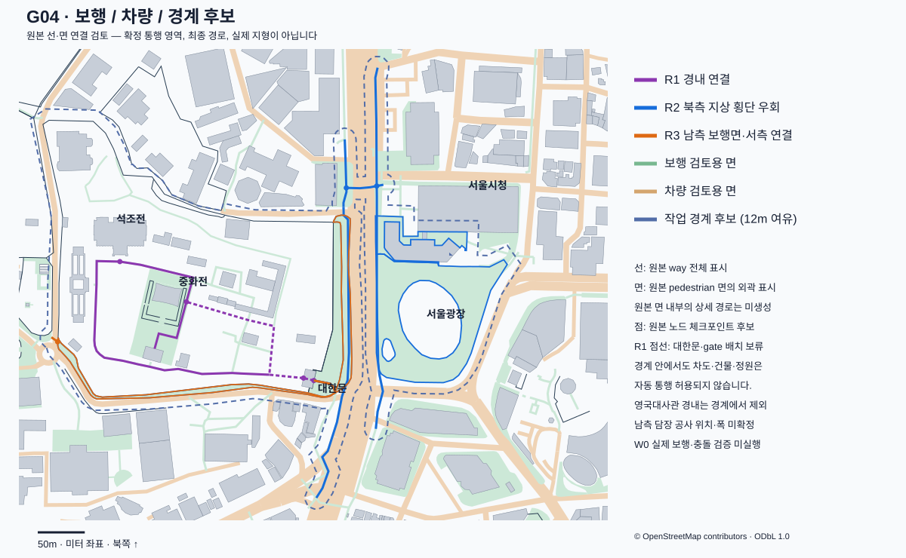

# G04 보행·주행·경계 후보 분리

실행일 2026-10-12 · 시작 커밋 `cbf6e576d2fa99bb81ffe0a1d3b3626c782e5a63`. **원천 기반 후보 분리와 R1/R2/R3의 2D 연결 검토 완료**다. 실제 통행·단차·경로 완주·충돌·최종 플레이 경계는 검증하지 않았다. 현재 다음 작업은 [WORK_STATUS](../../docs/WORK_STATUS.md)가 기준이다.

지도에는 선택한 원본 way 전체와 면 외곽을 표시했다. 선의 일부분만 쓰는 최종 동선, 면 내부 상세 경로, 지면 형상은 아직 없다. 점선은 배치 검토가 필요한 경내 연결이다.

## 입력과 재생성 결과

OSM v2 원본 SHA-256 `a3079892dc8249697f1eed506c37c404a0bd98258da35b2e465b1e5ec2999cea`와 G02/G03 분류를 재사용했다. 원문 위경도·원천 ID·노드/관계·미터 도형을 변경하지 않았다. [movement_rules.json](../../config/movement_rules.json)에 해석/추정 규칙을, [movement_review.json](../manual/movement_review.json)에 검토한 연결·원본 노드·경계 입력을 기록했다.

가공물은 `data/processed/walkable_areas.json`, `driveable_areas.json`, `boundary_candidate.json`이며 Git 제외다. 각각 좌표 계약·입력/규칙/수동 기록/공식 근거/생성 도구 해시를 갖는다. 준비 도구는 미리보기→G01→G02→G03→G04 순서로 재생성한다. 전국 원본이나 전체 DSM은 필요하지 않다.

| 분류 | 보행 | 차량 | 의미 |
|---|---:|---:|---|
| 전체 도로선/보행면 기록 | 478 | 478 | 도로선 409·pedestrian 면 69를 각각 모드별로 판정 |
| 원문 의미/접근 태그의 구조적 후보 | 279 | 190 | 실제 통행 확인이나 생성 승인 아님 |
| 검토용 면 생성 후보 | 190 | 180 | 임시 지면·노드/수직 예외를 적용한 참고 도형 |
| 구조적 후보 중 면 배정 보류 | 89 | 10 | 계단/지하/통과선/노드·턱 등 검토 |
| 공사 유형 보류 | 2 | 2 | highway=construction |
| 제한/해석 불가 접근 보류 | 3 | 12 | 보행 왕 계단 금지, 차량 전용 제한/사유 접근 등 |
| 해당 모드 공간으로 쓰지 않음 | 194 | 274 | 차도에 자동 보도 생성, 보행면에 차량 생성하지 않음 |

보행 190개 면은 원문 보행면 67개와 추정 중심선 버퍼 123개다. 생성 수는 독립 현실 시설 수가 아니며 서로 겹칠 수 있다. 토지/정원/공원 178개는 참조로만 남겼다. 서울광장의 park/recreation_ground 윤곽을 그대로 보행면이나 차량면으로 만들지 않았다.

## 접근·폭·수직 상태

접근 태그는 보행의 `foot`→`access`, 차량의 `motorcar`→`motor_vehicle`→`vehicle`→`access` 순으로 읽는다. `access=no`와 `foot=yes/designated`가 함께 있는 네 원천의 보행 허용 의미를 보존하고 차량 후보로 쓰지 않았다. 제한/사유/미해석 값과 조건부·운영시간은 별도 검토한다. 이는 [OSM access](https://wiki.openstreetmap.org/wiki/Key:access)와 [foot](https://wiki.openstreetmap.org/wiki/Key:foot)의 모드별 의미를 구현한 것이며 현재 현장 접근 권한의 독립 확인은 아니다.

폭 원문이 없으므로 보행 footway/cycleway 2.4m, pedestrian 4m, path 2m, steps 1.8m를 임시 계수로 적었다. 차량은 유효 원문 lanes×3.2m 또는 primary 12/secondary 10/tertiary 8/residential 6/service 4m 등을 사용했다. `G04-width-v1` 추정이며 실측 도로폭·보도폭·차선 배치가 아니다. 단일 유효 width가 있으면 원문을 우선하고 해석 불가 width는 보류한다. [OSM width](https://wiki.openstreetmap.org/wiki/Key:width)의 폭 의미와 [oneway](https://wiki.openstreetmap.org/wiki/Key:oneway)의 원문 방향을 보존했다. 차량 one-way를 보행에 일괄 적용하지 않는다.

원문 보행면은 내부 구멍과 전체 도형을 그대로 쓴다. 중심선 버퍼는 명시한 임시 폭·끝/모서리 규칙으로 만든 검토 도형이며, 원문을 수리/삭제/절단한 결과가 아니다. G03 지면 예외 외에도 step_count·incline·indoor와 모든 관련 노드의 barrier/access/조건부 태그를 보존한다. 관계 면의 member way·노드도 순회했다. 낮춘 턱 두 곳은 불통으로 단정하지 않고 검토 상태로 남겼다.

모든 `runtime_permission`은 null, `runtime_surface_ready`는 false다. 후보 면을 곧바로 충돌/내비게이션 영역으로 읽지 않는다. 차량 경로·회전 제한·횡단 정지/재개는 아직 만들지 않았다.

## R1 경내 연결

`w/1530764334`→`w/377289807`→`w/377289813`→`w/377289810`이 원본 공유 노드로 연결된다. 대한문 외측 `n/3806615944`, gate `n/3851434686`, 내부 접속 `n/921242931`을 확인했다. 긴 경내 선은 중화전 앞/측면을 지나 석조전 계단 아래 `n/3851434705`까지 이어진다. 앞 마당 `r/5681909`와도 실제 원문 도형 접촉이 있다.

대한문 통과선에는 `tunnel=building_passage`, `access=permissive`가 있다. 대한문 건물 면과 약 11.34m 겹치는 원문 증거를 남겼다. 건물 전체 부피로 막으면 이 연결이 끊긴다. 문 개구부·통과 폭·지면/문턱·카메라·충돌은 W01에서 별도 구현해야 한다. gate 노드 하나가 자동 개구부를 만들지는 않는다.

중화문 `w/381755277`의 건물 통과 약 12.77m와 계단 고리는 선택 참조다. 금지된 왕 계단 `w/381755265/266/267`은 필수 후보에서 제외했다. 석조전 외부 목적지와 16단 계단/기단·실내는 구분한다. 공식 도식의 금천교와 원문 길 대응·교량 높이는 여전히 미확정이다. R1의 2D 연결이 실제 평면 보행 가능성을 뜻하지 않는다.

## R2 서울광장·시청 연결

`w/1530764334`→보행면 `w/776588359`→보행 지정 분리 자전거길 `w/1415923127`→`w/1415923126`→횡단 `w/1230789306`→동측 `w/1498257483`→광장 외곽 `r/6012272`→시청 앞 `w/768397718`을 후보 연결로 선택했다.

횡단선은 `footway=crossing`, `crossing=marked`, `crossing:markings=zebra`이고 bridge/tunnel/layer 예외가 없다. 서측 `n/11414286298`·동측 `n/13721232744`를 원본 보행 지정 길과 공유한다. 대한문 앞을 직선으로 건너는 대신 **북측 지상 횡단 우회**다. 지하 layer=-1/-2/-3 연결이나 단순 근접 거리로 횡단을 만들지 않았다.

선↔면은 실제 원문 도형 접촉, 선↔선은 동일 원본 노드만 연결 근거로 쓴다. 면 안의 상세 경로·자전거/보행 폭 분리·턱·차량 정지·장애물 검사는 미실행이다. 광장 잔디를 통과하는 최종 경로로 확대하지 않는다.

## R3 돌담길과 날짜 제한

대한문 밖 선→남측 보행면 `w/776588359`→서측 `w/1415923123`과 공유 노드 `n/7245912943`을 후보로 택했다. 차량 도로 `w/37400087`의 중심선을 돌담길 보도로 변환하지 않았다. 북측 영국대사관·고종의길·전체 일주는 필수 후보에 자동 포함하지 않는다.

이번에 [공식 남측 담장 공사 안내](https://royal.khs.go.kr/ROYAL/contents/R403000000.do?id=20260929103013870594&schBcid=notice01&schM=view)의 공개 HTML 본문을 다시 열었다. 2026-09-21~11-19 공사, 평성문 10-25~11-19 예정 통제를 구분했다. 10-12 현재 평성문 통제나 남측 돌담길 전체 폐쇄를 뜻하지 않는다. 실제 가림막 위치·남은 폭·기간 변경 여부는 미확정이다. [접근 수준과 날짜 근거](g04_official_route_evidence.json).

## 경계와 겹침

작업 경계 후보는 세 원천 연결/대상 면, 덕수궁 외곽·서울광장 참조 윤곽의 합집합에 임시 12m 여유를 둔 도형이다. 영국대사관 원문 경내를 뺐다. 후보 외접 범위는 X `-269.995…251.701m`, Z `-334.796…146.855m`다. 조사 bbox와 G03 전체 배경 평면 범위를 확정 플레이 경계로 복사하지 않았다. 후보 안의 차도·건물·잔디·정원에 접근 권한을 주지 않으며 스폰·경계 충돌·낙하 복귀는 아직 없다.

검토용 보행면↔건물/담장 겹침 77쌍, 차량면↔건물/담장 133쌍, 횡단 후보와 차량선의 접촉 기록 19건을 남겼다. 원문 건물/담장 중복 표현·처마/통과선·임시 폭 때문에 발생할 수 있어 자동 삭제/절단으로 숨기지 않았다. 모든 쌍이 실제 결함이라는 뜻은 아니며 E/P/W 단계에서 실제 생성 역할·개구부·폭·충돌에 맞춰 판정한다.

## 검증과 수정

[movement_check](movement_check.json)의 23개 검사와 [회귀 검사](g04_regression_check.json)의 17개 변형 거부를 통과했다. 입력/G02/G03/설정/수동 근거 해시, 원문 속성·관계 노드, 폭/방향/접근 의미, 원문 면 구멍·버퍼, 347개 원문 접촉 연결과 세 후보 동선, 체크포인트, gate 증거, 경계/사유지/권한, 겹침 기록을 확인했다.

[독립 Sol 검토](g04_independent_review.json)가 관계 면 노드의 낮춘 턱 누락과 mode/padding 표기 변조 통과를 발견했다. [이전 검사](g04_before_review.json)를 보존하고 관계/member 노드 순회·최상위 모드·경계 여유 폭 검사를 추가했다. 정상 결과는 계속 통과하고 해당 변형은 거부됐으며 제한된 최종 재검토에서 추가 결함은 발견하지 못했다. 1,200×740 [SVG](g04_movement_overview.svg)를 PNG로 렌더해 표기·구멍·북측 횡단·경계 그림을 직접 확인했다. 실제 지도 외형 정확도나 3D 검증은 아니다.

정책/수동 큐 진행 메모가 바뀌어 G02/G03의 출처 해시를 재생성했다. 이전 공유 검사 [geometry_check-g03](geometry_check-g03.json)·[height_check-g03](height_check-g03.json)는 보존했다. 기존 높이·도형·수평 좌표·사용자 범위는 바꾸지 않았다. [G04 인수 검사](g04_verification.json)는 작은 공유 파일만 있는 별도 사본의 반복 재현·변경 거부·문서 상태를 확인한다.

다음은 **E01** 엔진 설치·빈 3D 장면 기동이다. 디스크 여유와 현재 M1 환경을 확인하고 공식 무료 엔진의 버전/렌더러를 실제 기동 후 고정한다. 이후 E03/E04 표시와 P/W 실제 보행에서 문·단차·충돌·미확정 폭·공사·경계를 해결한다. 독립 위치/치수/접근 확인, 실제 게임·차량·성능·M4 Pro는 미실행이며 W0/V0 미완료다.
