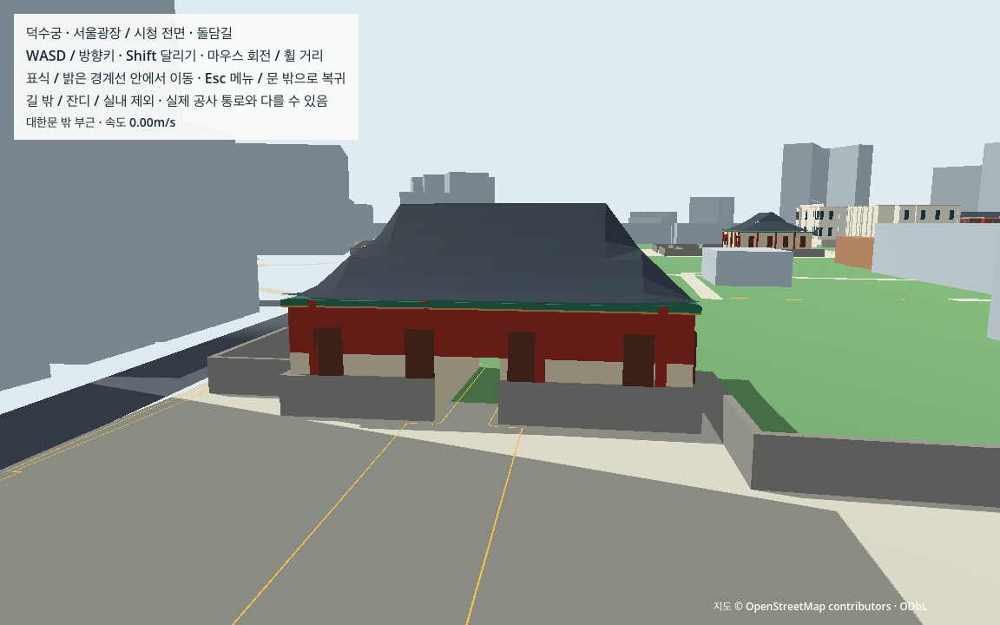

# L02 궁궐 외형과 기존 보행 공간 보존

기준일: 2026-10-15. 시작 커밋 `289a64fc9ea98d3b042e645484183be09ec47199`. **L02 궁궐 외형·자동 보행 회귀 완료.** 사람의 장소 인상·직접 조작/OS·M4·도시 성능은 별도 미검증이다.

## 구현과 표현 범위

대한문·중화전·중화문·석조전·돈덕전·정관헌의 단순 외형을 기존 서울 보행 공간에 붙였다. 6대상/401표시 부재/10,766삼각형이며 새 충돌체·경로·수입 미디어는0개다. 기존 도로·건물 배치·원점·1단위=1m와 임시/부분 유래 높이를 유지했다. 실제값을 새로 측량한 모델이나 정밀 복원이 아니다.

| 대상 | 구현한 특징 | 유지한 한계 |
|---|---|---|
| 대한문 | 단일 지붕 층·붉은 기둥 리듬·비어 있는 통로 | 기존 폭/높이3×3m는 공학용 가정, 홑처마 구조를 확인한 모델 아님 |
| 중화전 | 현재 단층 전각·상부 박공/하부 hip의 단순 팔작 인상·기둥/기단 띠 | 비례·색·세부 구조는 제작 가정, 기단 진입 없음 |
| 중화문 | 낮은 지붕·붉은 기둥·닫힌 문 면 | 기존 닫힌 충돌과 우회 동선 유지 |
| 석조전 | 밝은 대칭 면·열주·중앙 박공·기단 단차 부조 | 부모 하나의 외형, 두 줄 창호는 지상2층 표현이며 지층을 지상3층으로 그리지 않음. 계단/열주 안 진입 없음 |
| 돈덕전 | 붉은 면·청록 창 두 줄·모서리 지붕 강조 | 현존 재건 건물 참조, 세밀한 벽돌/텍스처 재현 없음 |
| 정관헌 | 낮은 지붕·가는 기둥·얕은 난간 | G03 선택 이름 윤곽만 사용, 겹침 보류 윤곽/포치 보행 복원 없음 |

원천은 [L01 제작 명세](../../docs/landmark_reference.md)와 [자체 제작 recipes](../../game/assets/authored/landmarks/palace/recipes.json)다. 위치는 원본 footprint/구멍을 따르고 모든 새 삼각형을 그 안으로 자른다. 닫힌 건물의 0.2~0.32m 안쪽 면은 기둥/창을 드러내는 얕은 부조다. 새 실내·발코니·지형/지원면을 만들지 않는다. 대한문은 W01의 축을 사용하고 다른 전각의 긴 축/제작상 정면은 명세에 기록하며 측량 방향으로 주장하지 않는다.

## 같은 시점의 교체 전후

각 비교는 같은 고정 카메라/조명·실제1152×720 렌더다. 장소 이름 Label3D를 숨겨 이름표가 외형을 대신하지 않게 했다. 이 고정 관찰 위치는 추가 스폰/보행 권한이 아니다. 직접 사용자의 장소 인상 확인은 미실행이다.

| 대상 | 이전 일반 부피 | 교체한 외형 |
|---|---|---|
| 대한문 | [이전](landmarks/l02/views_view_daehanmun_before.png) | [이후](landmarks/l02/views_view_daehanmun_after.png) |
| 중화전 | [이전](landmarks/l02/views_view_junghwajeon_before.png) | [이후](landmarks/l02/views_view_junghwajeon_after.png) |
| 중화문 | [이전](landmarks/l02/views_view_junghwamun_before.png) | [이후](landmarks/l02/views_view_junghwamun_after.png) |
| 석조전 | [이전](landmarks/l02/views_view_seokjojeon_before.png) | [이후](landmarks/l02/views_view_seokjojeon_after.png) |
| 돈덕전 | [이전](landmarks/l02/views_view_dondeokjeon_before.png) | [이후](landmarks/l02/views_view_dondeokjeon_after.png) |
| 정관헌 | [이전](landmarks/l02/views_view_jeonggwanheon_before.png) | [이후](landmarks/l02/views_view_jeonggwanheon_after.png) |



[실제3인칭 시작 화면](landmarks/l02/views_view_gate_third_person.png)·[석조전 기단 근접 확인](landmarks/l02/stone_close.png)·[고정 관찰 카메라/엔진 기록](landmarks/l02/views.json.gz). 비교 화면은 지붕/열주/벽돌·창 대비가 기존 일반 상자와 구별되는지 확인하는 개발 검토다. 실제 덕수궁과의 독립 측량/정밀 외관 일치나 사람 인지 검수로 확대하지 않는다.

사용자가 나중에 확인하면 가장 도움이 되는 항목은 **대한문이 입구로 읽히는지, 전각과 석조전의 인상이 구별되는지**다. 이번 제작·자동 검수·공유를 사용자 답변 대기 조건으로 삼지 않는다.

## 실제 구조와 검증 방식

[별도 L02 장면](../../game/scenes/world/palace_landmarks.tscn)은 W03 public_walk를 상속한다. 원본6메시/대한문3조각의 표시만 끄며 원래 body의 face·layer/mask·변환은 유지한다. 외형 아래에는 CollisionObject/CollisionShape를 만들지 않는다. 원본692생성/687활성 충돌, W03 지원면/구멍·기존3×3m 통로·닫힌 중화문과 전체 여정을 재사용한다.

[독립 외형 검사](../../tools/check_palace_landmarks_evidence.py)는 실제 MeshInstance 배열/법선/재질·원본 연결·높이 분류·전체 삼각형의 footprint 포함·통로 아래 좌우 고형 포함을 검사한다. 정점 몇 개만 확인해 삼각형이 구멍/오목한 곳을 가로지르는 오류를 놓치지 않게 했다. 전체1,233원본 메시/7조각의 실제 가시성도 대조한다. 새 면이 기존 체적 밖으로 나가지 않는 조건과 실제 보행/카메라 관측을 함께 사용한다.

[실행 도구](../../tools/check_palace_landmarks_contract.py)는 캐시 없는 별도 runtime-only 사본(authored42/runtime17/helper8+명세 사본1)과 고정 Godot4.7.2·Forward+/Metal을 사용하고 앱 네트워크를 차단한다. frozen W04의 물리/시간 판정은 그대로 사용한다. 원본 관측은 보존하고 **의도된 대한문 시각 가시성3개만** baseline 값으로 정규화해 W04 검사에 넘긴다. 실제 숨김/다른 메시 보존은 별도로 판정하며 body/경로/시간/침투 관측은 정규화하지 않는다.

상속 관측기의 `inventory.source_display_unchanged=true`는 과거 도구의 상수 필드다. L02의 화면이 그대로라는 근거로 사용하지 않는다. L02의 실제 표시/전체 가시성은 `l02_visuals`와 독립 외형 검사로 판정하며 원래 source 메시 배열과 충돌의 바이트 보존은 따로 확인한다.

원본 관측은 용량을 줄이기 위해 `.json.gz`로 공유한다. 내용은 일반 JSON이며 `python3`의 gzip/json으로 읽을 수 있다. 자동 가공 메시·`.godot`·가상환경·빌드·국가 지도는 Git에 넣지 않는다.

## 실패와 수정

1. 외곽사각형 끝에 기둥을 놓아 원본과 교차되지 않는 부재가 사라졌다. 실제 footprint의 경계 교점에 붙여 중화전 기둥 등을 복구했다. 첫352부재 후보는 당시 이미 덮어써져 실행 바이트를 보존한 것으로 주장하지 않는다.
2. 대한문 위쪽 두 backing이 겹쳐 GPU 화면에 대각 얼룩이 생겼다. 아래 면은3m까지만 두어 중복을 없앴다. 석조전 단차 부조가 본체 안에 가려지는 문제도 발견했다. [당시 실제401부재 번들·생성기·화면](landmarks/l02/development/gate_overlapping_backing/finding.json)을 보존했다.
3. 정점과 법선이 모두 원래 float32와 같은 값이라는 첫 검사 가정이 실패했다. 실제 실행 버전의 [normal octahedral uint16 저장](https://github.com/godotengine/godot/blob/ed1daf0bf/servers/rendering/rendering_server.cpp#L562-L579)·[복원](https://github.com/godotengine/godot/blob/ed1daf0bf/servers/rendering/rendering_server.cpp#L1382-L1396)·[수학 정의](https://github.com/godotengine/godot/blob/ed1daf0bf/core/math/vector3.cpp#L84-L105)를 확인해 독립 재현했다. 정점1e-9m 기준과 법선1e-9 비교를 유지하며 packed 예측값과 비교한다. 임의 허용치 확대가 아니다. [이전 검사/실제 실패·원인](landmarks/l02/development/normal_packing/finding.json).
4. 단차 부재의 존재 검사와 전체 자동 보행은 통과했지만 근접 화면에서 0.01m 앞면이 여전히 단차를 가리는 것을 발견했다. 원본 앞 경계까지 기단 절삭을 연장하고 첫 띠를 그 경계에 맞게 잘랐다. footprint/충돌을 바꾸지 않았으며 [수정 전 관측/통과 기록/근접 화면](landmarks/l02/development/stair_front_sliver/finding.json)을 보존했다. 최종 전체 검사는 수정한 번들에서 다시 실행한다.
5. 짧은 독립 코드 검토에서 교체 대상 외 메시의 뜻밖 숨김을 놓칠 수 있음을 발견해 전체1,233/7개 가시성 검사를 추가했다. 검증 범위를 보강한 것이며 기존 물리 허용치는 유지했다.
6. 첫 GPU 전체 여정은 완주·물리/카메라·외형 검사를 통과했지만 초반3단계의 실제 시간이2% 기준을 넘었다(최대6.464256%, 전체0.592900%). pipeline 계수는 관측상 변하지 않았으며 원인을 shader compilation으로 확정하지 않는다. [실패 원본·당시 도구·전체 결과](landmarks/l02/development/first_gpu_clock/finding.json)를 보존하고 **소스·자료·허용치 변경 없이** 짧은 GPU 관측과 전체 재시험을 실행했다. 재시험은 통과했지만 첫 지연의 원인은 미확정이고 초기 기동/도시 성능을 해결했다고 주장하지 않는다.

## 최종 검사 결과

최종 번들 SHA: `346e3fac6f7244e25c96e3b5031a1da008d0b19f05f4f3638835b1bc4d342e18`.

- [고정 GPU 전후 화면](landmarks/l02/views_check.json): 외형76개·실행 계약9개 통과.
- [자동 엔진 검사](landmarks/l02/contract_check.json): 실행 계약22개·외형76개·전체 보행3,508개 통과. 지붕 숨김/외형 이동/충돌 추가/통로를 막는 시각 상자/원본 다시 표시 등 실제 엔진 결함5종을 넣어 각각 관련 검사에서 거부했다.
- [작은 사본 재생성](landmarks/l02/portability_check.json): 준비 입력6개만 복사해2회 동일 생성, 손상 실행 파일/변경된 recipes의 오래된 결과 거부 등8개 통과. 현재 M1의 기존 인터프리터/의존성 검사이며 새 설치·전체GIS·다른 Mac 검증은 아니다.
- [짧은 GPU 재시험](landmarks/l02/gpu_trial_check.json): 외형76개·보행874개·실행 계약10개 통과.
- [최종 전체 GPU 재시험](landmarks/l02/gpu_check.json): 외형76개·보행3,520개·실행 계약10개 통과. 11단계/334구간·57,116tick·물리951.933333초/실제952.020547초·56,637프레임·8체크포인트/21도착·10PNG다. 여정 중 순간이동/복귀/영역 이탈0·전tick 지면 접촉, 목표점 최대 오차0.058265m, 캡슐/카메라 침투2.177564/0.000697mm로 기존5mm 이내다. 전체 시간차0.009162%·단계 최대0.919792%로 기존2% 기준을 유지했다. [실제 관측](landmarks/l02/gpu.json.gz)·[독립 보행 판정](landmarks/l02/gpu_walk_check.json)·[의도된 시각 차이](landmarks/l02/gpu_visibility_delta.json).
- [보호된 W04 입력](landmarks/l02/baseline_preservation.json): source/runtime/공간/proof99개 바이트 보존. [독립 코드/화면 검토](landmarks/l02/independent_review.json). 첫 지연/이전 가림 실패와 최종 통과는 별도 보존하며, 통과는 현재 M1·고정 버전/해상도의 준비 후 자동 관측 범위다.
- [일반 실행 로그](landmarks/l02/normal_startup.log): 자동 probe 없이 W03_READY/L02_READY·정상 종료. 직접 키/OS 조작 검증은 아니다. [마무리 무결성·인수 검사](l02_verification.json)는37개 항목으로 현재 소스/입력/증거·작업 상태·문서 연결을 대조한다.

## 실행과 인수

W04/L01 자료까지 준비한 현재 Mac:

```sh
.venv-data/bin/python tools/prepare_palace_landmarks.py
sh tools/run_palace_landmarks.sh run
```

WASD/방향키·Shift 달리기·마우스 회전/휠 거리·Esc 메뉴를 사용한다. 자동 움직임은 시험 프로세스에서만 사용한다. 다른 Mac의 준비·검사 명령은 [CROSS_MAC](../../docs/CROSS_MAC.md)을 따른다.

사람/OS 직접 조작·개별 실내·실제 지형/공사 접근·독립 외관 정확도·M4·도시 성능/배포·NPC/차량·V0는 미검증/미완료다. 다음은 L03 도시 외형이며 [기존 자산 대안](../../docs/ASSET_REUSE_OPTIONS.md)의 후보 한 개를 비교해 볼 것을 권고한다. 현재 공간은 탐험·생활/도시 시뮬레이션의 무대다. 메타버스/멀티플레이를 목표로 확정한 상태가 아니며 핵심 반복 활동은 후속 기획으로 남긴다.
