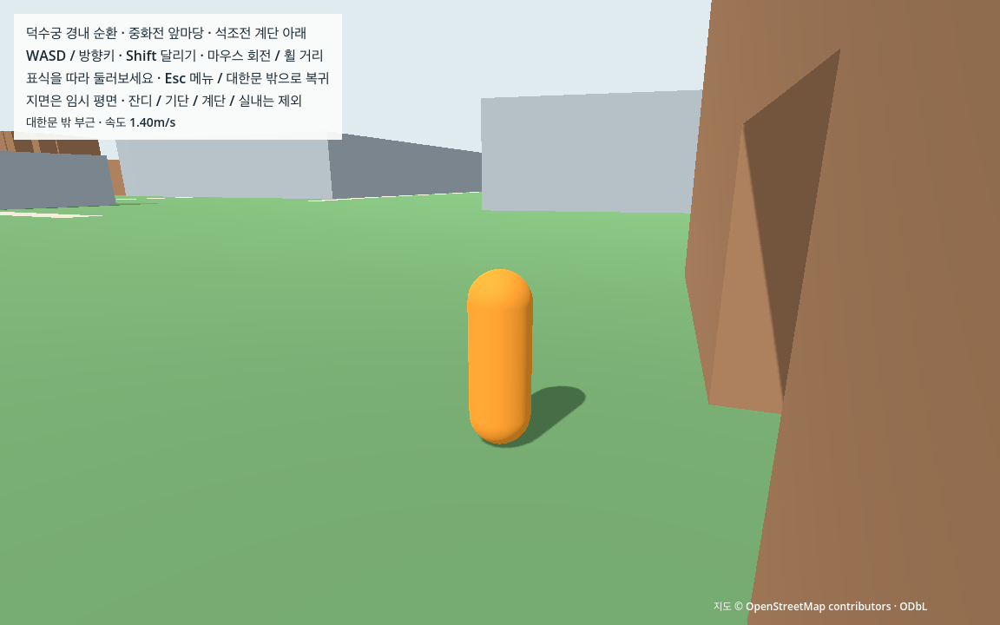
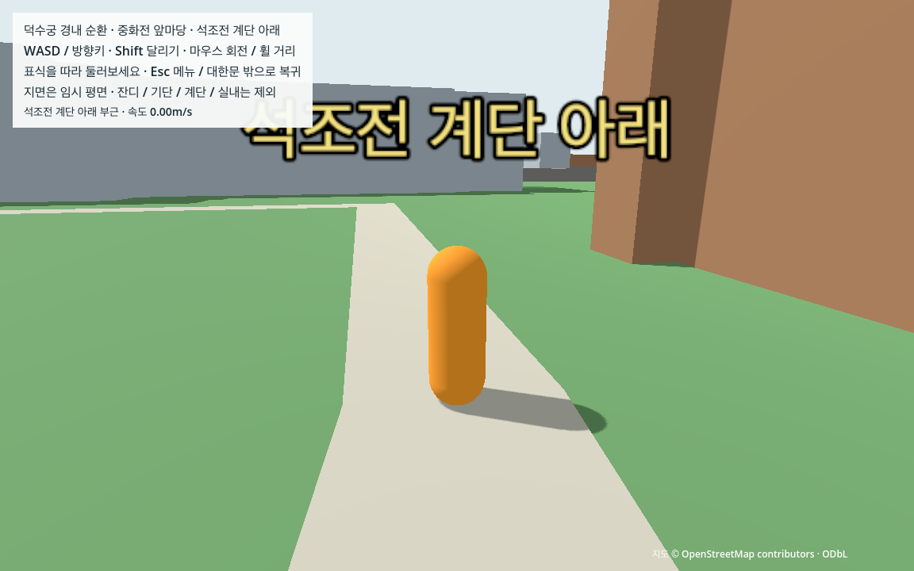
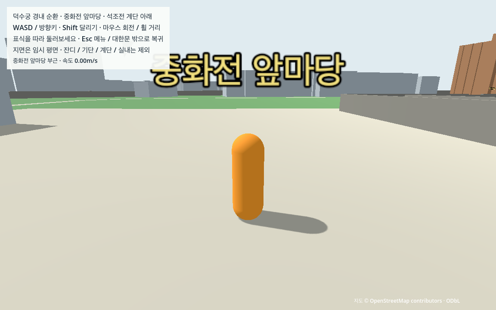

# W02 덕수궁 경내 순환과 중화전 앞마당

작업일: 2026-10-13~14. 이 결과는 기존 대한문 연결을 재사용하는 경내 보행 장면이다. 원본 미터 배치와 단순 건물 외곽을 유지한다. 아래 실제 검증 결과를 기준으로 완료를 판정하며, W0 전체 동선과 V0는 별도다.

## 경로와 선택 이유

G04 R1의 `w377289813`과 `w377289810`을 이어 n921242931에서 출발해 같은 지점으로 돌아온다. 원본 24좌표/23구간의 길이는 564.412107m다. 중화문을 통과하지 않고 중화전 측면, 석조전 계단 아래, 서측 길을 지난다. 원본 중화문·전각·담장은 닫힌 충돌을 보존하고 새 개구부를 만들지 않는다.

잔디가 원본 중심선에서 약 24cm 떨어진 좁은 구간은 캡슐이 침범하지 않도록 별도 실행 경로를 계산했다. 최대 보정 0.300215m, 실행 순환 길이 564.446303m다. 원본 선/노드와 보정한 각 구간을 따로 저장하며 원본 좌표를 수정하지 않는다. G04의 보행로 폭 2.4m 추정을 재사용하고, 기존 대한문 입구는 원본 65.608256m 연결을 유지한다.

중화전 앞마당은 원본 보행 면 `relation/5681909`를 사용한다. 원본 기단/전각 구멍을 보존하면서 측면에서 열린 앞마당의 게임 시점 `(-130,-40)`까지 47.011114m 접근로를 연결했다. 이 시점은 측량한 전각 중심/출입구가 아니다. 석조전 접근은 n3851434705까지만이며 실제 16단 계단과 실내를 포함하지 않는다.

기술적 지원면은 y=0, 깊이 0.2m의 지역 메시다. 원본 보행로와 열린 앞마당에 연결되며 잔디·물·금지 계단·살아있는 건물/담장 외곽을 제외했다. 4,265.422857m², 내부 구멍 2개, 1,068삼각형이다. 금천교와 실제 단차의 상세 대응은 확인되지 않아 평면 연결을 실제 교량·지형 재현으로 설명하지 않는다. 독립 분수 객체도 특정하지 못해 임의 위치의 분수를 만들지 않았다.

## 실행과 재현

기존 G/E03/P04/W01 준비 자료를 재사용한다. 새 Mac에서는 [CROSS_MAC](../../docs/CROSS_MAC.md)의 기본 준비와 P04/W01 준비 후 아래 순서로 진행한다.

```sh
.venv-data/bin/python tools/prepare_palace_walk.py
python3 tools/check_palace_bundle.py
sh tools/run_palace_walk.sh run
```

WASD/방향키로 걷고 Shift로 달린다. 마우스 회전·휠 거리, Esc 메뉴·문 밖 복귀를 사용한다. 안내 표식은 대한문 밖·경내 입구·중화전 측면·석조전 계단 아래·중화전 앞마당이다. 길 가장자리와 제외 구간에서는 멈추거나 가장자리를 따라 미끄러지고, 낙하·잘못된 외부 위치에서는 안전 스폰으로 복귀한다.

생성된 `palace_walk.json`, `palace_decision.json`, `palace_manifest.json`은 Git 제외다. 공유되는 수동 가정은 [palace_walk.json](../../data/manual/palace_walk.json)이다. 실행은 준비 후 지도/Python/GIS 패키지/네트워크 없이 Godot 실행 자료만 사용하며 실행 전 표준 Python 검사기는 GIS 패키지가 필요 없다.

```sh
python3 tools/check_palace_contract.py --mode contract
python3 tools/check_palace_contract.py --mode gpu30
python3 tools/check_palace_contract.py --mode gpu60
python3 tools/check_palace_rejections.py
.venv-data/bin/python tools/check_palace_portability.py
```

## 구현과 검증의 경계

W01·P04 원본은 유지한다. W02는 원천 충돌 685개 중 기존 비활성 3개를 유지하고 W01의 문/담장 조각 4개를 재사용한다. W01 지원면은 비활성/숨김으로 바꾸고 W02 지원면 하나로 교체한다. 실제 생성 691개/활성 687개이며 기존 표시 데이터의 provenance와 권한 null은 바꾸지 않는다.

1.7m/반경 0.3m 캡슐, 걷기 1.4m/s·달리기 3.5m/s, 물리 60Hz, 기존 3인칭 카메라/메뉴/복귀를 사용한다. 이동 중심 영역은 지원면에서 0.4m 안쪽이며 구멍도 제외한다. 경로 계산에는 추가 0.08m 여유가 있다. 지역 이동 경계이며 서울 전체 플레이 경계는 미정이다.

독립 검사기는 생성기를 import하지 않고 원본 노드 경로·보정 범위·지원면 원천 적합성/구멍·실제 float32 face hash·역할/마스크·추가 충돌체 누락을 검사한다. 약 10Hz 보존 표본의 캡슐/카메라 구와 원본 체적 거리를 독립 계산하고, 엔진의 모든 물리 tick 극값·접촉 질의는 별도 보고한다. 모든 tick의 독립 재계산을 했다는 뜻은 아니다. GPU30은 속도·문·경계의 짧은 시험, GPU60은 전체 경내 왕복 시험이다. 짧은 굴곡 구간은 1tick까지 짧으므로 실제/물리 시간 2%는 경로 그룹 합계에서 판정한다. 10초 속도·정지·문·경계 구간은 개별 판정한다. 렌더 빈도 허용 20%, 이동 관통 5mm, 정지 높이 범위 1mm 기준을 유지한다.

GPU 측정은 체크포인트 15카메라 시점과 중립 정지 후 실행한다. 초기 캐시는 복사하지 않지만 준비 후 측정이므로 콜드 기동/도시 성능 보장은 아니다. 시험 프로세스의 입력 격리 helper는 일반 실행에 적용하지 않는다. 외부 이동 키 이벤트는 개수만 기록하고 키 내용은 저장하지 않는다.

## 실패와 수정

첫 전체 순방향 실행은 경로 leg18에서 내부 좌표 `(-131.031570,-1.730310)`를 바깥으로 판정해 시작점으로 복귀했다. 같은 전체 실행에서 반복 재현했고, 원본 이동 영역의 독립 계산상 경계에서 0.799644m 안쪽인 지점이었다. 짧은 해당 구간만 따로 실행했을 때는 재현되지 않았다. [원래 전체 관측·계측 소스·수정 전 World](palace/development_failure/failure.json)를 보존했다.

원본 도형/지원면/허용치를 바꾸지 않고 W02의 포함 판정을 명시적 수평 교차 계산으로 교체했다. 같은 좌표의 실제 엔진에서 기존 판정 false/수정 판정 true를 기록하고 전체 경로를 재실행했다. 초기 개발용 short 시험의 43개 정적 검사만으로 물리 완료를 주장하지 않는다. 잔디 바깥 경계 가까운 초기 ray 시점도 원본 잔디 안쪽으로 바꿔 검사 의미를 맞췄다.

## 최종 실행 결과

| 검사 | 결과 |
|---|---|
| 독립 사본 정상/반복 | 각각 85사례·30,300물리 tick·1,237검사 PASS, 보존 표본과 몸체 목록 동일 |
| 실제 고장 주입 | 지원면 제거·기단 담장 제거·플레이어/카메라 마스크0·광역 평면 재활성·앞마당 구멍 메움 6종 모두 관련 실패 감지 |
| 실제 GPU30 | 짧은 9사례·3,596tick·854검사 PASS |
| 실제 GPU60 | 전체 85사례·30,300tick·1,252검사 PASS, 순환/앞마당/입구 양방향 완료 |
| 잘못된 실행 자료 | 실제 15종 모두 거부, 원천/교체 충돌체 생성 0개 |
| 작은 입력 사본 재생성 | 85입력/도구를 복사해 W02를 두 번 생성, plan/decision/manifest 바이트 일치 |
| 일반 실행 장면 | 자동 시험 옵션 없이 오프라인 Forward+/Metal 기동·종료 PASS |

GPU 실제/물리 시간 차이는 측정 대상 중 최대 30fps 0.169350%, 60fps 0.067400%다. 경로의 최대 목표점 오차는 0.058235m, 캡슐 관통 극값은 약 2.178mm로 5mm 기준 이내다. 카메라 구 관통·근접면 ray 막힘·예기치 않은 복귀는 0이며 정지 높이 범위는 0이다. 준비는 약 9초/15시점, 측정 구간 pipeline 추가와 외부 이동 키 이벤트는 0이다. GPU mode는 처음 캐시 없는 사본에서 30fps 실행 후 같은 사본에서 60fps를 실행했다. 준비 후 결과이며 콜드 기동·1080p 도시 성능을 검증한 것은 아니다.

[전체 인수 198개 검사](w02_verification.json), [계약](palace/contract_check.json), [GPU](palace/gpu_check.json), [자료 거부](palace/rejections/rejection_check.json), [사본 재생성](palace/portability_check.json), [독립 검토 23개](palace/independent_review.json)를 함께 보존한다. 각 정상/고장 raw 기록과 로그는 `palace/`에 있다. 잘못된 생성 JSON 전체는 로컬 캐시에 보존하고 Git에는 원본 해시·변경 코드·입력 fingerprint·실제 거부 관측을 남긴다. 원본 변경 없이 재현 도구로 다시 만들 수 있다.

일반 기동 확인의 첫 호출은 상대 로그 경로가 game 기준으로 해석돼 기록 실패가 발생했다. [호출 실패](palace/native_log_path_failure.json)를 남기고 절대 경로로 재실행해 [일반 기동](palace/native_production.json)을 통과했다. 실행 장면 자체의 완료 증거로 첫 오류 호출을 사용하지 않았다.

실제 GPU60의 주요 시점이다. 건물과 캐릭터·표식은 임시 외형이며 사람 조작 또는 랜드마크 인상 검수의 대체물이 아니다.







## 남은 범위

실제 지형·문/길 치수·현재 현실 접근 허가, 전각의 상세 외형·계단·실내, 직접 조작감·OS 입력, M4 실행은 미검증이다. 문 근접 때 최소 카메라 거리는 약1.477m였고 일부 표본에서는 몸체가 화면 밖으로 투영됐다. 지속적인 몸체 가시성과 조작감 검수를 완료한 것은 아니다. 사용자는 당분간 구현/검증/기록/공유를 에이전트에게 위임했으며 확인 질문을 반복하지 않는다. 서울광장·시청 전면·돌담길 연결은 W03, 전체 W0 검수는 W04다. 보행자·차량과 장소 외형은 이후 V0 작업이다.

다음 W03의 원문 지상 횡단·광장/돌담길 입력은 [시작 입력 검토](../../docs/evidence/W03_INPUT_REVIEW.md)에 정리했다. 경내 전체 참조 토지면의 표시 색은 보행 허가를 뜻하지 않으며 이동 범위는 위 지역 지원면/중심 영역이 기준이다. 표식과 경로 시인성·랜드마크 외형은 후속 검수에서 다듬는다.
