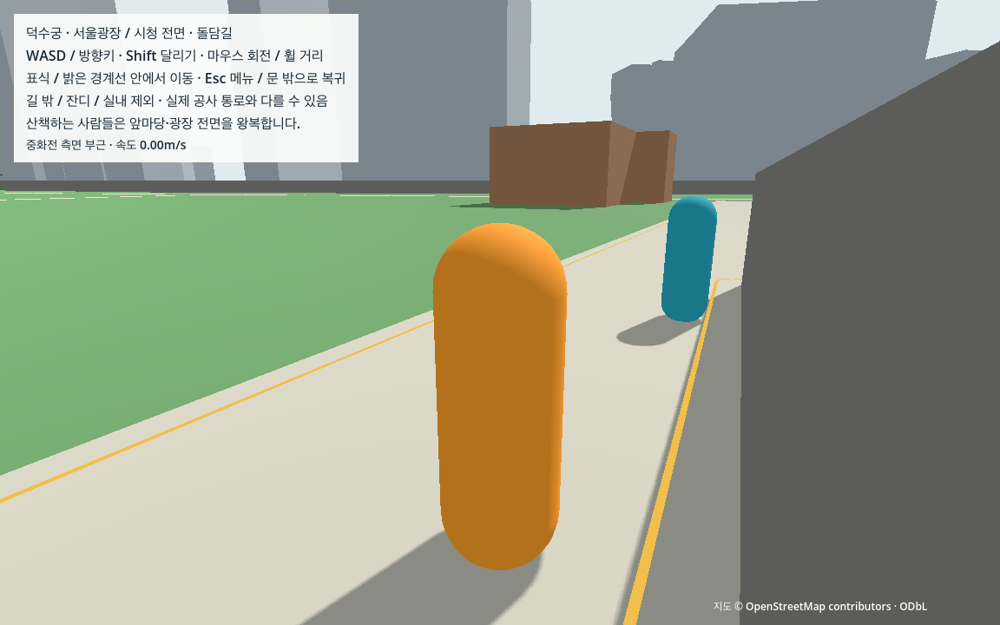
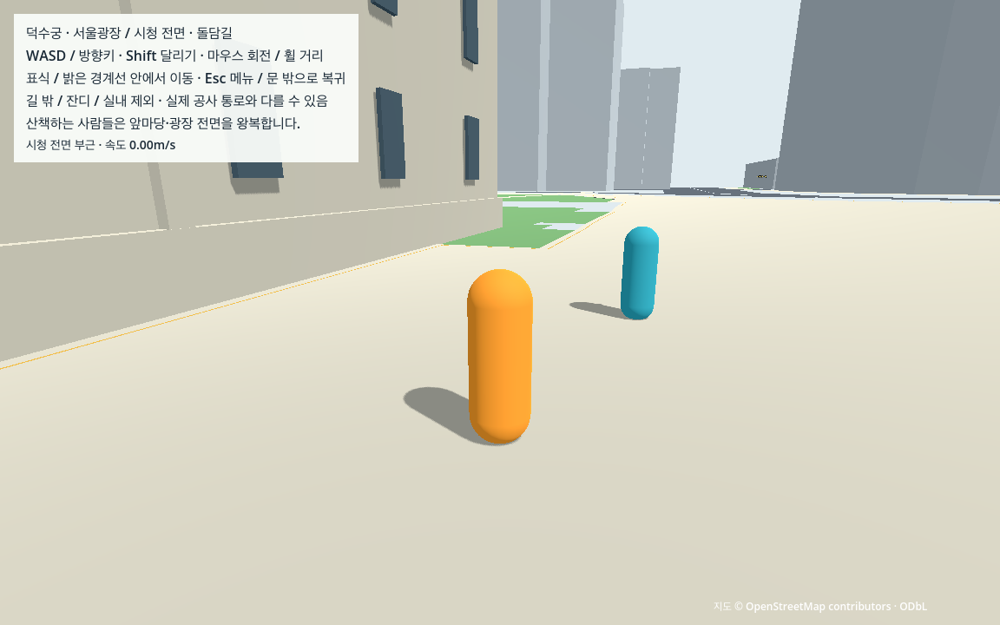
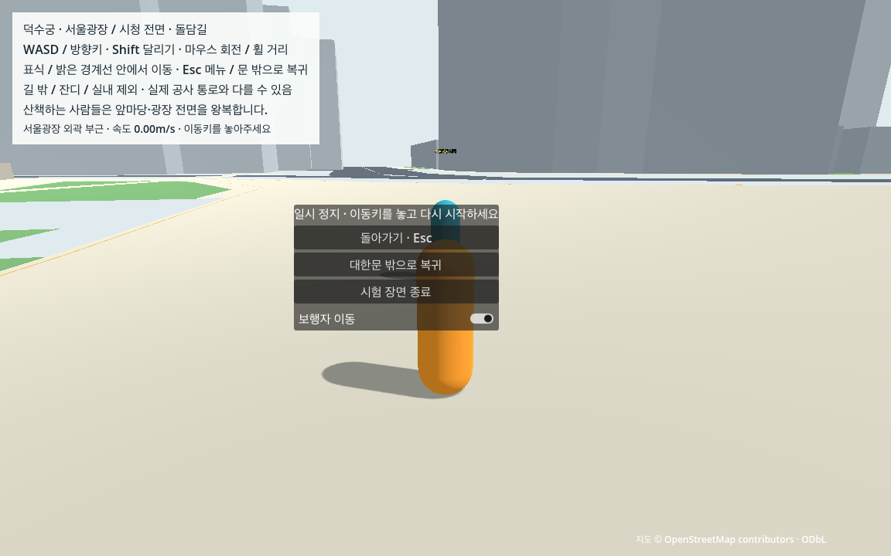

# N02 보행자 왕복·회전·정지·접촉

N01에서 고른 중화전 앞마당47.011114m와 서울광장 전면73.713895m의 기존 보행선에 한 명씩 추가했다. 새 장면은 L03을 상속하며 대한문 통로·보행 경계·원래 건물/담장과 지원면을 유지한다. 차량은 다음 N03이다.

## 실행과 조작

이미 L03/N01 자료가 준비된 Mac에서는 다음 순서로 실행한다. 처음 준비하는 Mac은 [CROSS_MAC](../../docs/CROSS_MAC.md)의 선행 준비부터 따른다.

```sh
.venv-data/bin/python tools/prepare_routes.py --check
.venv-data/bin/python tools/prepare_pedestrians.py
sh tools/run_pedestrians.sh run
```

WASD·Shift·마우스·휠 조작과 대한문 쪽 시작 위치는 기존과 같다. 앞마당과 광장 전면으로 걸어가면 청록색 임시 보행자가 보인다. `Esc`를 누르면 모두 멈추며 메뉴의 `보행자 이동`을 끄고 계속하기를 누르면 보행자만 멈춘 채 탐험할 수 있다. 같은 스위치로 다시 걷게 한다. 편집기는 `sh tools/run_pedestrians.sh editor` 뒤 현재 장면 실행(F6)을 사용한다. 기본 프로젝트 시작 장면은 과거 단계 보존을 위해 그대로다.

## 구현 선택과 보존 범위

- 경로 중간50%에서 원문 순방향으로 시작하는 두 `CharacterBody3D`, 높이1.7m/반경0.3m·layer4/mask15·속도1.2m/s다. 왕복 끝에서0.5초 멈추고180도/초 이내로 돌아선다. 걷는 동안 기존 선의 다음 물리step 지점을 향해 움직이며 위치를 덮어쓰거나 재스폰하지 않는다.
- 앞에 플레이어 등이 있으면 기다리고, 앞이0.3초 동안 비면 재개한다. 2초 이상 막히면 기존 경로의 뒤쪽0.6m 전체가 비었을 때만 돌아서 물러난다. 앞뒤가 막히면 기다린다. 생활AI·자유 목적지/군중을 만들지는 않았다.
- 실제 지원면RID를 제외한 전체 캡슐 탐색과 `move_and_slide`를 함께 사용한다. 접지 중에는 지면 스냅, 공중에서는 중력9.8m/s²를 사용한다. 이동 스위치는 진행 상태를 보존하며 메뉴는 실제 SceneTree를 멈춘다. 같은 장면에 중복 생성하려는 요청은 거부한다.
- 원본 좌표/미터축척·높이 분류·건물/담장·플레이어 경계·3×3m 문·원래 입력/카메라는 그대로다. 정적 충돌은692생성/687활성이다. 실제 도시/궁궐 외형도 기존 검사로 대조한다. 새 소스 자료나 외부 모델은 추가하지 않았다.

보행 JSON/manifest는 N01 독립 검사와 현재 바이트 대조 후 생성하며 Git에 넣지 않는다. checksum·지원면/world/region·좌표·선의 원래 정점 구간과 정책을 확인한 뒤 두 명을 생성한다. 공유 검증 snapshot과 기기별 자동 가공물은 구분한다.

## 검증과 실제 화면

최종 GPU 독립171개·도시58개·궁궐76개와 GPU 계약9개를 통과했다. 아홉 case 합계18,408tick/306.8물리초·306.806859실제초다. 280초 자유 보행에서 앞마당3/광장2왕복, 교대 끝점7/4회·제자리 회전을 관측했다. 지면 접촉은 NPC36,816tick 전부 유지했고 영역 이탈/플레이어 복귀0이다. 최대 수평step0.020007415m·경로오차0.000017060m·Y0.000942310m·NPC 원본/지원면 침투0, 최소 플레이어 중심 간격0.601589m·구간 시간차 최대0.6223%다.

최종 headless 독립162개/계약20개도 통과했다. 실제 NPC collision_mask=0 결함은 capsule/mask·지면/궤적 검사에서 거부됐다. 저장 관측의 case 누락·중복 descriptor·표본 누락·정지 끝 위치 변조4종은 각각 관련 검사에서 거부했다. checksum·복제 경로·좌표·오래된 지원면 SHA의 loader4종은 NPC0명 상태로 거부했다. 실제 엔진 결함1종과 저장 관측 변조4종을 합쳐 엔진 결함5종으로 세지 않는다.

시작 커밋의 기존 game/config/manual/raw/tools179파일이 바이트 그대로임도 대조했다. [기존 소스 보존](n02/source_preservation.json). 자동 입력 없는 실제 일반 GPU 장면의 기동/정상 종료도 확인했으며 직접 키 조작 시험과는 구분한다. [일반 기동](n02/ordinary_check.json).

실제 GPU 캡처는 보행자를 잠시 멈추고 찍었으며 움직임 판정에는 관측 궤적을 사용한다. 첫 정면 캡처에서 플레이어가 보행자를 가려, 동일 장면의 카메라만30도 돌린 별도 검토 화면2장을 추가했다. 이 별도 화면은 동작/성능 시험이 아니다. [별도 실제 관측·이미지 SHA](n02/views.json)와 첫 캡처도 보존한다.







검증 파일: [headless 계약](n02/contract_check.json), [독립 보행 판정](n02/contract_pedestrian_check.json), [GPU 계약](n02/gpu_check.json), [GPU 독립 판정](n02/gpu_pedestrian_check.json), [다른 폴더 재생성](n02/portability.json), [인수](n02_verification.json).

네트워크가 차단된 Godot4.7.2 runtime-only 사본에서280초 자유 보행과 정지/재개·짧은 막힘/길 비우기·지속 막힘/퇴각·플레이어 접근/뒤로 빠지기/전진을 수행한다. 모든 물리tick에서 두 명·지면/영역·속도/수평step·높이/침투·yaw를 요약하고10Hz의 위치/속도·단계·실제 물리tick을 남긴다. 독립 검사기는 원래 정점 선과 캡슐 전체 지원 범위·장애물을 대조하며 실제 위치에서 끝점 교대와 왕복 거리를 다시 계산한다. counter만으로 왕복을 인정하지 않는다.

각 case 사이에는 플레이어만 시험 위치로 옮긴다. NPC의 위치·거리·물리tick은 이어져야 한다. 물리60Hz·실제 화면60fps와 구간 시간 오차2%, 수평 명령1.2002m/s·step0.0202m·누적1.2×초+5mm·경로/높이/침투5mm 상한을 함께 적용한다. 실제 mask 결함과 저장 관측 변조·loader 거부는 별도 기록이다. [검증 기준](../../docs/VALIDATION_PLAN.md)·[기술 계약](../../docs/TECHNICAL_CONTRACTS.md).

## 발견한 실패와 수정

개발 원기록/로그/판정은 [development](n02/development/)에 보존한다. 초기에는 probe 변수의 명시 타입 오류와 JSON 숫자(float)/코드 상수(int)의 Dictionary 동등 비교 때문에 정상 자료가 거부됐다. 숫자를 명시적으로 대조하고 JSON의 정점 binding 타입을 맞췄다. 손상된 자료를 허용하도록 검사 항목을 제거하지 않았다.

첫 경로 추종은 멀리 있는 선분 끝만 향해 걸어 바닥 접촉 오차가 굽은 길에서 누적됐다. 매 물리step 중심선 바로 앞 지점을 향하는 속도 제한 이동으로 고쳤다. 1mm 충돌 여유를0.1mm로 줄인 실험은 바닥에서 반복적으로 멈춰 폐기했고, 지면 속도 유지 설정만으로도 큰 보정이 없어지지 않았다.

전체 반복에서 원래 접지 상태에도 매번 중력을 더하는 방식이 지원면 이음부의 위치 보정을 키움을 확인했다. 접지 중에는 기존 스냅을 사용하고 공중에서만 중력을 더하도록 고친 뒤 전체 반복을 다시 검사했다. 개발 중 검토한 수평step0.021m 접촉 예외는 채택하지 않았으며 최종 상한은 원래0.0202m다. source/경로·Y·침투5mm와 실제 시간2%도 유지했다. 독립 검사에서 누락한 지원면 체적과 가속 headless timer/실제 GPU 시간의 구분도 정정했다.

## 재검증과 다른 Mac 인수

```sh
.venv-data/bin/python tools/check_pedestrians_contract.py --mode contract --output data/cache/n02_recheck
.venv-data/bin/python tools/check_pedestrians_contract.py --mode gpu --output data/cache/n02_gpu_recheck
.venv-data/bin/python tools/check_pedestrians_portability.py --output data/cache/n02_portability.json
.venv-data/bin/python tools/capture_pedestrians.py --output data/cache/n02_views
python3 tools/check_pedestrians_handoff.py
```

고정된 최종 증거를 덮어쓰지 않도록 재시험 출력은 cache로 분리한다. 원래 실행 자료까지 재생성한 뒤에는 `check_pedestrians_handoff.py --prepared`로 바이트도 대조한다. prepared 재생성은 기존 Python3.14.7/Shapely2.2.0에서27파일16,327,528bytes만 복사해 두 번 확인했으며, 새 Mac 설치나 전체 GIS/M4 시험은 아니다. 최신 작업/다음 행동의 단일 기준은 [WORK_STATUS](../../docs/WORK_STATUS.md)다.

## 남은 범위

두 고정 경로의 단순 보행자다. 실제 인구/군중·생활 활동·보행자끼리 만나는 교차는 구현하지 않았다. 기존 두 선은 서로 분리돼 있어 NPC끼리의 실제 조우는 이번 증거가 아니다. 실제 서울의 지형/접근·현장 정확도·직접 사람 조작감/OS포커스·M4·도시 성능/패키지·실내·V0 완료도 별도다. 새 동적 시험을 과거3.3km 통합 완주로 확대하지 않는다. N03에서 차도 지지/접촉을 먼저 확인하고 차량·교차 정지/재개·시야 밖 반복을 구현한 뒤 N04의10분 이상 통합 시험으로 이어간다.
