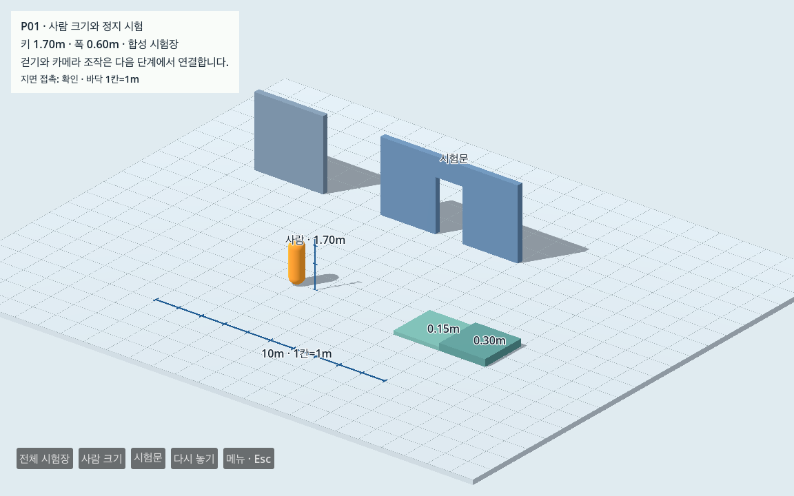
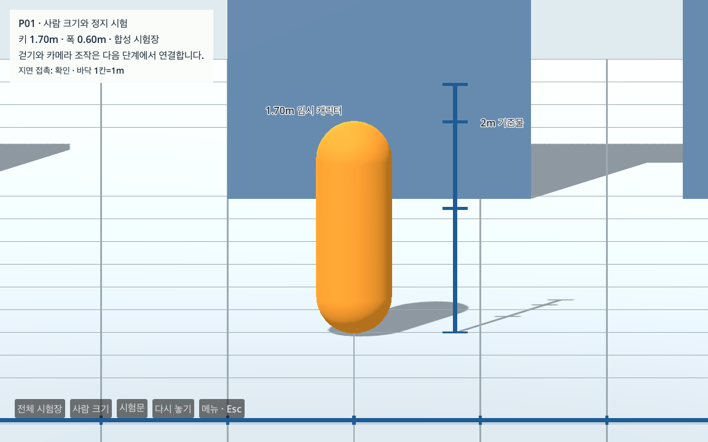
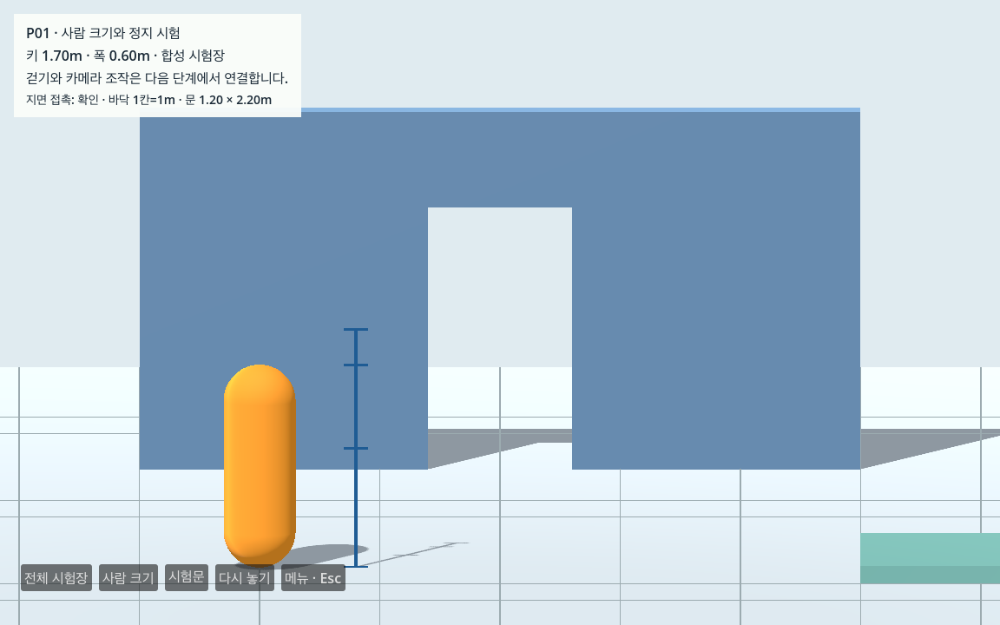

# P01 사람 크기 임시 캐릭터와 독립 충돌 시험장

2026-10-13 · **완료** · Godot 4.7.2 Standard / Forward+ / Metal / M1 Pro · 다음 P02

미터 계약을 유지해 전체 높이 **1.70m**, 반경 **0.30m**(폭 0.60m)의 임시 캡슐 캐릭터를 만들었다. 외형과 충돌체를 분리하고 평면·벽·시험문·단차의 독립 시험장에 배치했다. 실제 GPU에서 정착 후 **60.009초 / 물리 처리 3,600회** 동안 안정 정지를 확인했다. [인수 요약](p01_verification.json), [현재 작업 상태](../../docs/WORK_STATUS.md).

## 구성과 비례

| 항목 | 실제 구성 / 기준 |
|---|---|
| 캐릭터 | CharacterBody3D, 전체 높이 1.70m·반경 0.30m, 루트는 발 위치 |
| 외형 / 충돌체 | Visual/Body와 CollisionShape를 분리, 둘 다 루트에서 y=0.85m 중심, 부모 scale=1 |
| 평면 | 24×20m, 두께 0.20m, 상단 y=0 |
| 독립 벽 | 3×3m, 두께 0.25m |
| 시험문 | 양쪽 벽+상부 보, 실제 빈 폭 1.20m·바닥부터 높이 2.20m |
| 단차 | 2×2m 블록 두 개, 상단 y=0.15/0.30m |
| 미터 기준물 | 10m 수평 눈금·2m 수직 눈금, 바닥 격자 1m |
| 시험장 시작 | `(-2,0.08,2)`m, 지면 위이며 실제 서울의 원점/스폰과 무관 |

Godot 캡슐의 `height`는 양 끝 반구를 포함한 전체 높이다. 1.7m에 반구를 다시 더하지 않았다. 실제 엔진 메시 정점의 global bounds와 충돌체 중심/크기를 함께 검사했다. [CapsuleShape3D 정의](https://docs.godotengine.org/en/stable/classes/class_capsuleshape3d.html), [CapsuleMesh 정의](https://docs.godotengine.org/en/stable/classes/class_capsulemesh.html).







캡슐은 크기·접촉을 확인하기 위한 임시 외형이다. 위 **사람 크기** 화면에서 2m 눈금 옆의 키와 폭을 비교할 수 있다. 사용자의 직접 조작 검증은 아직 없으며, 걷기·카메라가 연결되는 P02/P03에서 조작감 검토가 더 유용하다.

## 정지·충돌 결과

- 정상 GPU 검사 **11개 그룹** 통과. 정착 1초 뒤 실제 벽시계 60.009401초·물리 시간 약 60초·3,600회 전체를 관측했다. 3,600회 모두 `is_on_floor=true`, Y 변화 0m·수직 속도 0m/s·XZ 이동 0m다. [엔진 측정/1Hz 표본](p01/gpu_engine.json), [독립 검사](p01/gpu_check.json), [GPU 로그](p01/gpu.log).
- 발 좌표는 `y=-0.000135415m`로 일정했다. 약 **0.135mm**의 접촉 수치 오차이며 허용 접촉 범위 ±2mm 안이다. “정확히 y=0”이나 오차 없는 충돌로 표현하지 않는다. 안정 기준은 60초 전체 높이 범위 ≤1mm, 속도 ≤0.001m/s, XZ 이동 ≤1mm다.
- 정적 구조 7개는 활성 BoxShape3D이며 외형/충돌 경계가 일치한다. 플레이어는 **레이어 번호 2(비트 값 2) / 마스크 값 1**, 정적 구조는 **레이어 번호 1(비트 값 1) / 마스크 값 2**다. 장식 눈금/격자에는 충돌체가 없다. 전체 NPC·차량·카메라 행렬은 P04 이후의 작업이다.
- 실제 물리 shape 질의에서 문 가운데는 빈 상태, 좌우 벽·상부 보·독립 벽·두 단차는 겹침이 감지됐다. 시작 위치에서는 겹침 0개이고 아래로 쏜 물리 ray는 Floor를 확인했다. 이는 형상/질의 검사이며 문 통과나 단차 걷기 시험이 아니다.
- headless **10개 그룹** 및 계약 **15개** 통과. 별도 최소 사본에서 60초의 물리를 `--fixed-fps 60`으로 빠르게 처리하고 두 번 실행한 형상/질의 측정값과 정지 결과를 대조했다. 실제 벽시계 60초와 구분한다. [headless 검사](p01/headless_check.json), [실제 변형/계약](p01/contract_check.json).
- 실제 캐릭터 scale 1.1, 충돌 높이 2m, 외형 오프셋 0.15m, 플레이어 마스크 0, 캐릭터 충돌 비활성, 바닥 충돌 비활성, 지면 아래 시작, 낮춰 막힌 문, 바뀐 단차의 **9종**을 엔진에서 실행했고 각각 관련 검사에서 실패 판정했다. 결과는 `p01/regression/`에 보존했다. JSON만 변조한 모의 결과가 아니다.

CharacterBody3D는 스크립트로 처리하는 몸체이므로 P01에 수직 지지에 필요한 최소 중력/`move_and_slide`만 넣었다. 9.8m/s²를 물리 delta와 함께 적용하고 속도는 m/s로 유지한다. 수평 입력은 받지 않는다. [CharacterBody3D 정의](https://docs.godotengine.org/en/stable/classes/class_characterbody3d.html). 본격 이동·달리기·회전·경사/단차·낙하/경계 복귀는 P02에서 검증한다.

## 실행과 다른 Mac 인수

저장소와 동일한 Godot이 있으면 P01 장면에는 지도 가공·Python 설치가 필요 없다. 기본 서울 화면은 기존 `run_game.sh`, 거리 검증은 `run_scale_view.sh`로 계속 연다.

```sh
sh tools/run_player_fixture.sh run
sh tools/run_player_fixture.sh editor
sh tools/run_player_fixture.sh observe
```

아래 **전체 시험장 / 사람 크기 / 시험문** 버튼으로 고정 시점을 바꾼다. **다시 놓기**는 시험장 초기 위치에 수동 배치하며, Esc 메뉴로 물리 처리를 멈추거나 종료할 수 있다. 자동 낙하 복귀나 실제 서울 스폰 구현은 아니다. `observe`는 기본 정착 1초+60초 관측 후 세 시점·메뉴·JSON/로그를 Git 제외 `data/cache/player/`에 저장하고 종료한다. 짧은 화면 확인은 `observe 2`처럼 관측 초를 지정할 수 있지만 P01 60초 완료 근거로 사용하지 않는다. 엔진 경로가 다르면 `GODOT_BIN`을 지정한다.

```sh
python3 tools/check_player_fixture.py --input data/cache/player/<관측폴더>/engine.json --report data/cache/player_check.json --require-real-time
python3 tools/check_player_contract.py
```

독립 검사기는 표준 Python만 사용하며 정상 exit 0 / 실패 exit 1이다. 계약 도구는 macOS `sandbox-exec`로 실제 Godot 시험 프로세스의 네트워크를 차단한다. 제한 도구 환경에서 sandbox 적용이 막히면 호스트 터미널에서 실행한다. [다른 Mac 안내](../../docs/CROSS_MAC.md), [정식 장면 구성](../../docs/GAME_PROJECT.md).

이번 실제 GPU 사본에는 `project.godot`과 P01 장면/스크립트 **총 5개 파일만** 들어갔다. 지도 원본·가공물·생성 자산·Python·초기 캐시 없이 실행했다. 현재 M1·기존 엔진의 시험이며 새 Mac 설치나 M4 결과는 그 기기에서 별도로 기록한다. 저장소 밖에서 실행 도구의 2초 관측·화면 저장·정상 종료도 확인했다. [실행 도구 검사](p01/launcher_check.json).

## 실패·수정·한계

첫 GPU 기록은 초기 위치를 첫 화면 처리 후에 찍어 이미 낙하 중인 위치/속도를 “초기”로 기록했다. 독립 검사가 이를 잡았고 첫 물리 처리 전에 기록하도록 수정했다. 첫 결과는 [실패 검사](p01/before-initial-timing-fix/gpu_check.json)·[엔진 기록](p01/before-initial-timing-fix/gpu_engine.json)으로 보존했다. 첫 화면의 밝은 패널/흰 글자는 어두운 글자로 고치고 수직 눈금 안내 위치도 조정했다. 수정 후 실제 GPU 60초 관측과 캡처를 다시 검증했다. [수정 기록](p01/development_failures.json).

짧은 문맥의 Sol 검토는 캡슐/시작점/레이어/60초 관측의 기준, 독립 검사기 작성, 최종 코드 검토에 한정했다. [독립 검토 범위](p01/independent_review.json). E03/E04 도시 geometry·좌표·기존 완료 증거는 변경하지 않았다. 걷기·달리기·회전·시험문 통과·단차 이동·3인칭·실제 도시 충돌/대한문/필수 동선·성능·M4는 미검증이며 W0/V0는 미완료다.

다음 **P02**의 첫 행동은 이 플레이어와 시험장을 재사용해 입력 의도→수평 속도/중력·지면 접촉·낙하/영역 이탈 복귀를 연결하고 정지·직선·대각·회전·단차·프레임 조건을 검증하는 것이다.
