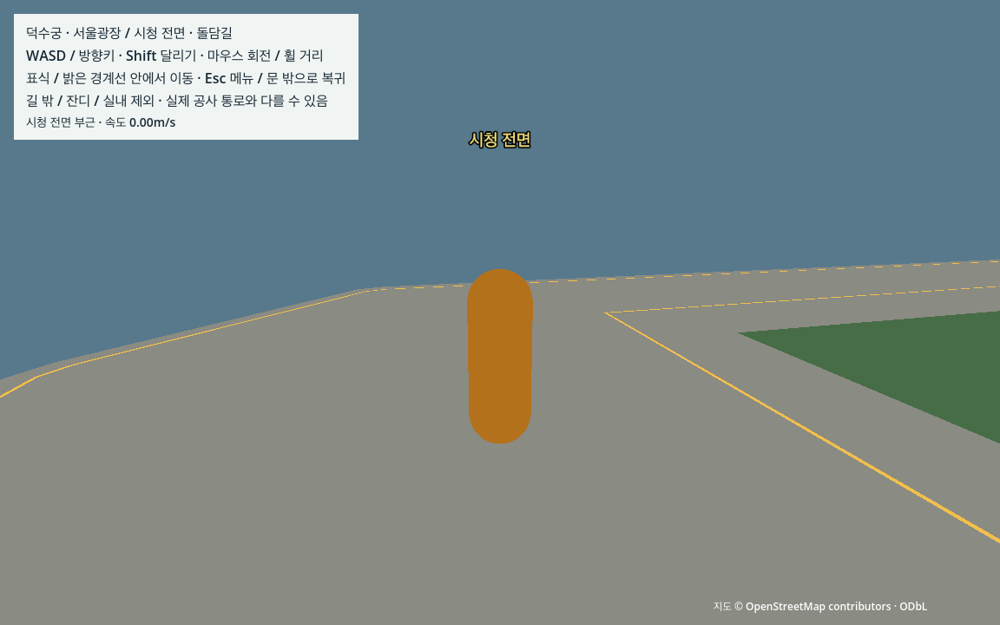
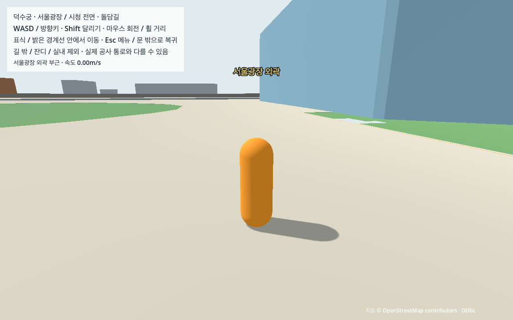
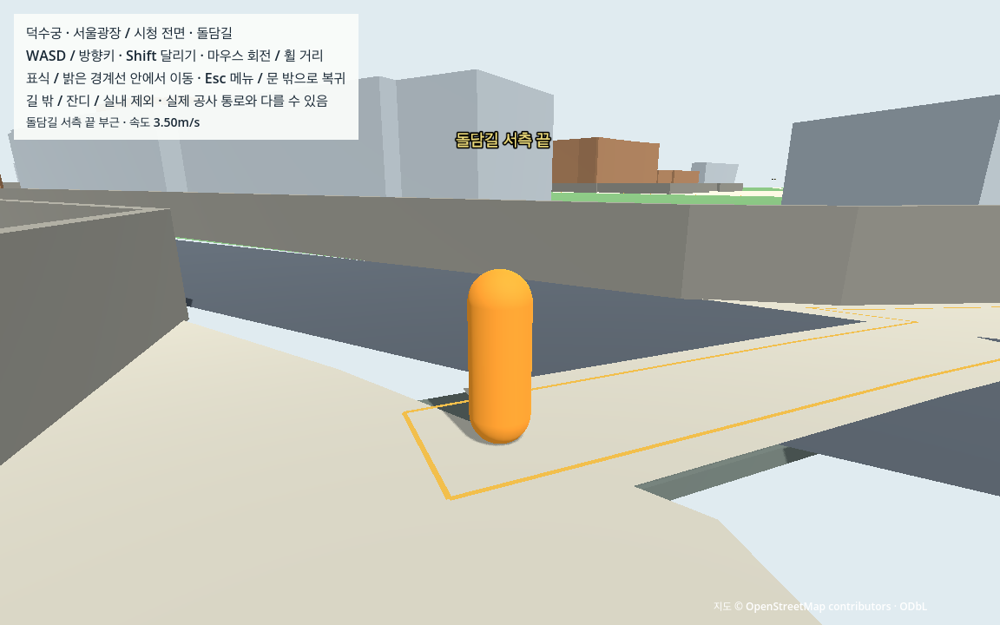

# W03 도심·돌담길 연결과 경계

기준일: 2026-10-14. 기준 커밋은 W02 `e2fdb0ca80fb072b57c83018d1f1bd04a7e7d633`. 자동 입력으로 현재 M1의 임시 평면 보행을 검증한다. 실제 지형·현장 통행·사람 조작·M4·W0/V0 판정과 구분한다.

## 경로와 입력

[수동 결정](../manual/public_walk.json)·[생성기](../../tools/prepare_public_walk.py)·[원문 시작 검토](../../docs/evidence/W03_INPUT_REVIEW.md)를 연결한다. 새 지도 다운로드는 없고 G04/E03/P04/W01/W02를 재사용한다. 원문은 그대로 유지하고 실행 보정 선·면을 별도로 생성한다.

| 연결 | 원천과 구현 |
|---|---|
| 경내→시청 전면→광장 외곽 | 대한문 원문 통과선, w1530764334·외측 보행면 w776588359, 보행 지정/분리 cycleway w1415923127·w1415923126, 북측 marked/zebra w1230789306, w1498257483, 시청 보행면 w768397718·광장 relation6012272 |
| 북측 지상 횡단 | 원문 32.509519m, shared node 5194567167/11414286282가 두 primary 도로와 이어짐. 대한문 정면 직선 횡단을 새로 만들지 않음 |
| 돌담길 | 원문 외측 보행면 w776588359 내부 경로와 서측 footway w1415923123. 도로 접속 공유 노드13012013128 보존 |
| 기존 경내 | W02 entrance/palace_loop/court_approach 좌표와 W01 spawn/방향 유지 |

실행 경로는 시청/광장 **572.948671m**, 돌담길 **413.509709m**다. 원문선 보정은 0.75m 한도이며 2.4m 보행 통로 폭·y=0은 추정이다. cycleway의 foot=designated/segregated=yes를 사용하지만 실제 보행 부분의 폭은 미확인이다. 시청(130,-140)·광장(190,-100)은 원문 열린 보행면 안의 제작 관측점이며 실제 문·건물 중심이 아니다. 시청과 광장 면을 합친 뒤 경계 여유를 적용해 두 면 사이의 가짜 틈을 피했다. 도서관 본체·광장 원문 구멍2개·잔디/물/분수/미구현 계단·사유지는 유지/제외한다.

## 유지·변경 판단

- 대한문 정면을 바로 건너는 연결 대신 공유 노드와marked태그가 있는 북측 횡단을 택했다. 더 짧은 가상 연결을 만들면 실제 배치/출처를 유지하는 목표를 바꾸므로 채택하지 않았다.
- 돌담길의 원문 면을0.2m 보정하면 이동 영역은 이어져도 추가0.08m 경로 여유는 끊겼다. 담장 삭제/이동 대신 제한된0.3m round 보정을 택하고 원문 면·게임 보정면을 분리했다. 독립 실측 폭이 생기면 이 보정을 다시 검토한다.
- 광장/시청 면의 접촉 경계는 합친 뒤 inset했다. 각 면을 먼저 줄이면 source가 연결된 곳에 가짜 틈을 만들 수 있기 때문이다.
- 정지 흔들림은 허용치 확대나 캐릭터 중력 수정으로 넘기지 않았다. floor cap 분할만 바꿔 접촉 안정화를 확인하고 분할 전후 면/벽/높이 동일성을 따로 검증했다. 실제 지형을 도입할 때도 이 임시 평면의 성공을 그대로 승격하지 않는다.
- source좌표의 의미와 화면 표시를 별도 확인했다. 생성기와 검사기가 같은 잘못된 가정을 공유할 수 있어 LineString 원문 노드로 다시 대조했고, 구조상 guide가 존재해도 보이지 않을 수 있어 실제 faces의 방향 및PNG를 확인했다.

## 경계와 물리

[play_boundary.tres](../../game/resources/play_boundary.tres)의 `W03-play-boundary-v1`은 이 장면/자료 스냅샷의 보행 범위다. G04 후보·배경 bbox·현장 통행 권한과 구분한다. 지원면은 0.4m 안쪽을 캐릭터 중심의 이동영역으로 삼고 경로 계산에는 추가0.08m 여유를 둔다. 밝은 금색 선은 시각 안내이며 충돌체가 없다. 경계에서 정지/가능한 축 미끄러짐, 영역 이탈/낙하/수동 복귀와 중립 입력·카메라 방향을 재사용한다.

차도 중심선 밖의 아무 횡단이나 허용하지 않는다. 0.5m 도로 중심선 제외를 세 원문 접속부에서만 해제한다: 북측 marked 횡단, Sejong-daero19gil 공유 노드11414286332, 돌담길 서측 공유 노드13012013128. 마지막 두 곳의 도색/신호는 미확인이다. 0.5m는 실측 차도 경계가 아닌 생성 보행면의 잘못된 연결을 막는 추가 guard다. 차량은 현재 없고, 이후 차량이 점유된 접속부에서 정지해야 한다는 계약만 남겼다.

대한문 남동 모서리의 원문 면은 0.4m+0.08m 여유를 적용하면 끊겼다. x36..58/z20..33 안에서 w776588359의 외측을 최대0.3m round buffer로 국소 보정했으며 추가 면적13.757727m²이다. 실제 담장·건물 위치나 충돌체를 옮기거나 삭제하지 않았다. 실측 보도 확장이 아니다. Boolean 경계의 수치 정리는 1µm 이내, 실제 최대0.431397µm이며 원문 좌표에는 적용하지 않았다.

지원면 footprint18014.395277m²/구멍4개·3,028삼각형, 실제692생성/687활성이다. 기존682본체·담장과 대한문 조각4개를 유지하고 W01/W02 지원면은 비활성화한다. 원래 광역 평면도 비활성 상태다. 정지 접촉을 위해 스폰 안의 2×2m 영역에서 상/하부 삼각분할만 나눴다. 면 범위·y·두께·외측 벽·구멍·이동경계는 바꾸지 않았다.

## 현재 공사 근거

[덕수궁 공식 공사 공지](https://royal.khs.go.kr/ROYAL/contents/R403000000.do?id=20260929103013870594&schBcid=notice01&schM=view)는 2026-09-29 게시, 09-21~11-19 남측 대한문~운교터 담장 및 평성문 지붕 공사, 평성문 통제 예정10-25~11-19를 알린다. 확인 기준일10-14는 공사 기간 안이다. HTML 본문에서는 남측 보행로 전체 폐쇄·가림막 좌표·남은 폭·우회 동선을 확인하지 못했다. 첨부 JPG는 도구 접근 실패로 미열람이므로 이미지 내용까지 판단하지 않는다. 따라서 현실 공사 통로를 임의로 모델링하거나 현재 통행 가능성을 선언하지 않았다. 이 게임의 원문 기반 외측 연결은 현실 이동 안내가 아니다.

## 개발 실패와 수정

[실패 원기록](public/development/pre_idle_fix_engine.json)·[당시 probe](public/development/pre_idle_fix_probe_snapshot.gd)·[당시 생성기](public/development/pre_idle_fix_generator.py)·[요약](public/development/pre_idle_fix_summary.json)을 보존한다.

1. 매우 짧은 Boolean 경계가 메시 생성의 zero-length edge를 일으켰다. 1µm 이내 위상 보존 정리로 해결했다.
2. G02에서 정리된 Polygon ring의 정점 순서를 원문 node_ids와 짝지어 연결 끝점을 잘못 읽었다. 생성기와 초기 독립 검사 양쪽에 같은 가정이 있어 정정했다. 불변 LineString의 공유 노드로 다시 확인한 원문 면 내부 경로는12.970095m/327.523544m다. [잘못된 연결 기록](public/development/wrong_node_projection.json)·[당시 생성기](public/development/wrong_node_generator.py).
3. 광장 구멍 경계 시험의 초기 시작점(190,-100)은4초 안에 경계에 닿지 않았다. 지원면·기준을 바꾸지 않고(175,-85)에서 접근하도록 시험을 수정했다.
4. 첫 full의 정지 높이 범위2.008199mm가 기존1mm 기준을 초과했다. 스폰 근처 좁은 cap 삼각형의 접촉을 점검하고 완전히 안쪽의2m 정사각형을 기준으로 coplanar cap만 재분할했다. 개발 재시험의60초/3,600tick 정지에서 높이 범위0·XZ 이동0이었다. 물리 설정/중력/허용치는 바꾸지 않았다. 수정 전 자료로 통과한 거부/재생성은 superseded 시도로 따로 남기고 최종 자료로 재실행한다.

5. 실제 화면에서 금색 경계 안내선이 보이지 않았다. 기존 삼각형 winding이 아래를 향해 backface culling으로 가려졌다. GPU30과 당시 headless는 이동을 통과했지만 최종 완료로 사용하지 않고, GPU60은 도심 왕복/돌담길 순방향 뒤 직접 중단했다. [당시 소스·결과·부분 로그·화면](public/development/pre_guide_winding_fix/summary.json)을 보존한다. guide의 삼각형 순서만 위를 향하도록 수정하고 실제 ArrayMesh faces/재질/변환을 독립 계산으로 검사한 뒤 전체 고정 시험을 재실행한다. 이동/충돌/자료 범위는 변경하지 않았다. 실제 guide1332삼각형은 높이0.08m/폭0.05m/위쪽 앞면을 검사한다. double원문과Godotfloat32 짧은 선의 방향 계산 차이는 최대0.301843mm로 관측돼 guide비교만0.4mm를 사용한다. 보행/정지/충돌 허용치는 그대로다.

## 실행과 재검증

이미 G/E03/P04/W01/W02가 준비된 Mac에서:

```sh
.venv-data/bin/python tools/prepare_public_walk.py
python3 tools/check_public_bundle.py
sh tools/run_public_walk.sh run
```

새 Mac은 [CROSS_MAC의 순서](../../docs/CROSS_MAC.md)를 따르고 같은 엔진을 설치한다. generated/.godot/venv/앱은 Git으로 공유하지 않는다. WASD/방향키·Shift·마우스/휠·Esc 메뉴/문 밖 복귀를 사용한다. 전체 지도/DSM이나 실행 중 Python/네트워크는 필요 없다.

```sh
python3 tools/check_public_contract.py --output data/cache/public_contract --mode contract
python3 tools/check_public_contract.py --output data/cache/public_gpu --mode gpu
python3 tools/check_public_rejections.py --output data/cache/public_rejections
.venv-data/bin/python tools/check_public_portability.py --output data/cache/public_portability.json
```

독립 사본은 authored39/runtime13/test helper5개만 복사한다. 고정 scorer/probe/driver bytes·입력 SHA를 시작/끝에 대조하고, 실제 오류/timeout/새 JSON 누락은 이전 결과로 덮지 않는다. 정상 일반 실행에는 측정 helper가 없다. 약10Hz 표본의 독립 캡슐/카메라/near-plane 기하 계산과 엔진 매tick 극값/질의를 구분한다. 실제 GPU30은 짧은 접속부/조작·GPU60은 전체 R2/R3 왕복이다. 준비 시점16개·중립 정착·첫 화면 저장은 측정 밖이며 cold startup/도시 성능을 판정하지 않는다.

## 최종 검증

M1 Pro16GB/macOS27·Godot4.7.2/Forward+/Metal·1152×720·물리60Hz, 네트워크 차단 runtime-only 사본에서 수행했다. 모든 매tick 지면 접촉/영역 유지·의도하지 않은 복귀0을 확인했다.

| 실행 | 사례 수 | 물리 tick | 독립 검사 | 결과 |
|---|---:|---:|---:|---|
| headless_engine | 277 | 41,619 | 2,517 | PASS |
| repeat_engine | 277 | 41,619 | 2,517 | PASS |
| gpu_30_engine | 27 | 5,376 | 1,024 | PASS |
| gpu_60_engine | 277 | 41,619 | 2,532 | PASS |

[고정 계약](public/contract_check.json)·[GPU 계약](public/gpu_check.json)·[측정값](public/measurements.json)·[독립 검토](public/independent_review.json)·[최종 인수](w03_verification.json). 정상/반복은 동일 관측 경로/몸체였다. Headless의60초는 가속 물리이며 실제 벽시계60초는 GPU60에서 확인했다. GPU30 준비/관측과 GPU60 준비/관측은 별도로 기록하며 초기 shader/OS/기동 지연의 원인을 단정하지 않는다.

GPU 준비는30fps 9.500초·60fps 9.498초이고, 개별 기본 시험/전체 경로 그룹의 최대 실제시간 오차는 각각0.244100%/0.050127%다. GPU60 목표점 최대오차0.057029m·최대 캡슐 침투2.177564mm·카메라 침투0.005585mm·정지 높이 범위0.000000mm를 기록했다. 이는 게임 접촉/표본 범위의 수치이며 독립 위치 정확도/기기 성능 보장은 아니다.

실제 고장6종은 지원면 비활성·보존 담장 삭제·player mask0·camera mask0·광역 평면 재활성·이동 경계 guard 제거다. 마지막은 시험 사본에서 실제 무제한 controller를 적용해 경계 정지와 사유지 복귀의 행동 실패까지 요구했다. 고장 raw는 예상대로 FAIL이며 driver가 관련 실패 감지를 PASS로 판정한다. [실제 고장 판정](public/contract_check.json). 잘못된자료21종은 기존/교체 body 생성0으로 거부하고 source/proof 불변을 확인했다. [거부](public/rejections/rejection_check.json)·[손상파일 fingerprint](public/rejections/invalid_input_fingerprints.json). 실제 손상된 생성 JSON/Resource 사본84개는 로컬 cache에 보존하며 반복 대형 가공물을 Git에 넣지 않는다. 변형 코드·기준해시·관측로그로 재현한다.

[98개 prepared 입력 사본/2회 생성](public/portability_check.json)은 현재 plan/decision/manifest와 bytes 동일이다. 전국 지도·전체 DSM·초기 cache/venv/환경 설치를 복사하지 않은 W03-only 검사이며 기존 M1 인터프리터를 사용했다. [cap/보정 독립 기하11검사](public/cap_geometry_review.json): 분할 전후 저장된6소수 정밀도의 footprint/외측 벽/높이는 동일하다. 원문 double좌표와 저장된6소수 정점의 차이는 최대0.661561µm로 구분하며 raw double에 정확한0을 요구해 실패한 첫 비교를 보존했다.

실제12ray는 대한문 통로/상부/좌우벽·지원면 밖·시청/광장 지면·광장 구멍/사유지/횡단 밖 차도·보존 담장·도서관 본체를 확인했다. 경계4종은4초 접근에서 멈춤/미끄러짐과 영역 유지다. 사유지는 새 지원면에서약74.70m 떨어져 있어 일반4초 걸음으로 진입하는 시험을 꾸미지 않았고, 실제 강제 배치 후 spawn 거부/복귀를 검사했다. 지역경계 밖·낙하·수동복귀·메뉴정지/카메라/입력중립5이벤트도 대조했다. 모든 경로 그룹은 source 지정접속부 점유·연속 구간 사이 teleport0을 확인했다.

[일반 그래픽 기동](public/native_production.json)은 automatic probe 없이 W03_READY와 정상 종료를 확인한다. 사람의 키/마우스 조작 검수는 아니다.







일반 건물/캐릭터·표식은 임시 외형이며 세밀한 랜드마크는 L 단계다. 이 화면으로 도심/돌담길 연결과 금색 이동영역을 확인할 수 있다.

## 남은 범위와 다음 행동

다음은 **W04**의 R1→대한문→R2/R3 통합 검수/중간 버전 보존이다. 기존 W01/W02 개별 증거와 현재 W03 전체 왕복을 연결한 통합 재현 경로를 만들고 카메라/복귀/경계·장소 시인성을 검사한다. 직접 사용자 조작은 아직 미실행이다. 사용자 위임에 따라 사람 확인을 기다리는 승인 절차로 만들지 않고 미확인 결과를 명시한다. 상세 랜드마크·보행자/차량·실내·실측 지형·M4·도시 성능·W0/V0는 완료 처리하지 않는다.
