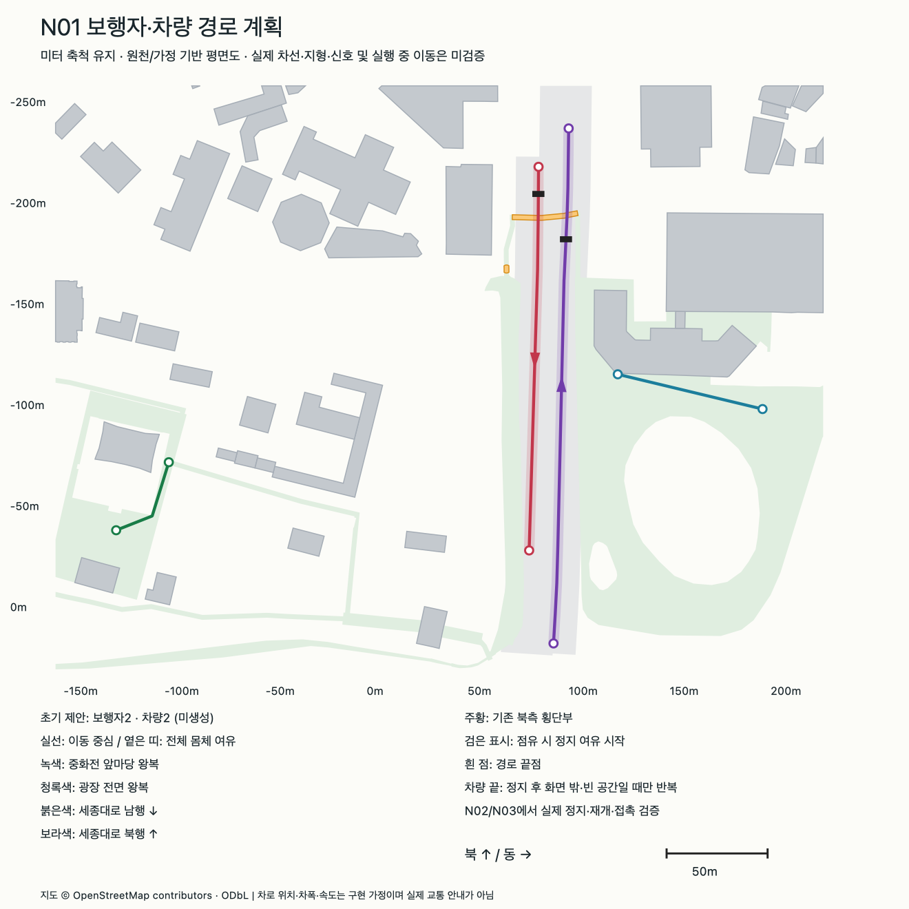

# N01 경로·교차 규칙 검증 결과

2026-10-15 · 기준 `78c92281ac3c1843eff499f20414f1c82013d11a` · 현재 M1/기존 Python3.14·Shapely2.2.0 · 새 다운로드/설치/엔진 실행0

**NPC2개·차량2개 경로 계획과 교차/반복 규칙을 정했다.** 독립 기하108검사, 출력 변조15종 거부, 준비 자료23파일의 별도 폴더2회 재생성/이동 및 입력·출력 거부를 포함한16검사를 통과했다. 이것은 실제 NPC/차량 이동·정지·성능 검증이 아니다. 일반 게임/모델·충돌·기존 경계/지원면을 그대로 보존했다.



[SVG 원본](n01/routes.svg) · [수동 원천](../manual/urban_routes.json) · [경로와 규칙](../../docs/route_rules.md)

## 실제 산출

- 로컬 `data/processed/npc_routes.json`·`vehicle_routes.json`: 공통 미터좌표/입력 SHA/가정·모드별 경로/전체 차체 띠/교차·정지 지점을 기록한다. 가공 파일은 Git 제외, [정상 스냅샷](n01/plans/)과 생성기를 공유한다.
- 보행: 중화전 열린 앞마당47.011114m, 시청/광장 전면73.713895m를 각각 왕복한다. 기존 W03 정점/지원면·경계를 유지하고 건물/잔디/사유지의 새 연결은 없다.
- 차량: 세종대로 남행189.962601m·북행255.073117m의 원문 진행방향 직진 구간이다. 원문의 각8차로/일방통행과 게임 가정인 오른쪽1.6m를 분리한다. 차량 전체를 포함하는2.6m 띠는 서로/NPC 띠와 분리된다. 보행 영역 접촉은 기존 북측 횡단부에만 있다.
- 횡단: 기존3곳 원천을 보존하고 현재1곳에 차량 경로가 닿는다. 사람 우선·정보 불명/오래됨 정지·빈 상태1초·차량1대/FIFO, 계산상 정지 여유7.666667m를 정했다. 실제 신호·법규나 엔진 제동 결과가 아니다.
- 반복: NPC는 실제 선 왕복, 차량은 끝점 정지 후 전체 진입/퇴장 차체가 화면 밖이고 사람과30m 이상·진입 공간이 빌 때만 재진입한다. 역주행·새 물리 복귀 링크는 없다. 보이면 대기하므로 실제 순환은 N03/N04에서 확인한다.

## 검증 증거

| 실행 | 결과 / 범위 |
|---|---|
| `prepare_routes.py`·`--check` | 정상 재생성/오래된 출력 거부; 공통 W03 원천/proof·G04/지도/좌표 해시를 대조 |
| [독립 경로 판정](n01/routes_check.json) | 108검사 PASS. 생성기 import 없이 원천 누적거리 절단·XZ 오른쪽 miter를 재계산하고 전체 연속 띠/방향/길이·원천/태그·사유지/건물/담장·경내·교차 누락·정지 여유를 대조 |
| [출력 변조](n01/rejections.json) | 15/15 거부: 역방향·좌표/NaN/hash·crossing/stop·offset/domain·정책/범위/반복/sweep 등. 정상2 gzip 스냅샷 해제 일치 |
| [다른 폴더 준비](n01/portability.json) | 16검사 PASS, prepared 23파일/16,234,347bytes·2회 동일 출력/폴더 이동·입력 불변. 현재 인터프리터를 사용한 N01-only 재생성 |
| 추가 입력 거부 | 사람 우선 반전·오래된 정보 허용·화면 안 반복 허용·소수 차로번호·원천 변조·오래된 출력6종 거부. 엔진 결함 주입이 아님 |
| [기존 자료 보존](n01/baseline_preservation.json) | 시작 커밋의 기존 game/config/manual/source/tools 바이트 일치. 새N01 파일·문서 추가는 별도 |
| 경로도 | SVG와 macOS Quick Look PNG를 확인. 첫 가로형 thumbnail 범례 잘림을 정방형/하단 범례로 수정하고 첫 화면도 보존 |

정상/변조 판정은 정적 기하·계약 검사다. 전체 선/몸체 띠를 검사했으며 1,001점 후보 표본만으로 경로 안전을 판정하지 않았다. 새로운 Godot 물리·프레임·직접 조작·현장 정확도 검증은0이다. 과거 L04/W04 자동 보행 결과는 기존 게임의 증거로만 유지했다.

## 시도·수정·남은 한계

[후보 검토](n01/development/candidate_review.json)에 XZ 오프셋 부호 정정, 남행 차체의 횡단외12.347679㎡ 침범과 구간 축소를 기록했다. 생성기의 부분 필드 비교가 원천 좌표 메타데이터를 빠뜨린 오류와, 보행용 G04후보를 차량 경계로 잘못 강제한 문제도 고쳤다. 차량은 선택 도로 후보∩배경 범위라는 별도 모드 영역을 쓰며 기존 보행 경계는 그대로다. bbox가 새 통행 권한은 아니다.

독립 검토에서 생성기가 양수인 위험 정책값·소수 차로번호를 허용할 수 있음을 확인해 사람 우선/관측/반복 보호조건과 정수형을 보강했다. 실제 정상 출력과 독립108검사·거부/인수를 최종 소스로 다시 실행했다. [그림 수정](n01/development/diagram_review.json)의 첫 thumbnail도 보존했다.

차로 중심/폭/용도·차도/보행 지형·현장 접근은 미확인이다. G04 양방향 도로 버퍼는 실제 도로 경계/차로 분할 복원이 아니며 원본 permission은 null이다. 특히 차량 실제 지지면/접촉과 브레이크·시야/재진입은 N03에서 관측해야 한다. 사람 조작·OS·M4·도시 성능/V0도 미완료다. 정보 UI·실내/엘리베이터는 추가하지 않았다.

## 재현과 다음 첫 행동

[CROSS_MAC](../../docs/CROSS_MAC.md)의 기존 G/W/L 준비 후 다음만 실행한다. 국가 원본·새 모델·추가 설치·Godot 실행은 N01 재현에 필요 없다.

```sh
.venv-data/bin/python tools/prepare_routes.py
.venv-data/bin/python tools/prepare_routes.py --check
.venv-data/bin/python tools/check_routes.py
.venv-data/bin/python tools/check_route_rejections.py
.venv-data/bin/python tools/check_route_portability.py
.venv-data/bin/python tools/map_routes.py
```

map 도구는 SVG만 생성한다. PNG는 현재 Mac의 Quick Look 렌더를 공유하며 다른 Mac에서 갱신할 때 실제 그림/잘림을 확인한다. 위 prepared-copy 결과를 새 Mac 설치·전체 GIS 재구축·M4 실행으로 설명하지 않는다. 다음은 **N02 단순 보행자 이동**이며 `npc_routes`2곳부터 경량 capsule 이동·왕복/정지·접촉/막힘을 구현해 실제 관측한다. [현재 상태](../../docs/WORK_STATUS.md) · [인수 검증](n01_verification.json).
