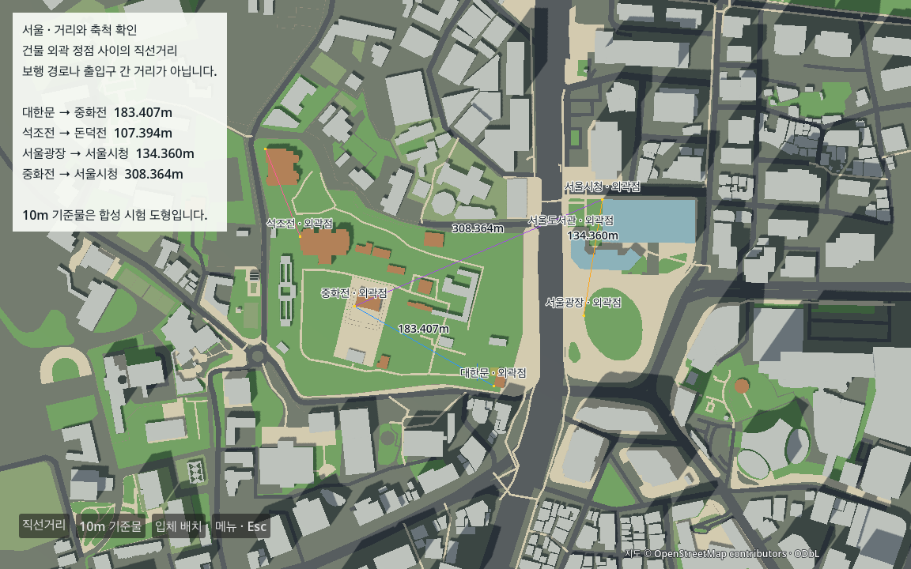
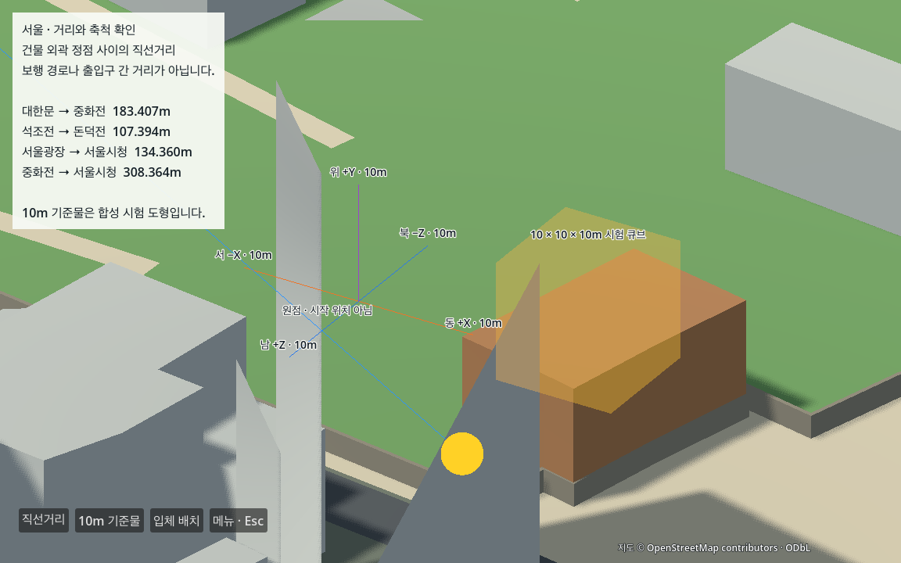
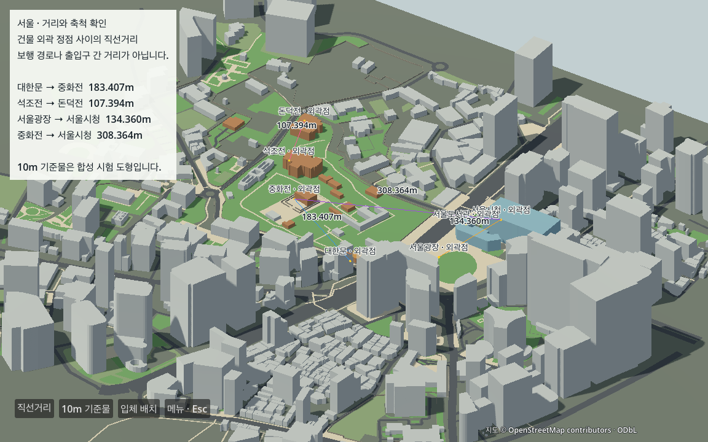

# E04 거리·축척 고정 검증

2026-10-13 · **완료** · Godot 4.7.2 Standard / Forward+ / Metal / M1 Pro · 다음 P01

E03의 서울 메시를 그대로 사용해 대표점 7곳, 직선거리 4쌍, 동·서·남·북·위 10m 기준물과 10×10×10m 시험 큐브를 고정했다. 원점·도시 배치·높이·통행 후보·충돌 상태는 바꾸지 않았다. [인수 요약](../e04_verification.json), [현재 상태](../../../docs/WORK_STATUS.md).

## 거리의 의미와 결과

대표점은 G01에서 저장한 **원본 외곽 링의 사전순 첫 정점**이다. 출입구·건물 중심·캐릭터 시작점이 아니다. 거리도 XZ 평면 직선거리이며 실제 걷는 거리와 다르다. y=0 대표점과 10m 기준물은 합성 검사값이고 현실 표고가 아니다. [G01 원본/기준점](../coordinate_check.json), [좌표 계약](../../../config/region.json).

| 외곽 정점 사이 | 원본 경위도 재투영 거리 | 실제 Godot 메시 XZ 거리 | 차이 |
|---|---:|---:|---:|
| 대한문 → 중화전 | 183.406983013m | 183.406979901m | 0.000003112m |
| 석조전 → 돈덕전 | 107.393624278m | 107.393616025m | 0.000008253m |
| 서울광장 → 서울시청 | 134.359898374m | 134.359900802m | 0.000002428m |
| 중화전 → 서울시청 | 308.364061598m | 308.364057916m | 0.000003682m |

위 실제 거리의 정확한 수치는 [GPU 검사 JSON](gpu_check.json)의 `pair_results`가 기준이다. 허용 오차는 `max(0.05m, 거리×0.001)`이다. 최대 거리 차이 0.0000082531m, 실제 메시 정점의 절대 XZ 오차 0.0000080610m로 통과했다. 이는 원본→엔진 전달 오차이며 현실 위치 정확도가 아니다. 메시 검사는 해당 원본 XZ와 일치하는 실제 imported 정점의 존재를 확인한다. 원본 정점 인덱스와 엔진 배열 인덱스의 대응·현실 높이를 증명하지 않는다.

## 실제 화면과 비례

직선거리 보기의 카메라는 `(-25,900,-100)`에서 `(-25,0,-100)`을 보며 정사영 높이 650m, 논리 화면 1152×720이다. 위쪽은 격자 북(-Z), 오른쪽은 격자 동(+X)이다. 10m의 이론 투영 길이 11.076923px와 실제 `Camera3D.unproject_position` 결과의 차이가 0.0000379252px 이하로 0.05px 기준을 통과했다. 엔진 투영 계산과 실제 PNG를 함께 확인한 것이며, 이미지 픽셀에서 건물 간 거리를 별도로 추출한 검사는 아니다. [Godot Camera3D](https://docs.godotengine.org/en/stable/classes/class_camera3d.html), [측지 거리 계산](https://pyproj4.github.io/pyproj/stable/api/geod.html).







세 시점은 모두 실제 Metal GPU의 1152×720 캡처다. 안내 선·대표점·시험 큐브는 건물에 가려지지 않도록 그린 **검사용 표시**이며 통로나 건물이 아니다. 입체 보기의 일부 가까운 이름표는 겹칠 수 있어 상단 거리표와 직선거리 보기를 함께 사용한다. [메뉴 화면](view_menu.png)은 실제 장면 처리 차단을 자동 호출해 확인했다. 직접 키보드·마우스 사용성 검사는 미실행이다.

## 실행·재검증

새 Mac은 [CROSS_MAC](../../../docs/CROSS_MAC.md)의 공유 지도 준비와 동일 Godot 설치부터 한다. 기존 가공 자료가 준비된 Mac에서는 저장소 루트에서 실행한다.

```sh
python3 tools/prepare_scale_view.py
sh tools/run_scale_view.sh run
sh tools/run_scale_view.sh editor
sh tools/run_scale_view.sh observe
```

`run`은 고정 검증 장면을 연다. 아래 **직선거리 / 10m 기준물 / 입체 배치** 버튼으로 시점을 바꾸고 Esc로 메뉴를 열거나 닫는다. `observe`는 자동으로 세 시점·메뉴 PNG/JSON/로그를 `data/cache/scale/`에 저장하고 종료한다. Godot/Python 위치가 다르면 `GODOT_BIN`, `SIM2SEOUL_PYTHON`을 지정한다. 실제 실행 도구를 저장소 밖에서 네트워크 차단 상태로 실행해 종료 코드 0과 같은 측정값을 확인했다.

```sh
python3 tools/prepare_scale_view.py --check
.venv-data/bin/python tools/check_scale_view.py --input data/cache/scale/<관측폴더>/engine.json --report data/cache/scale_check.json
.venv-data/bin/python tools/check_scale_contract.py
```

첫 검사기는 원본 경위도를 pyproj로 독립 재투영하고 실제 메시·대표점·선·큐브·변환·카메라의 209개 항목을 확인한다. `check_scale_contract.py`는 macOS의 설치된 Godot과 `sandbox-exec`를 사용해 별도 game 사본에서 실제 오류 변형·자료 거부를 재검증한다. 제한된 실행 환경에서 `sandbox_apply: Operation not permitted`가 나오면 호스트 터미널에서 실행한다. 생성물이나 국가 원본을 Git에 추가하지 않는다.

## 검증 증거

- 정상 실제 GPU **209개** 통과: [엔진 측정](gpu_engine.json), [독립 검사](gpu_check.json), [GPU 로그](gpu.log).
- 정상 headless **209개** 통과, 같은 고정 장면의 2회 실제 측정값 일치: [엔진 측정](headless_engine.json), [독립 검사](headless_check.json).
- 계약/회귀 **36개** 통과: [전체 결과](contract_check.json). 실제 World 축척·이동·회전·Z 반전·Y 축척, 대표점 이동, 기준물 축척, 장면 루트 이동, 9m 축 기준물, 5m 높이 큐브의 **10종**을 실행하고 각각 지정 검사에서 실패 판정했다. [실제 변형 측정 파일](regression/world_scaled.json) 등은 이 폴더 `regression/`에 보존했다. 검사 JSON만 바꾼 모의 결과가 아니다.
- 정상 실행 자료 1종 통과, manifest/자료 누락·체크섬·외부 경로·다른 world·대표점 정의/중복·축 반전·시점 누락/0 크기·큐브 크기 **11종**을 실제 E04 reader가 거부했다. G01 기준점·설정·도시 메시·생성 사본 변경 **4종**도 준비 검사에서 거부했다.
- 검증된 G01/E03 입력만 복사해 E04 자료 2회 재생성·현재 사본 일치를 확인했다. 전국 원본·전체 DSM을 쓰지 않았으며 기존 M1 인터프리터를 재사용했다. E03의 지역 원본부터 시작하는 재생성 증거는 [이전 검사](../e03/portability_check.json)다. 이번 검사를 새 의존성 설치나 M4 시험으로 해석하지 않는다.

## 실패·수정·한계

정상 10m 값을 JSON 배열로 읽을 때 정수 리터럴 배열과의 직접 비교가 실패했다. [실패 GPU 로그](gpu-before-json-number-fix.log)를 보존하고 유한 숫자 확인 후 성분별 float 비교로 수정했다. 첫 headless 구현은 물리 렌더 타깃 64×64를 논리 화면으로 보고해 픽셀 기준과 맞지 않았다. `get_visible_rect()`의 논리 크기와 실제 타깃 크기를 각각 기록하도록 수정했다. 자동 검사 도구의 초기 상대 출력 경로가 game 사본을 기준으로 해석돼 저장에 실패한 것도 절대 출력 경로로 고쳤다. [개발 실패 기록](development_failures.json).

독립 Sol 검토는 별도 검사기 구현과 최종 자료/장면 흐름 검토에 한정했다. [검토 범위](independent_review.json). 실제 지리 측량·수직 표고·높이/도로폭 정확도·문 개구부·보행·충돌·3인칭·도시 성능·M4는 미검증이며 W0/V0는 미완료다. 다음 **P01**에서는 이 미터 기준을 유지해 사람 크기 캐릭터와 독립 충돌 시험 지면을 만든다.
