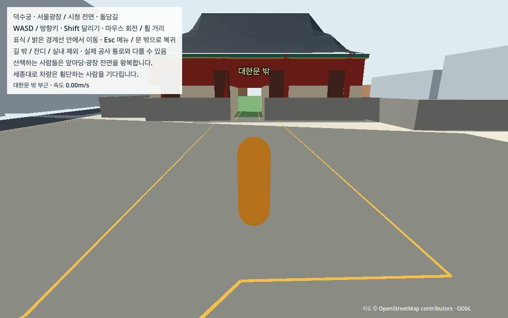
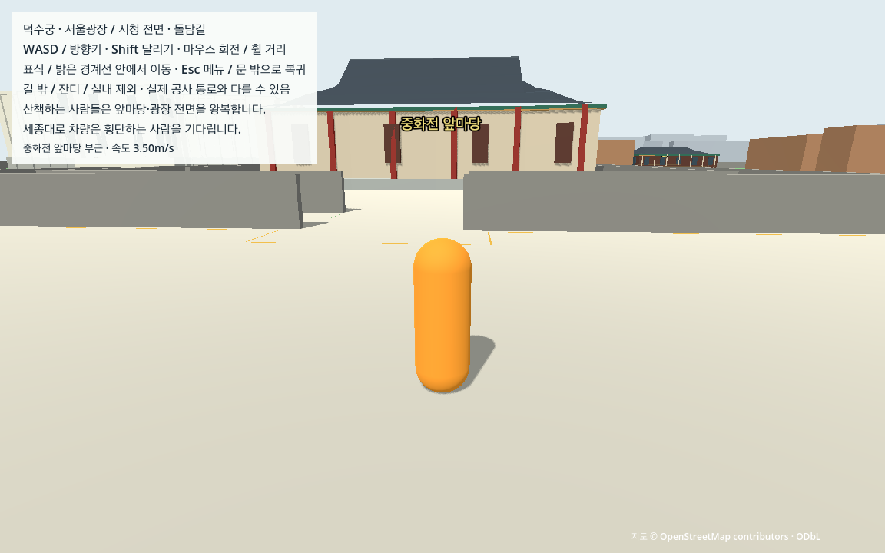

# N04 보행자·차량을 포함한 연속 도시 검수

N03의 같은 보행자2명·차량2대를 켠 채 한 캐릭터로 대한문·경내·마당·시청/광장·돌담길을 연속 검수했다. 워밍업 뒤 관측 구간에서는 캐릭터나 개체를 시험 위치로 옮기거나 끄지 않았다. 최종 headless396개·실제GPU398개 독립 검사와 도시58개/궁궐76개 검사를 통과했다. 완료 여부의 단일 기준은 [WORK_STATUS](../../docs/WORK_STATUS.md)다.

## 실행과 이번 산출물

일반 게임은 기존 `sh tools/run_traffic.sh run`을 그대로 사용한다. N04는 새 생활 기능이나 지도 수정 작업이 아니라, 도시 움직임을 포함한 전체 검수다. N03의 원본/추정·미터 축척·문/보행 경계·차량용 평면/충돌·랜드마크를 유지한다. 준비 자료와 조작은 [N03 실행 안내](vehicles.md), 다른 Mac 준비는 [CROSS_MAC](../../docs/CROSS_MAC.md)를 따른다.

```sh
.venv-data/bin/python tools/check_urban_motion_contract.py --mode contract --output data/cache/n04_recheck
.venv-data/bin/python tools/check_urban_motion_contract.py --mode gpu --output data/cache/n04_gpu_recheck
python3 tools/check_urban_motion_handoff.py
```

Godot4.7.2의 별도 runtime-only 사본에서 네트워크를 차단하고 실행한다. 최종 증거를 덮어쓰지 않도록 재시험은 cache의 새 출력 폴더를 사용한다. 원래 W04 동선/334개 원문 구간과 매 끝점·체크포인트는 유지하며, 실제 사람과 차량을 만나는 데 걸린 대기 시간까지 관측한다.

## 연속 입력과 여섯 번의 실제 만남

- W04의11단계/334구간·3,327.048107m 계획을 같은 순서로 걷고 실제 목표점0.065m 이내 도착을 확인한다. 사람이 막아도 고정 시간만 직진한 결과를 완주로 처리하지 않는다. 실제 입력 방향을 매tick 갱신하며 각 원문 구간을 끝까지 이동한다.
- 보행자가1.8m 앞에 있으면 기존 보행 영역/지원면·실제capsule sweep으로 확인한 최대0.85m 측면 지점으로 비킨다. 통과 후 원래 끝점으로 돌아오며 `yield`/`yield_wait`/`yield_return`을 구분한다. 원문선에서0.18m 이내로 복귀한 뒤에만 일반 이동으로 바꾼다. NPC를 이동시키거나 없애서 길을 만들지 않는다.
- 원문 세종대로 횡단/접근로를 걸으며 차량 앞 사람 점유·정지선 대기·비우기/재개를3회 만든다. 차량이 반복하기에 가까운 원문 끝점에서 기다리는 오류를 피하려고, 서측 원문22→23의80% 지점에서 표면31.445m를 확보한다. 동측은 원문29에서 기다린다. 실제 화면 밖/사람30m/빈진입 조건을 그대로 지키며 다음 차량을 기다린다.
- 별도로 경내 실제 보행자 앞을 잠시 막았다가 기존 길을 따라 비켜 주는 회복을3회 관측한다. 차량 횡단3회를 같은 사례의 재해석으로 복구3회라고 세지 않는다. 대리capsule/차량 상자도 사용하지 않는다.

같은 인스턴스·전역tick·누적거리/끝점 이력을 관측 시작부터 마지막 복귀까지 유지한다. 메뉴·강제 낙하·경계·수동 재시작의 기존 회귀 주입은 연속 구간이 끝난 뒤 별도 단계로 남기며, 이 위치 주입을 연속 보행에 섞지 않는다.

## 검증 기준과 관측 자료

전 물리tick의 개체수/접지·이동량·고도·사람 접촉·정적 침투·카메라/near 충돌·추적 오차/복귀를 요약하고,10Hz 실제 위치·속도·회전·floor·사람/대기열/점유·카메라 평면을 저장한다. 각 구간 끝tick도 반드시 추가한다. 동일 관측의 중복을 줄이기 위해 카메라/물리 원시trace는 `timeline.samples`에 한 번만 보존한다. 구간/그룹 요약과 실제 끝점·지면·관통·입력/양보 이력은 그대로 남긴다.

독립 검사기는 원문335개 정점/334구간과 순서·양보 근거/복귀, 실제 카메라/전체 차체·캡슐·지지 영역·정적 체적/사유지, 실제 교차구역의 차량과FIFO 소유권을 함께 검산한다. 각 보행자의 왕복과 차량의 끝점/정지·재진입은 실제 위치/누적거리와 현재tick guard로 다시 계산한다. controller의 cycle counter만으로 인정하지 않는다.

차량tick당5/60m+1mm·NPC0.0202m·플레이어3.5/60m+5mm, 정적 침투/지면/경로5mm·카메라 추적2mm·near/overlap0·실제 화면 시간2%의 기존 기준을 유지한다. 양보하는 동안만 원문선으로부터 최대1.05m를 허용하며, 실제 기존 보행/지원 영역과 충돌 기준을 완화하지 않는다. [계약](../../docs/TECHNICAL_CONTRACTS.md)·[검증 계획](../../docs/VALIDATION_PLAN.md).

## 개발 중 발견한 점

처음probe의 동적 반환값에 타입을 명시하지 않아 기동하지 못했다. GDScript 타입을 명시하고 원래 오류 로그를 보존한다. 첫headless전체는94,883tick/1,581.383333물리초에서396개 물리 검사를 통과했으나, 측정 중 독립 검사기를 보완해 proofSHA불변 조건이 실패했다. 이 실행은 개발 증거이며 고정된 최종 계약을 대신하지 않는다.

독립 검토에서는 양보 뒤 원문선 밖인데 바로 일반 이동으로 표시하는 문제를 발견했다. 측면 이동과 원문선 복귀를 나눠 실제0.18m 이내 복귀를 확인하도록 수정했다. 원문 횡단 지점에서 차량portal까지30m가 안 되는 문제도 정적 계산으로 먼저 확인하고 기존 접근선 위 대기점으로 해결했다. 차량 반복 조건을 없애지 않았다. 길 비우기tick은 먼 대기점 도착 시각 대신 실제 사람 점유가 처음 해제된 tick과 그때 위치를 기록한다.

최종 코드/검사기를 동결한 headless전체와 실제GPU전체를 다시 실행했다. [최초 실패와 중간 전체](n04/development/README.md)를 보존하며, 최종 증거와 구분한다. 보고서 정리 도중 원시case의 도착 오차 필드를 잘못 읽은 요약 생성은 자료를 쓰기 전에 중단됐고, 실제 `target_error_m`로 수정해 요약을 생성했다. 엔진/판정 자료는 바꾸지 않았다.

## 최종 실제 결과

2026-10-16, M1 Pro 16GB/macOS27.0, Godot4.7.2 Forward+/Metal. GPU 실행은1152×720·렌더60/물리60Hz이며 R01의1920×1080 성능 시험과 구분한다. [수치 요약](n04/summary.json)·[코드/기록 인수](n04_verification.json).

| 항목 | 최종 headless | 최종 실제 GPU |
|---|---:|---:|
| 독립 물리 검사 | 396 / 396 | 398 / 398 |
| 실행/불변/결함 계약 검사 | 16 / 16 | 8 / 8 |
| 도시 / 궁궐 외형 검사 | 58 / 76 | 58 / 76 |
| 연속 물리tick / 물리초 | 94,883 / 1,581.383333 | 동일 |
| 실제 경과 시간 | 176.063759초, 가속 실행 | 1,581.406079초 |
| 보행자 왕복 / 차량 반복 | 19·12 / 31·24 | 동일 |
| 실제 횡단 정지·재개 / 경내 막힘·회복 | 3 / 3 | 동일 |
| 원문 334구간 최대 도착 오차 | 0.059671775m | 동일 |

GPU 전체 시계 차이는0.001439%로2% 안이다. 원문 여정은57,176tick/952.933333물리초·952.945296실제초이며11단계·334구간·21체크포인트 이벤트를 모두 통과했다. 같은 세션에서 네 번의 NPC 양보/원문선 복귀를 관측했고, 여정 뒤 별도3+3회 시험과 대한문 밖 복귀까지 연속 기록했다.10Hz/구간 끝 원시 표본은16,169개다.

두 차량189,766개·두 NPC189,766개·플레이어94,883개 물리tick 전부 접지했다. 플레이어 영역 밖/강제pose/복귀·주행중 사람 접촉·카메라/near 충돌은0이다. 최대 차량step83.336234mm, NPCstep20.007415mm, 플레이어step60.098145mm, 차량Y0.941532mm·NPCY0.942309mm, 플레이어 정적 침투2.177563mm이며 원래 step/5mm 기준 안이다. actual 차체 위치/원문선·지지/사유지·FIFO소유권·동시교차0·끝점 정지/시야/30m/빈진입을 독립 검산했다.

실제 엔진에2m seam teleport를 넣은 진단 실행은 실제step과 연속성 검사에서 거부했다. 별도로 원문 구간 누락·중간 플레이어 표본 이동·횡단 시험 누락·차량 복제·허용된 재배치guard 변조5종도 각각 관련 항목에서 거부했다. 저장 변조는 최종 gzipSHA와 정확한 JSON patch/변경 후 canonicalSHA로 재구성하며 큰 관측 사본을 다섯 번 중복 저장하지 않는다. [최종 계약/결함 판정](n04/contract_check.json).

N03 기준 커밋의 기존 game/config/manual/raw/tools/tests와 `.gitattributes`243파일 바이트를 보존했다. 새 production 기능이나 좌표/충돌/지원면 수정은 없다. 기존 생성 도구를 그대로 사용하므로 별도 N04 생성기/새Mac 재생성 gate를 만들지 않았다. [원본 보존](n04/source_preservation.json)·[headless 원시](n04/contract.json.gz)·[GPU 원시](n04/gpu.json.gz)·[GPU 판정](n04/gpu_motion_check.json).




실제 체크포인트8장과 종료 뒤 메뉴1장을 직접 열어 확인했다. [9장 SHA/시점과 관찰](n04/views.json). 원시 이동과 사진의 역할을 구분한다. 일부 주요 외형이 가려지고 배경은 단순 상자이며, 사진만으로 장소 인지·개체 반복을 통과시키지 않는다. 일반 게임의 도로 접속부 상태문구에는 과거의 ‘현재 차량 없음’이 남아 있다. 차량은 실제 동작하며 이 안내 문구는 R02 UI에서 수정할 항목이다.

## 남은 범위

자동 입력을 사용하는 실제 엔진 검수다. 직접 사람 조작감·OS포커스·M4, 실측 지형/차선·현장 출입·실내/생활AI를 검증한 것은 아니다. 다음 R01의 첫 행동은 실제1920×1080 출력·고정 카메라 경로/조명·A0/0와현재B2/2에서30초 준비 뒤5분2회 및20분 측정을 수행하는 것이다. 성능/메모리·품질 설정·독립 macOS 앱·다른 Mac 판정은 R01–R04에서 이어간다. 개체가 동작한다는 결과를 도시 성능이나 첫 버전 전체 완료로 확대하지 않는다.
