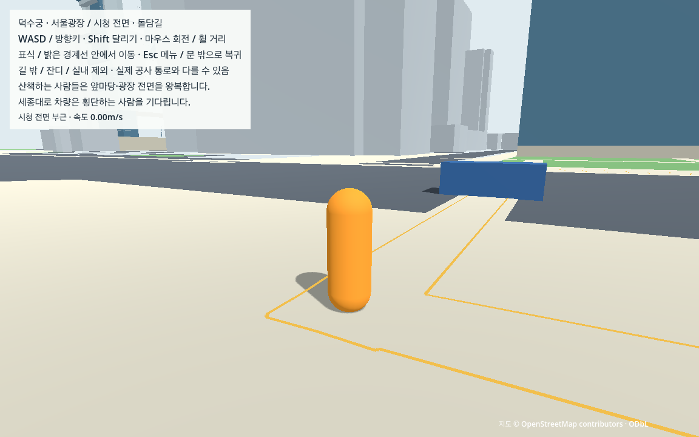
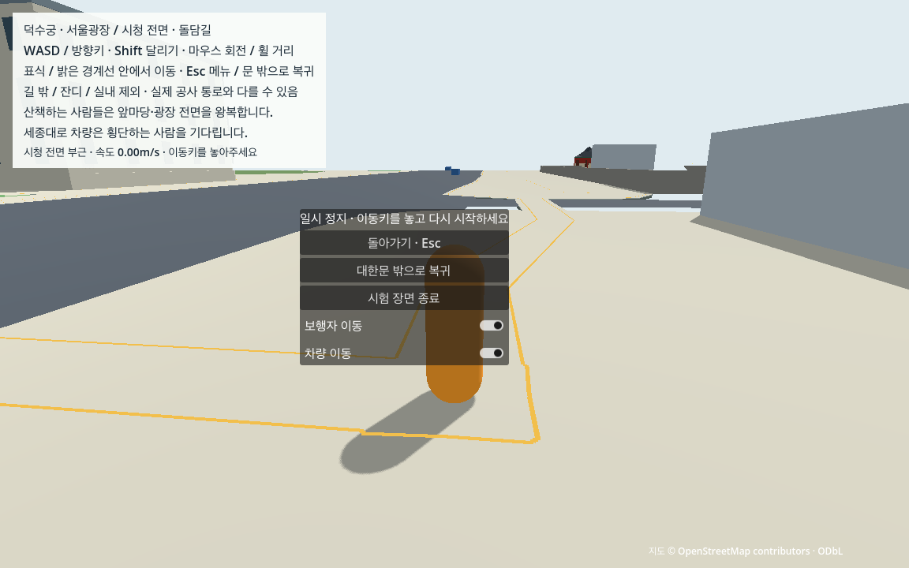

# N03 차량 지지·이동·횡단 대기와 재개

N01 세종대로 남행189.962601m·북행255.073117m의 기존 선에 임시 차량을 한 대씩 추가했다. N02 보행자 두 명과 L03 외형·대한문 통로·W03 보행 경계는 유지한다. 차량은 단순한 도시 움직임이며 실제 신호·교통량 모형이 아니다.

## 실행

L03/N01/N02 자료가 준비된 Mac에서 다음 순서로 연다. 처음 준비하는 Mac은 [CROSS_MAC](../../docs/CROSS_MAC.md)의 선행 준비부터 따른다.

```sh
.venv-data/bin/python tools/prepare_pedestrians.py --check
.venv-data/bin/python tools/prepare_traffic.py
sh tools/run_traffic.sh run
```

대한문 쪽에서 시작해 WASD·Shift·마우스·휠로 탐험한다. 세종대로에 밝은 전면 표시가 있는 파란 상자형 임시 차량이 움직이며, 북측 지정 횡단 구간에 들어가면 기다린다. `Esc`는 장면 전체를 멈추고, 메뉴의 `차량 이동`과 `보행자 이동`은 각각의 이동을 켜거나 끈다. 편집기는 `sh tools/run_traffic.sh editor` 뒤 현재 장면 실행(F6)을 사용한다. 기본 프로젝트 시작 장면과 과거 실행 도구는 보존한다.

## 먼저 확인한 차도 지지

기존 N02 장면에서 두 도로의 5m 간격92지점·중심과 차체 네 모서리460ray를 실제로 검사했다. **455ray에 바닥이 없었고**, 시작/중간/끝6개 차체는1초 후 모두 약−4.902m로 떨어졌다. [기존 지지 관측](n03/support_baseline.json.gz)·[판정](n03/support_baseline_check.json).

N01의 반경2.6m 연속 차체 띠에서 기존 W03 지지 영역을 뺀 부분에만 차량 전용 바닥2개를 생성했다. 로컬 y0/두께0.2m 가정이며 실측 지형이 아니다. 새 layer16/mask8은 차량만 받친다. 차량은 layer8/mask31로 확장하며 플레이어13·보행자15·카메라1과 기존 충돌 원본은 유지한다. 새로운 차량용 바닥을 사람이 걸을 수 있는 권한으로 사용하지 않는다.

별도 실제 시험에서는460ray 전부 지지·6개 낙하 차체의 접촉과 안정 정지를 확인했다. [최종 지지 관측](n03/support_final.json.gz)·[판정](n03/support_final_check.json). 이 시험은 N02 사본에 동일 면을 추가하는 독립 지지 시험이며, N03 실제 loader의 두 지원체/face SHA·마스크/identity는 차량 전체 시험에서 별도로 검사한다.

## 이동·교차·반복 선택

- `CharacterBody3D` 전체 상자4.2×1.8×1.5m, 여유1mm·중력9.8m/s²다. 실제 이동은 `move_and_slide`이며 같은 tick에 정점을 지나면 남은 거리만 다음 원문 선분으로 잇는다. 일반 이동에서 위치를 덮어쓰거나 역주행/U턴하지 않는다.
- 최고5m/s·가속1.5m/s²·제동3m/s², 원문 진행방향과8차로 태그를 유지한다. 폭3.2m/오른쪽1.6m 차로 위치는 N01의 구현 가정이다. 횡단 확장 구역은2m/s로 감속한다. 차체 전체로 반응0.5초·제동·1m 여유를 탐색하고, 지원면 부재나 경로 이탈 시 기다린다.
- 사람은 먼저 갱신하고 차량·카메라 순서로 처리한다. 매 물리tick 실제 플레이어/NPC 위치를 관측하며, 정보 불명 또는0.1초 초과 시 정지한다. 사람이 없어진 상태1초 뒤 대기열 순서로 한 대에게만 진입을 허용한다. 차체 반경을 포함한 확장 출구를 완전히 지난 뒤 점유를 해제한다. 구역 안에 사람이 새로 나타나도 감속·정지하고, 빈 상태 확인 후 이어간다.
- 끝에서 실제 정지한 뒤 **양쪽 끝의 전체 차체가 현재 카메라 시야 밖**, 사람과 표면 여유30m 이상, 진입 상자에 동적 물체 없음, 최신 관측 조건을 모두 만족할 때만 출발점으로 재배치한다. 조건이 맞지 않으면 계속 기다린다. 실제 카메라6평면과8모서리·재배치 전 위치/정지 상태를 저장하고 독립 검산한다. 끝 사이에 물리 도로가 연결됐다는 뜻은 아니다.

기존 정적 원본692생성/687활성의 전체 digest를 보존한다. N03만의 별도 지지체2개를 포함하면694생성/689활성이다. 원본/추정/수동 보정·미터 축척과 도시/궁궐 표시도 유지한다. 외부 자료나 모델은 추가하지 않았다.

## 검증 자료와 재현

최종 headless 독립281개/계약25개·실제 GPU 독립301개/계약9개와 도시58개/궁궐76개를 통과했다. GPU19case·22,608tick/376.8물리초·377.665162실제초이며, 두 차량45,216tick 전부 접지했다. 자유150초에서 남행3/북행2회 끝점 도달·정지/반복을 관측했다. 최대 한 tick 이동0.083336234m·실제 속도5.000347719m/s·명령5m/s·차체 발높이0.000941532m, 구간 시간차 최대0.580007%로 원래 상한 이내다. 경로/영역/침투·플레이어 복귀 검사를 통과했으며 주행 차량의 사람 충돌0, 플레이어 옆면 접촉은37개 저장 표본에서 실제 layer8 접촉으로 관측한 뒤 빠져나왔다. [실제 수치](n03/summary.json).

실제 엔진의 차량mask15 결함1종은 관측 mask·지지/이동 검사에서 거부했다. 저장 관측의 case누락/descriptor복제/표본누락/정지차 위치변조/허용재배치 guard변조5종은 각각 관련 검사에서 거부했다. checksum/복제경로/좌표단위/오래된 실행원천 SHA의 loader4종은 차량0/새지원체0 상태에서 거부했다. 엔진 결함·저장 변조·loader 거부를 같은 시험으로 세지 않는다.

시작 커밋의 game/config/manual/raw/tools/tests225파일 바이트를 모두 보존했다. [원본 대조](n03/source_preservation.json). 자동 probe/격리 InputMap 없는 실제 일반 GPU 장면도 두 보행자/두 차량/새지원체2개 기동·정상 종료를 확인했다. [일반 실행](n03/ordinary_check.json). 직접 키/마우스 조작 시험과는 구분한다.

최종 GPU 캡처에서 차량이 약110m 떨어져 작게 보여, 별도 근접 검토 화면을 추가했다. 실제 차량이 원문 선을 따라25.2m까지 이동한 뒤 두 차량/보행자를 잠시 멈추고 기존 횡단부 서쪽에서 촬영했다. 플레이어가 차를 가리면 카메라를30도 돌리며, 실제 위치/카메라·차체와 PNG SHA는 [검토 관측](n03/views.json)에 남겼다. 세 이미지 모두 열어 임시 상자 차체·지면 접촉/인체 비례·메뉴 가독성을 확인했다. 상세 자동차 외형을 만든 것은 아니다. 동작 판정은 위 궤적을 사용하며 검토 캡처의 정지 상태/명시적 사람 배치는 별개다. 메뉴 캡처는 실제 SceneTree가 멈춘 화면이다.





검증 파일: [headless 계약](n03/contract_check.json), [차량 독립 판정](n03/contract_vehicles_check.json), [GPU 계약](n03/gpu_check.json), [GPU 독립 판정](n03/gpu_vehicles_check.json), [현재 인수](n03_verification.json). 원시 관측은 같은 폴더의 `contract.json.gz`/`gpu.json.gz`, 실패는 [development](n03/development/)에 보존한다.

```sh
.venv-data/bin/python tools/check_vehicles_contract.py --mode contract --output data/cache/n03_recheck
.venv-data/bin/python tools/check_vehicles_contract.py --mode gpu --output data/cache/n03_gpu_recheck
.venv-data/bin/python tools/check_traffic_portability.py --output data/cache/n03_portability.json
.venv-data/bin/python tools/capture_traffic.py --output data/cache/n03_views
python3 tools/check_vehicles_handoff.py
```

전체 시험은 네트워크 차단·캐시 없는 runtime-only 사본의 실제 Godot4.7.2에서 수행한다.19case는 자유 반복·사람 점유/빈상태1초/FIFO·관측 중단/복원·구역 내 사람 출현/이탈·정지 NPC 역할 물체·플레이어 옆면 접촉/탈출·시야/사람 거리/진입 점유별 반복 차단·해제·수동 정지/재개다. 서로 독립인 시나리오 사이에는 장면을 새로 만들며, 사람 시험 위치와 정지 capsule/상자 역할 물체를 명시한다. 같은 시나리오 내 차량 위치/거리/물리tick은 이어져야 한다.

모든 물리tick의 두 대/접지·step·속도·접촉 요약과10Hz 실제 관측을 구분한다. 독립 검사기는 원문 누적거리/차체 회전 상자·지원 영역·기존 장애물/경계·실제 속도 차분·대기열 사건/점유·카메라 평면을 다시 계산한다. 단순 counter나 controller의 성공 문자열만으로 반복을 인정하지 않는다. 실제 화면 시간은2%, 경로/지면/침투5mm, 한 tick 이동은5/60m+1mm 기준을 적용한다.

준비 파일31개/16,336,566bytes의 다른 폴더 복사·두 번 생성·폴더 이동 후 생성물 삭제/재생성을27검사로 확인했다. 두 traffic 파일의 bytes/SHA가 같고 입력은 변하지 않았다. [재생성](n03/portability.json). 기존 Python3.14.7/Shapely2.2.0을 사용했으며 새 Mac 설치·전체 GIS 재생성·M4 검증은 아니다.

## 남은 범위

기존 두 NPC 선은 차도와 분리돼 있다. 정지 NPC 역할 capsule은 실제 보행자 두 명과 차량이 자연스럽게 만나는 증거가 아니다. 실제 플레이어 입력에 의한 측면 접촉/탈출과 함께 범위를 구분한다. N04에서 두 보행자/두 차량을 켠 채 필수 보행 여정·10분 이상·각2주기·교차 정지/재개3회를 함께 관측한다. 이번19case를 새3.3km 연속 보행이나 N04 내구성 완료로 확대하지 않는다.

직접 사람 조작감·OS포커스·M4·실측 지형/차선/현장 출입·도시 성능/패키지·상세 외형 보완·실내/생활AI·V0 완료는 별도다. [현재 상태와 다음 행동](../../docs/WORK_STATUS.md)을 따른다.

## 발견한 실패와 수정

[개발 기록](n03/development/)은 최종 결과와 분리한다. 최초 probe의 변수 타입 추론과 manager의 `owner` 이름이 Godot 기본 속성과 충돌해 기동하지 못했다. 명시 타입과 `zone_owner`로 수정했다. 실제 지원체의 표준 충돌 노드 이름도 관측기와 맞췄다. 차체 상자의 float32 크기를 JSON 소수와 정확히 같다고 비교한 초기 지지 판정은 허용 오차로 정정하고 원래 실패를 보존했다. 실제 바닥 결손 자체는 판정기 문제와 구분한다.

첫 전체 시험의 재배치 차단3항목은 검토 시점이 포털에서 약280m 떨어져 있었는데 카메라 far가200m여서 실패했다. 바라보는 방향만으로 포털이 화면 안에 있다고 가정한 시험 배치 오류였다. 실제 W03 시작 위치에서 북행 진입점이 약37m 앞에 보이게 고친 뒤, 동일 카메라 평면과 전체 차체 판정을 유지해 다시 시험했다. 이전 raw/최초 판정·그 당시 재심을 보존한다. 재심 시 검사기의 case/타이머·headless 캡처 기대가 갱신 중이었던 차이도 구분했다. 중간 검사기 전체 바이트를 복구했다고 주장하지 않는다.

독립 코드 검토에서는 차량 이동을 끈 동안 관측이 중단돼 이전의 빈 시간 누적을 재사용할 수 있음을 발견했다. 차량OFF에도 카메라 단계에서 매tick 사람을 관측하고, 관측 tick 공백이면 누적을 초기화했다. 실제 사람이 횡단 구역에 있는 수동 정지2초와 사람이 떠난 뒤 재개3초를 기존 case에 넣어, 정지 중 최신 관측/빈시간0·재개 첫 관측부터 다시 누적됨을 검사한다.

N01 원문 경로/영역·정지 여유와 물리/공간/시간 기준을 유지했다. 실제 mask 결함은 독립 지면/이동 관측으로 거부하고, 보존 기록 변조나 loader 자료 거부를 같은 엔진 결함으로 합산하지 않는다.
