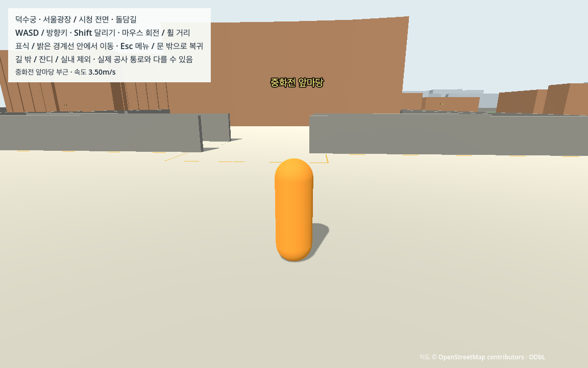
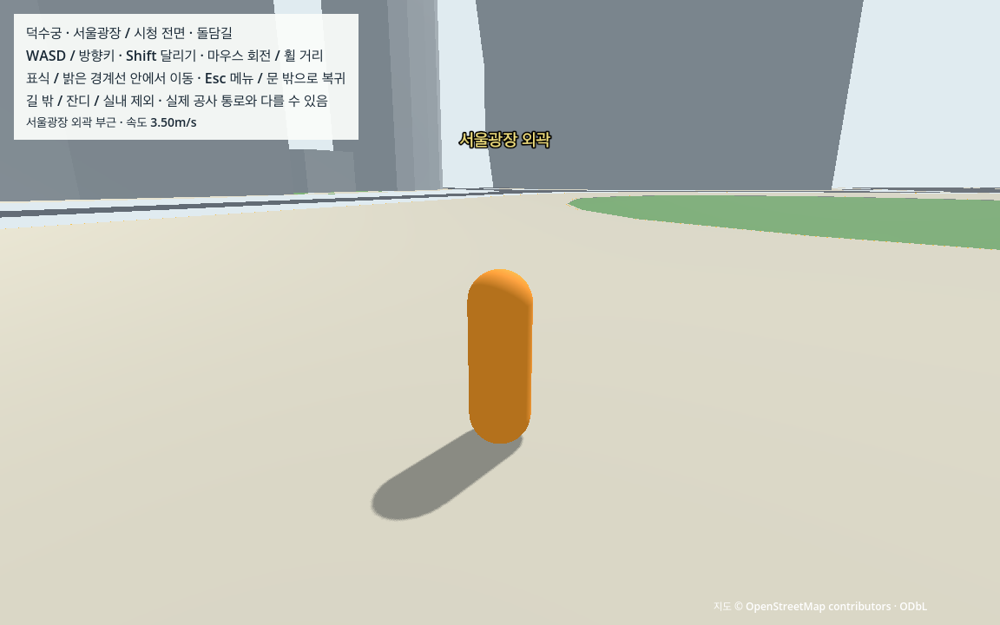

# W04 통합 보행 검증과 W0 엔진 검증판

기준일: 2026-10-15. 시작 커밋은 W03 `b4216b78e1a549e8d7ca5870fe2ed3570c026a86`이다. 기존 게임·지도·좌표·경계·W01/W02/W03 도구는 변경하지 않고, 동일 장면의 연속 통합 여정을 검수한다.

## 이번 판정의 범위

W04는 한 캐릭터가 실제 엔진에서 전체 필수 동선을 연속 이동하고, 물리·지면·충돌·카메라·경계·복귀의 실패가 없는지 확인한다. 입력 명령이나 풍경 화면만으로 통과시키지 않는다. 원래 controller/router의 액션으로 자동 입력하고 매 물리 tick 관측과 독립 기하 계산을 남긴다.

사용자 위임에 따라 직접 조작 피드백을 대기 조건으로 삼지 않는다. 성공 시 식별자는 `W0-engineering-walk-v1`이며 **현재 자료·임시 지면의 자동 통합 검증판**으로 한정한다. 사람의 키/마우스 조작감·OS 포커스·실측 지형/현장 접근·M4 실행은 미검증이다. 이 판정으로 합의한 첫 버전 V0나 상세 랜드마크·NPC·차량을 완료 처리하지 않는다.

## 여정과 선택 이유

[수동 순서](../manual/walkable_milestone.json)·[생성기](../../tools/prepare_walkable_itinerary.py)는 W03의 5개 실행 경로 좌표만 복사한다. 새 연결선·좌표 보정·경로 탐색은 없다. 경계는 `W03-play-boundary-v1` 그대로다.

| 순서 | 이동 | 이유 |
|---|---|---|
| 1 | 대한문 밖→경내 입구 | 실제 개구부와 진입 연결 검수 |
| 2–5 | 경내 순환 중 중화전 측면에서 앞마당 왕복 후 나머지 순환 | 원문 공유 노드에서만 갈라지고 돌아옴. 중화문·기단·계단/실내 제외 유지 |
| 6 | 경내 순환 반대 방향 | 같은 경로의 역방향 검수, 석조전 계단 아래 포함 |
| 7–8 | 경내 입구→북측 원문 횡단→시청 전면→서울광장 외곽 왕복 | 가상 직선 횡단을 만들지 않고 기존 R2 사용 |
| 9–10 | 경내 입구→남측 돌담길 서측 끝 왕복 | 기존 R3와 담장 모서리 연결 검수 |
| 11 | 경내 입구→대한문 밖 | 원래 시작점으로 실제 걸어서 복귀 |

총 **3,327.048107m**, 11단계·335점·334이동 구간, 체크포인트8개/계획 도착 이벤트21개다. 중화전 앞마당 분기는 경내 순환의 실제 원문 공유 노드921242850/runtime index5에서만 연결한다. 각 기존 구간을 양방향 한 번씩 포함하고 모든 이음점은 원문 좌표가 정확히 일치해야 한다. 거리 합계는 경로의 반복 왕복 길이이며 조사 구역 크기나 직선거리가 아니다.

## 연속성·관측·독립 판정

[실제 관측 도구](../../tests/game/check_walkable_milestone.gd)·[고정 실행기](../../tools/check_walkable_contract.py)·[독립 검사기](../../tools/check_walkable_evidence.py)를 분리한다. 계측 사본만 기존 W03 helper를 상속하며 일반 실행은 자동으로 움직이지 않는다.

- 준비16시점·정착 후 시작한다. 준비 중의 배치는 여정 밖이며, 여정 중 pose 호출·복귀는0이어야 한다.
- 한 actor/session의 전역 물리 tick을 끝까지 관측한다. 매 tick 이동 거리는3.5/60+0.005m 이하여야 하고 tick 간격은1이어야 한다. 단계 경계·첫/끝·도착점을 별도로 대조해 건너뛰기·누락을 잡는다.
- 체크포인트 화면을 저장하는 동안에도 전역 관측은 계속한다. 이동 구간 tick과 화면 대기 tick을 따로 세며 총 tick/시간에서 숨기지 않는다. 단계와 전체 여정의 실제 시간/물리 시간2%·렌더 빈도20% 기준을 유지한다. 아주 짧은 개별 꺾임은 전체 단계 시간으로 평가한다.
- 기존5mm 캡슐/카메라 침투·지면/영역·near-plane/추적 기준을 유지한다. 약10Hz 보존 표본의 독립 계산과 엔진 매 tick 극값은 서로 다른 증거다. 전역 표본에는 각 이동 끝점도 포함한다.
- 실제 body/mesh SHA·레이어/마스크·BoundaryResource와 안내선 mesh를 검사한다. unchanged W03의 원천/지면/cap/출처 검증은 고정 해시로 재사용하고 현재 actor·물리·카메라 관측은 새로 판정한다.
- 북측 표시 횡단과 두 원문 도로 접속부의 점유, 대한문 양방향 실제 통과, 체크포인트8개의 순서와 도착 오차를 확인한다.
- 여정 종료 후에만 메뉴·낙하·영역 이탈·수동 복귀·사유지 복귀5이벤트와12ray를 시험한다. 강제 배치/복귀를 여정 완주로 섞지 않는다.

## 실행과 다시 만들기

이미 W03까지 준비된 Mac에서:

```sh
python3 tools/prepare_walkable_itinerary.py
sh tools/run_walkable_milestone.sh run
```

처음 쓰는 Mac은 [CROSS_MAC](../../docs/CROSS_MAC.md)의 기존 G/E/P/W 준비 순서를 먼저 따른다. 준비된 좌표/메시/생성물은 Git 제외 상태이며 같은 작은 지역 원본과 기록에서 재생성한다. [직접 확인 체크리스트](../../docs/WALKABLE_CHECKLIST.md)는 자동 기록과 구분한다.

```sh
python3 tools/check_walkable_contract.py --mode contract --output data/cache/walkable_contract
python3 tools/check_walkable_contract.py --mode gpu --output data/cache/walkable_gpu
python3 tools/check_walkable_portability.py --report data/cache/walkable_portability.json
```

기존 게임 authored39개/runtime13개에 W04 itinerary/manifest2개만 더한 실행 사본이다. 계측 helper6개를 사용하고 .godot 초기 cache·원본 지도·가상환경 없이 engine을 네트워크 차단 상태로 실행한다. source·runtime·입력·검사기/관측 도구 해시는 시작/끝에 대조한다. 새 JSON이 없거나 실제 engine 오류/timeout이면 이전 결과를 재사용하지 않는다.

## 최종 결과

정상/반복/최종 그래픽을 같은 source·runtime·input·관측/판정 SHA로 검수했다. [고정 계약](walkable_milestone/contract_check.json)·[그래픽 계약](walkable_milestone/gpu_check.json)·[최종 인수](w04_verification.json)·[스냅샷](walkable_milestone/snapshot.json).

| 시험 | 실제 관측 | 독립 판정 |
|---|---|---|
| 정상/반복 headless | 각334구간·11단계·57,116tick /951.933333물리초, 같은 경로·body | 각각3,508개 PASS·계약19개 PASS |
| GPU60 예비 | 8구간·2단계·3,676tick·5PNG, 전체 완료 증거 아님 | 874개 PASS |
| GPU60 전체 | 334구간·11단계·57,116tick /951.933333물리초 /951.933643실제초·56,594frames·10PNG | 3,520개 PASS·그래픽 계약7개 PASS |
| 실제 엔진 고장4종 | 이음점2m 이동·앞마당 왕복 생략·player/camera mask0 | 지정 관련 검사에서 모두 거부 |
| 작은 사본 재생성 | prepared65파일21,344,919bytes, 표준Python/site·환경 차단 후2회 | itinerary/manifest 동일·입력 불변 |

전체 GPU 여정의 이동 tick은57,116, 화면 대기 tick은0이며 전역 관측에서 모두 센다. 여정 중 pose/복귀/영역 이탈0·매 tick 지지면 접촉, 도착 오차 최대0.058265m다. 매 tick 이동량 최대0.059406161m /상한0.063333333m, 캡슐/카메라 침투 최대2.177564/0.000697mm로 기존5mm 기준 안이다. 전체 실제/물리 시간 차이0.000033%, 단계별 최대0.453689%로 기존2% 기준을 통과했다. sphere overlap/near-ray hit/추적 tick 불일치0이다. 강제복귀·메뉴5이벤트와12ray는 여정 뒤 별도 phase다.

GPU는16시점/정착 후의 현재 M1·Forward+/Metal·1152×720·물리60Hz/렌더60 상한 결과다. W04의 새 전체30fps 시험은 없으며, 소스가 같은 W03의30fps 개별 경로 증거를 범위를 구분해 재사용한다. cold startup/도시 성능 목표 달성·직접 사람 조작·M4 판정이 아니다.

### 실패·수정과 증거 보존

첫 전체 GPU에서 체크포인트 이름이 `checkpoint_0.0`으로 저장됨을 발견해 중단했다. Godot JSON 숫자의 `str()` 형식을 정수로 명시해 수정했으며 물리 기준/경로는 바꾸지 않았다. 당시 headless/고장 결과·중단 로그/화면·수정 전 probe/driver는 [capture_name_fix](walkable_milestone/development/capture_name_fix/summary.json)에 보존하고 예비 GPU 확인을 추가했다.

다른 폴더에서 과거 W03 input 해시의 절대 경로가 원래 체크아웃을 읽는 문제도 수정했다. 저장 당시 root를 제외한 상대 경로를 현재 root로 재배치하며 원래 폴더 fallback은 없다. 원래 경로 접근을 막은 사본 감사의116회 읽기에서 차단 대상 접근0·기존874개와 동일 판정을 확인했다. [재배치 검증](walkable_milestone/relocation_check.json)·[수정 전 정확한 검사기/관측](walkable_milestone/development/legacy_path_rebase/summary.json)을 보존했다. 이후 모든 최종 엔진 시험을 새 고정 SHA로 재실행했다.

최종 [독립 재검토](walkable_milestone/independent_review.json)는 새 엔진 관측·고장/저장 표본·화면/해시를 대조한다. 저장 JSON을 변형한 검사와 실제 엔진 고장을 구분한다. [인수 도구](walkable_milestone/handoff_check.py)는 이전 W03 game/tests/tools/config/manual/raw 파일 보존·현 SHA·실패 기록·문서 링크/상태와 검증판 식별을 확인한다. `snapshot.json`은 source/runtime/input/proof/doc/evidence의 결정적 식별이며 생성물을 Git에 추가한 것이 아니다.






## 한계와 다음 단계

W03의 임시y0·보행 폭/모서리 보정·공사 접근 미확인을 그대로 이어받는다. [W03 출처·공사·수정 이력](public_walk.md)을 현실 지형/통행으로 승격하지 않는다. 건물/캐릭터와 표식은 임시 외형이다. 실제 사람 조작감과 M4 검증은 미실행이며 cold startup/도시 성능 시험도 아니다. 다음 L01은 대한문·주요 전각·석조전·시청의 특징과 무료로 쓸 수 있는 참조 범위를 정하는 작업이다.
