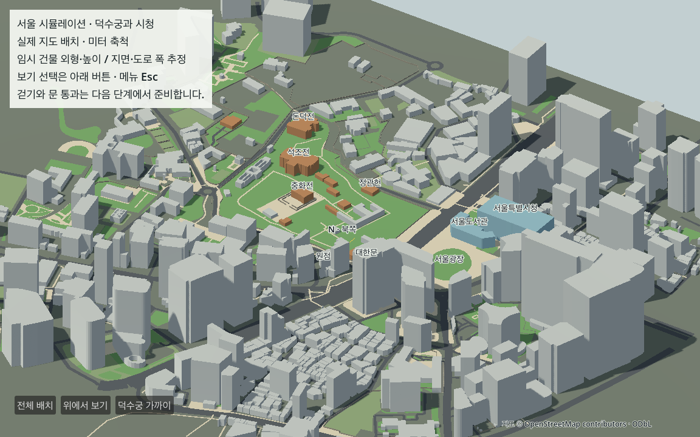
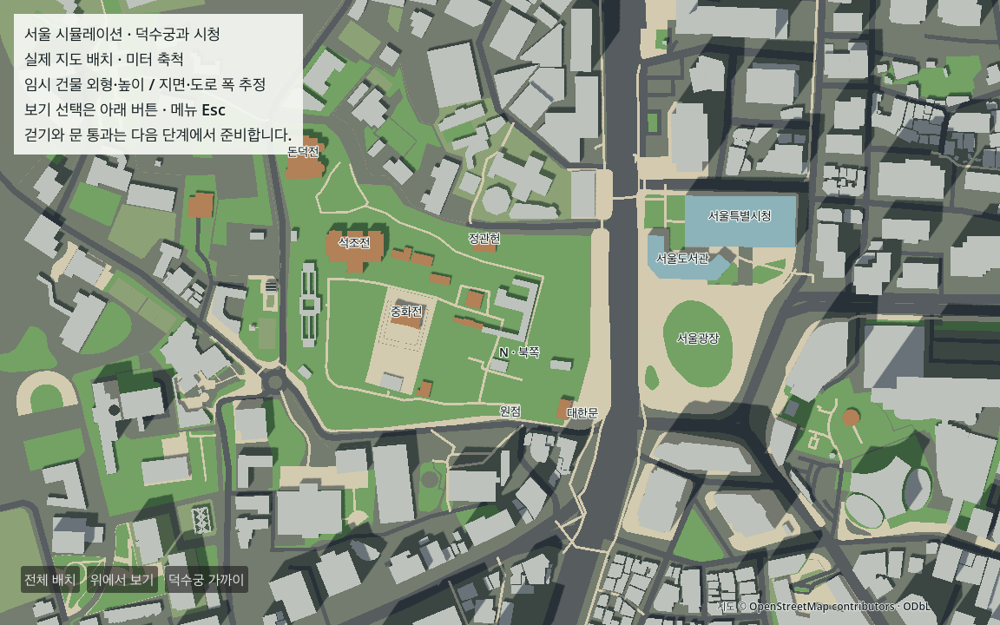
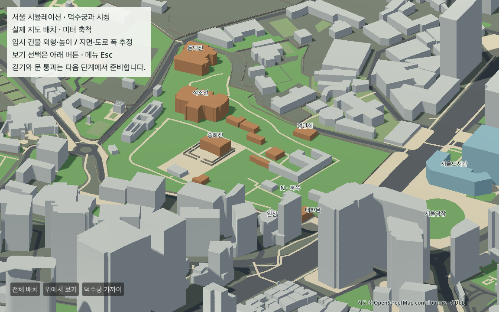

# E03 서울 바닥·길·건물 표시

2026-10-13 · E03 완료 · 다음 E04 고정 축척 검증 장면

실제 G02 미터 도형과 G03 높이·지면, G04 검토용 면을 정식 Godot 장면에 연결했다. 현재 M1 Pro에서 실제 Metal/Forward+ GPU로 전체·수직·경내 시점을 확인했다. 사용자는 첫 전체 배치 화면을 보고 **“이대로 ㄱ”**라고 답했으며 현재 배치를 유지한다. 이는 장소의 배치 인상에 관한 피드백이며 측량·보행·조작감 승인과 구분한다.







## 생성 결과와 원천

| 표시 역할 | 도형 수 | 의미 |
|---|---:|---|
| 건물 | 635 | G03 `emit_coarse_body` 본체만 표시. 실제 독립 건물 개수 아님 |
| 길·도로 | 370 | 보행 후보 면 190·차량 후보 면 180. 권한·실제 폭 미검증 |
| 지면 | 179 | G03 임시 지지 평면 1·토지 참조 면 178. 통행 허가 없음 |
| 담장 | 49 | 선 47·독립 면 2. 참조 면/지면 보류는 동시 생성하지 않음 |
| 합계 | 1,233 | 삼각형 27,054·정점 81,162. 충돌체 없음 |

건물 높이 분류: 원문 높이 98·층수 추정 53·석조전 부분 상단 도출 1·전각 임시값 4·용도 기본값 479. 실제 높이의 독립 검증을 뜻하지 않는다. 정관헌 작은 이름 윤곽과 상동교회 본체만 표시하며 큰 윤곽/탑·부분 건물 83·지붕 참조 72는 별도 전체 부피로 세우지 않는다. 지면이 미정인 132개는 y=0으로 대체하지 않고 보류한다.

입력은 현재 작은 지역 지도 v2와 공유 G01–G04 증거에서 재생성한 `features.json`, `heights.json`, `terrain.json`, `walkable_areas.json`, `driveable_areas.json`이다. 전국 원본이나 국내 미수신 자료를 다시 받지 않았다. Overture 22개 후보를 새 본체로 병합하거나 DSM을 실제 지면으로 사용하지 않았다.

## 구현과 재생성

[표시 설정](../../config/world_display.json)에서 색·고정 시점·담장 두께 0.35m와 시각 층을 관리한다. 두께, 땅 색 분류, 15–21mm 토지/35mm 차량/55mm 보행 표시 오프셋은 명시된 표현 가정이다. 실제 턱·도로폭·지형 높이가 아니다.

[생성기](../../tools/prepare_world.py)는 구멍을 포함한 제약 삼각분할 후 원본 면적/coverage를 대조하고 지붕·하단·외벽·중정 벽을 만든다. Godot 앞면은 시계 방향이며 명시 법선과 `-cross`를 대조한다. 양면 재질로 뒤집힌 면을 숨기지 않았다. [Shapely 공식 삼각분할](https://shapely.readthedocs.io/en/stable/reference/shapely.constrained_delaunay_triangles.html)·[Godot ArrayMesh](https://docs.godotengine.org/en/stable/classes/class_arraymesh.html).

생성 자산은 Git 제외 `game/resources/world_geometry/world.json` 약 5.04MB다. 원천·정책·수동 결정·공식 근거·생성기 해시 28개를 기록한다. [준비기](../../tools/prepare_game_data.py)는 필수 목록과 현재 파일 해시를 확인해 manifest v2/`E03_display_only`를 만든다. 소스가 바뀌면 G 단계부터 검증하고 다시 생성해야 한다. [도시 장면](../../game/scenes/world/base_world.tscn)·[로더](../../game/scripts/base_world.gd)는 `game/` 안의 자료만 읽고 단위 변환 없이 ArrayMesh에 전달한다. 원점/조사 bbox를 스폰/플레이 경계로 삼지 않는다.

```sh
.venv-data/bin/python tools/prepare_world.py
python3 tools/prepare_game_data.py
sh tools/run_game.sh run
```

처음 쓰는 Mac은 먼저 [CROSS_MAC](../../docs/CROSS_MAC.md)의 `setup_mac.sh`를 실행한다. 이미 준비한 이 Mac에서는 전체 데이터 준비를 반복할 필요 없다. 실행 준비에는 가공 환경이 필요하고, 준비된 `game/` 사본의 Godot 실행은 Python·원본·네트워크 없이 동작한다. 자동 메시·UID·캐시·빌드 대신 생성기/지역 원본/설정/증거를 공유한다.

## 검증 결과

| 검증 | 결과 | 증거 |
|---|---|---|
| 원본 ↔ 삼각형 | 1,233개 caps/bottoms/측면·구멍·분리면·높이/추정/보류 대조 통과 | [geometry_check](e03/geometry_check.json) |
| 손상 도형 | missing cap·뒤집힘·구멍 채움·좌표 변경·부분 중복·미정 지면 6건 각각 거부 | 같은 보고서 |
| 자동 입력·메뉴 | 실제 엔진 이벤트 27개 통과. 직접 키 조작과 구분 | [project_check](e03/project_check.json) |
| 잘못된 자료 | 기존 계약+도시 자료·출처 누락/변경 27건 거부. 저장 실패 종료 코드 1 확인 | 같은 보고서 |
| 엔진 좌표·면 | 12개 headless, 실제 GPU 12개+화면 저장 4개 통과 | [GPU 결과](e03/view.json)·[로그](e03/gpu_world.log) |
| 오프라인 정상 실행 | config/raw/processed/Python 없는 game 사본, 네트워크 차단 GPU 기동·관측 저장·정상 종료 | [실행](e03/offline_runtime.json)·[로그](e03/offline_runtime.log) |
| 재생성·인수 | 작은 공유 파일 사본에서 G01–G04→E03 11개 준비/검사, 두 생성 일치·본 사본 도형/결정 일치·수동 입력 불변 | [portability_check](e03/portability_check.json) |
| 표시 겹침 | 본체↔본체 0·도로↔장애물 210·도로↔도로 655. 서로 다른 토지 재질 겹침 15곳은 시각 층으로 분리 | [overlap_check](e03/overlap_check.json) |

원본 대비 cap 면적 차이 최대 0.002778715㎡·형상 거리 6.9762e-7m, 엔진 정점 성분 전달 오차 최대 0.000121969m다. 이는 생성/전달의 수치 검사이며 현실 위치·높이 정확도가 아니다. G01 대표점 7개와 정관헌의 G02 원본 정점을 대조했다. 대표점 간 거리와 10m 기준물의 고정 재검증은 E04에서 한다.

토지 재질의 다른 색이 같은 높이에 놓인 경우를 분리했다. 같은 재질의 동일 평면 교차와 도로/건물·담장 교차는 원천을 절단하지 않고 목록으로 남겼다. G04 보행/차량 장애물 후보 77/133건과 E03 실제 표시 면의 교차는 각각 기록한다. 길이 보인다고 실제 통과 가능한 것은 아니다.

## 실패·수정과 남은 일

최초 GPU 시험 스크립트의 bool 타입 추론 오류를 명시 타입으로 수정했다. 출처 검사 확장 뒤 기존 독립 검사기가 추가 해시를 오류로 판단해 필수 집합 포함+중복 검사를 적용하고 실패 시 종료 코드 1로 바꿨다. 최초 어두운 면/안내·원점/대한문 레이블 겹침을 조명·안내 배경·글자 위치로 정리했다. 독립 검토에서 찾은 필수 출처 목록 누락과 관측 저장 실패의 성공 종료 덮어쓰기를 수정하고 회귀 검사를 추가했다. 이전 실패/화면·수정 전 통과 결과는 `e03/*before*.json|log|png`로 보존했다.

직접 키보드·마우스 조작, 실제 대한문 개구부/충돌/계단/지형·보행 완주·3인칭 카메라는 이번에 검증하지 않았다. 전각·시청은 외곽 부피의 임시 형태이며 장소 특징 제작은 L 단계다. GPU 관측 12초와 1,233개 표시 성공을 도시 성능이나 M4 성공으로 확대하지 않는다. W0와 V0는 미완료다.

다음 첫 행동은 E04: 이 배치와 원점/축을 유지하며 대한문·중화전·서울광장·시청 및 10m 기준물을 `scale_view.tscn`에 놓고 대표 거리와 동일 시점 재검증을 저장한다.
