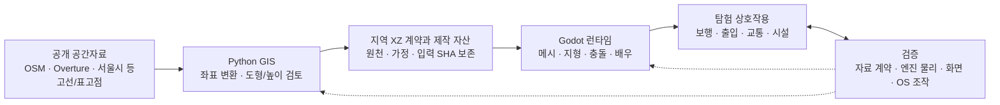

# 기술 구조와 문제 해결

Sim2Seoul은 공개 공간자료를 Python GIS 파이프라인에서 정리하고, Godot의 실제 지형·충돌·이동과 연결하는 로컬 3D 탐험 프로젝트입니다. 지도에서 가져온 건물·도로의 위치와 미터 축척은 유지하면서, 원천 자료·추정 높이·게임용 실내와 시설을 구분합니다. 기술적으로는 공간자료를 화면에 표시하는 데서 그치지 않고, 같은 장소에서 보행·건물 출입·승하차가 일관되게 작동하도록 입력 상태, 물리 갱신 순서, 지형 표현을 맞추는 데 집중했습니다.

작성 기준은 2026-10-21입니다. 아래 결과는 날짜별로 보존한 실행 기록이며, 이 문서를 작성하면서 새로 실행한 검사 결과는 아닙니다. 최신 기능 상태는 [WORK_STATUS](WORK_STATUS.md), 구현 범위와 선택 이유는 [PROJECT_CONTEXT](PROJECT_CONTEXT.md)를 따릅니다.

## 아키텍처

- **자료 준비:** `osmium`으로 OSM을 읽고, `pyproj`로 EPSG:4326에서 EPSG:32652를 거쳐 지역 좌표로 변환합니다. Shapely로 도형·구멍·중첩을 처리하며, 1단위=1m와 X=동쪽·Y=위·Z=남쪽을 고정합니다. [좌표 계약](../tools/coordinate_system.py) · [도형 전처리](../tools/prepare_features.py)
- **런타임 구성:** 생성한 도시 자료를 메시와 정적 충돌체로 읽고, 최신 탐험 장면에서 지형과 건물 기초 높이를 연결합니다. 원본 지도 파일을 실행 중에 덮어쓰지 않습니다. [메시 구성](../game/scripts/base_world.gd) · [충돌 구성](../game/scripts/collision_world.gd) · [지형 연결](../game/scripts/terrain_scene_binding.gd)
- **실제 진입점:** [run_exploration.sh](../tools/run_exploration.sh)는 입력 확인·로컬 지형 준비·리소스 import 후 [explore_walk.tscn](../game/scenes/world/explore_walk.tscn)을 엽니다. 기능 조립은 [explore_walk.gd](../game/scripts/explore_walk.gd)가 맡습니다. 프로젝트 기본 `main.tscn`은 초기 지도 표시 장면으로 보존되어 있습니다.
- **폴더 역할:** `config/`는 좌표와 정책, `data/raw·processed·manual/`은 원천·가공·검토 기록, `game/resources·assets/authored/`는 공간 계약과 제작 자산입니다. `game/data/generated/`에는 로컬 생성 입력을 두고, `tests/game/`과 `data/reports/`에는 엔진 검사와 원시 결과를 분리해 보관합니다.

## 사례 1. 짧은 E 입력과 메뉴에서 누른 키를 구분하기

**문제** — 가까운 자전거에서 E를 눌러도 간헐적으로 반응하지 않았습니다. 반대로 메뉴에서 E를 누른 채 돌아오면 새로 누르지 않았는데도 상호작용이 발생할 수 있었습니다.

**원인** — 물리 갱신 때의 눌림 상태만 읽으면 두 갱신 사이에 끝난 짧은 press/release를 놓칩니다. 메뉴도 물리 갱신 사이에 열렸다 닫힐 수 있으므로, 다음 물리 틱에서만 메뉴 입력을 차단하는 방식으로는 충분하지 않았습니다. 기존 액션의 키 장치 바인딩과 이전 틱의 접지 상태도 함께 점검해야 했습니다.

**설계 판단** — [interior_visit.gd](../game/scripts/interior_visit.gd)의 `_input()`에서 press/release를 관찰하고, 유효한 새 입력만 pending edge로 보존했습니다. 메뉴에서 시작한 입력은 즉시 해제 필요 상태로 기록하고, 해제한 뒤의 새 탭만 허용합니다. 거절된 입력을 나중에 대상 가까이 갔을 때 실행하도록 보관하지는 않습니다.

거리 상호작용은 [explore_walk.gd](../game/scripts/explore_walk.gd)의 단일 dispatcher로 모았습니다. 탑승 중인 운송수단이 E를 먼저 소유하고, 보행 중에는 안내와 동작이 같은 가까운 대상을 선택합니다. 현재 발밑 지지·수직 속도·경사를 확인하며, 시선을 잠깐 가리는 등록 보행자와 실제 탑승 공간 점유를 구분합니다. 벽·차량·점유된 공간의 차단은 유지합니다. [탑승 조건](../game/scripts/city_bike_service.gd)

**검증과 한계** — 2026-10-20의 [E 입력 검사](../tests/game/check_bike_entry_reliability.gd)는 바로가기 직후 짧은 탭, 메뉴에서 유지한 E, 해제 뒤 새 탭, 공중 입력, 접촉 방향과 장치 번호 변경을 포함합니다. 당시 [native 원시 결과](../data/reports/personal_mobility/20261020/bike_entry_native_final02.json)는 60/60 PASS입니다. 엔진에 전달한 `InputEventKey` 검사는 실제 OS 키보드 조작과 구분하며, 일반 창에서 수행한 짧은 OS 조작은 [별도 실행 기록](../data/reports/personal_mobility/20261020/normal_launch.json)에 남겼습니다. 모든 장소의 조작감이나 장시간 입력 안정성을 보증하는 수치는 아닙니다.

## 사례 2. 하차 직후 차량이 밀리는 물리 게시 경합 해결

**문제** — 버스에서 내린 뒤 버스가 옆으로 밀려 원래 경로를 벗어나는 현상이 native 실행에서 나타났습니다. 플레이어의 화면상 위치만 보면 이미 안전한 하차가 끝난 것처럼 보였습니다.

**원인** — 앞선 우선순위의 콜백에서 플레이어 위치를 바꿔도, 같은 틱의 물리 조회에는 이전 승객 위치가 남을 수 있었습니다. 이때 버스와 플레이어 사이의 충돌 예외를 즉시 없애면 버스의 작은 지면 보정 이동이 이전 캡슐과 겹친 것으로 판정되어 옆으로 밀렸습니다.

**설계 판단** — [city_bus_service.gd](../game/scripts/city_bus_service.gd)의 하차 경로는 먼저 지지면과 캡슐 여유를 확인한 외부 위치를 적용합니다. 이어 `_restore_ride()`가 충돌 예외 해제를 예약하고, 두 물리 프레임 뒤부터 이를 검토합니다. 시간이 지났다는 이유만으로 해제하지 않고 `_finish_collision_release()`의 실제 shape 조회에서 플레이어가 버스 밖에 있음을 확인합니다. 그 뒤 충돌 관계와 보행 제어를 복원합니다. 지지되지 않거나 막힌 하차 후보에서는 승객을 유지합니다.

자전거·킥보드에도 같은 원칙을 적용했습니다. 원래 플레이어 캡슐을 유지하고 제어·카메라·충돌 예외를 저장/복원하며, 이전 하차 처리가 다른 운송수단의 제어권을 되돌려 빼앗지 않도록 확인합니다. 킥보드는 자전거 제어를 상속하여 이 정리 경로를 공유합니다. [공유 복원 로직](../game/scripts/city_bike_service.gd) · [킥보드 확장](../game/scripts/city_scooter_service.gd)

**검증과 한계** — [버스 검사](../tests/game/check_city_bus_service.gd)는 앞문·가운데 문 주변의 여러 접근 위치에서 하차 뒤 경로 유지, 캡슐·mask 보존, 막힌 하차 대기와 재개를 확인합니다. 2026-10-20 [headless 원시 결과](../data/reports/personal_mobility/20261020/bus_headless_final02.json)는 32/32 PASS입니다. 별도로 2026-10-19 [거리 통합 검사](../tests/game/check_street_transit.gd)의 [native 기록](../data/reports/street_detail/20261019/native.json)에 실제 버스 도착·새 E 탑승·이동·하차와 화면 관찰이 남아 있습니다. 두 날짜의 결과를 하나의 최신 실행이나 고유 요구사항 합계로 합치지 않습니다. 이는 작은 게임 노선의 검증이며 도시 전체 교통 상황을 수용한 결과가 아닙니다.

## 사례 3. 표시·충돌·높이 조회가 같은 지형을 사용하도록 만들기

**문제** — 평면 도시를 경사 지형으로 확장하면 도로와 건물, 출입구·배우가 서로 다른 높이를 사용할 수 있습니다. 특히 격자와 건물 기초 경계가 거의 일치하는 곳에서는 얇은 삼각형이 만들어져 기준 높이 함수보다 훨씬 가파른 가짜 횡경사가 생겼습니다.

**원인** — 높이장 표본만 각 메시의 꼭짓점에 적용해서는 기초 경계와 지형 삼각형 경계가 일치하지 않습니다. 곡면의 높이를 긴 변과 매우 좁은 폭에 따로 표본화하면 수치적으로 큰 횡경사가 생길 수 있습니다. 면을 삭제하거나 높이를 임의로 제한하면 원래 면적과 기초 경계까지 바뀌게 됩니다.

**설계 판단** — [prepare_terrain_surface.py](../tools/prepare_terrain_surface.py)에서 격자와 평탄 기초 경계를 실제 삼각형 변으로 구성했습니다. [terrain_mesh_conditioning.py](../tools/terrain_mesh_conditioning.py)는 문제가 되는 얇은 삼각형의 긴 변에 기준 높이를 조회한 새 점을 넣고, 그 변을 공유하는 인접 면을 함께 나눕니다. 기존 정점·기초·면적을 보존하며 개선되지 않는 실제 좁은 급경사는 그대로 기록합니다.

[terrain_surface.gd](../game/scripts/terrain_surface.gd)는 같은 삼각형 배열로 표시 메시·`ConcavePolygonShape3D`·높이 조회를 만듭니다. [terrain_geometry_warp.gd](../game/scripts/terrain_geometry_warp.gd)는 도로와 충돌 도형을 이 경계에 맞춰 나누고, [terrain_scene_binding.gd](../game/scripts/terrain_scene_binding.gd)는 중간 물리 틱 없이 정적 장면을 연결한 뒤 배우의 지면 기준을 갱신합니다. 건물 기초 높이와 바깥 발 위치는 구분하고 원래 XZ와 건물 자체 높이를 유지합니다.

**검증과 한계** — 2026-10-18 [메시 생성 기록](../data/reports/terrain_integration/20261018/mesh_preparation.json)에는 공유 변 23회 분할, 기존 정점 이동 0, 기초 정점 이동 0, XZ 면적 변화 0이 기록되어 있습니다. [지형 통합 검사](../tests/game/check_terrain_integration.gd)의 당시 [native 원시 결과](../data/reports/terrain_integration/20261018/final/main_gpu.json)는 26/26 PASS이며, 높이 조회와 native 지지면 대조·원본 경로 보행·복귀를 포함합니다. 지형 여정과 동적 배우 검증은 분리되어 있으므로 살아 있는 모든 교통 객체와 함께 전체 여정을 검증했다는 뜻은 아닙니다.

서울시 등고선·표고점의 보간과 게임용 기초 평탄화는 실측 DEM이 아닙니다. 원자료의 수직 datum도 미상으로 남겨 두었습니다. 형상 정합성 검증을 현장 고도 정확도나 모든 문턱의 통행 가능성 보증으로 확대하지 않습니다. [원천 품질 기록](../data/reports/terrain_integration/20261018/source_quality.json) · [지형 선택과 한계](TERRAIN_INTEGRATION.md)

## 검증 자료를 읽는 방법

- `headless`는 실제 엔진 물리와 상태 검증, `native`는 데스크톱 렌더링을 사용하는 실행입니다. 이미지 저장 성공과 실제 이미지 검토, OS 조작은 각각 다른 증거로 남깁니다.
- 각 보고서의 날짜·입력 SHA·검사 범위와 fixture를 함께 봅니다. 과거 보고서가 PASS여도 변경된 소스나 다른 Mac의 검증을 대신하지 않습니다. [인수 검사기](../tools/check_street_detail_handoff.py)는 저장된 파일과 증거의 일치 여부를 확인하며 엔진을 재실행하지 않습니다.
- 자동 검사에서 명시적으로 놓은 시작 위치·차단물·합성 이동 입력은 일반 사용자의 조작과 구분합니다. 반복 회귀의 판정 수를 고유 기능 수나 테스트 커버리지 비율로 환산하지 않습니다.
- 이 문서는 구현한 기술과 그 당시 검증을 설명합니다. 도시 전체 노선·지하철·생활 시뮬레이션의 핵심 규칙은 별도 후속 방향이며, 최신 구현·미정 사항은 [현재 상태](WORK_STATUS.md)와 [프로젝트 결정](PROJECT_CONTEXT.md)에서 구분합니다.
