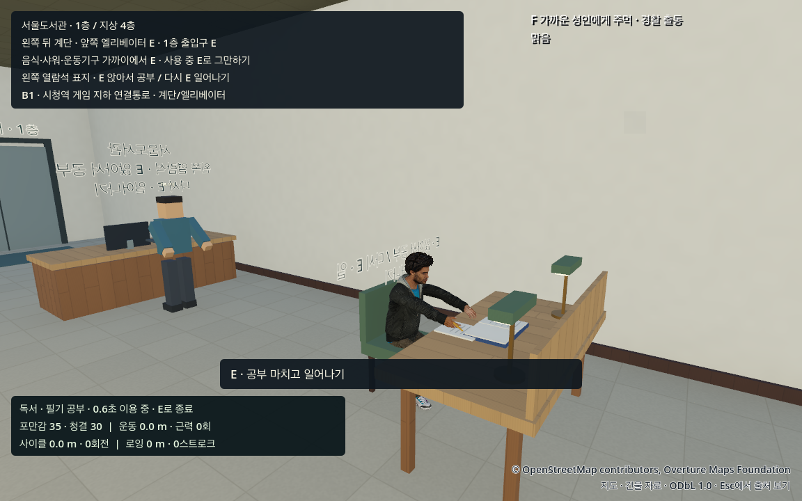
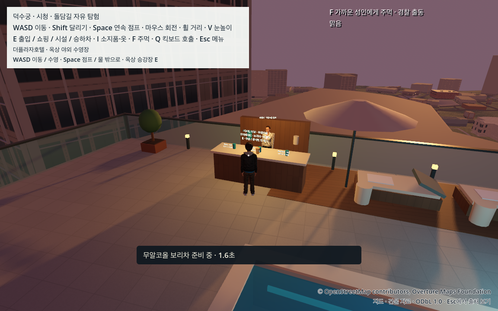

# 보행과 도서관·야외 풀 생활

## EXP31: 어깨와 팔이 이어지는 걷기·달리기

기존 팔꿈치는 걷기 약8°/달리기39°로 고정돼 있었고 어깨도 거의 돌지 않았다. 팔은 발 궤적의 평평한 구간에서 멈추는 듯했다. 작은 어깨/골반 반대 회전, 연속 팔 흔들림, 걷기12~22°/달리기75~95° 팔꿈치 굽힘과 출발/정지 전환을 추가했다. 남녀 실제 어깨 범위는 약5°/8°이고 팔·어깨·목의 원래 연결/길이와 이전32/44mm 골반 움직임·발 접지를 유지한다. 카메라에는 새로운 bob/roll을 넣지 않았다.

[실제 관절 수치](../data/reports/upper_body_gait/20261022/upper_metrics_summary.json)는 남녀30Hz/남성120Hz184조건, [남녀 픽셀 검토](../data/reports/upper_body_gait/20261022/visual_review_peer.json)는144원본/20시트다. 공부·운동·수영복/목 연결·거리·타격/움찔의 소유권도 현재 소스로 회귀했다. 설계 기준의 PASS를 실측 인체 표준이나 사용자 자연스러움 수용으로 바꾸지 않는다. 펼친 손가락과 손목의 작은 동작은 후속 과제다. 아래 EXP30의 생활 기능/조작은 유지하며 당시 실행 수와 새 EXP31 실행 수는 구분한다.

2026-10-22 개발판. [현재 EXP31 소스·실행·원시 로그 집계](../data/reports/upper_body_gait/20261022/summary.json)가 수용 범위의 기준이다. 새 다운로드나 유료 자산은 없으며 기존 MIT/CC0 인체와 원래 지도·캡슐을 유지한다.

## 바로 체험하기

1. Esc → **자연스러운 걷기·달리기 체험**, V로 시점을 맞춘다. WASD/Shift로 이동한다. 저장된 초고속 선호는 유지하고 현재 세션만1.4/3.5m/s를 쓴다.
2. Esc → **서울도서관 공부 · 정문으로 이동**. 정문 E로 들어가 왼쪽 열람석의 E 표지를 찾는다. 책상 가까이에서 E로 앉아 독서·필기하고 다시 E로 일어난다. 공부 시간과 쪽 기록은 게임 활동 기록이며 실제 학습 성과를 의미하지 않는다.
3. Esc → **야외 수영장 · 해질녘 조명과 바텐더**. 탈의실 E → 샤워실 E로4초 샤워 → 입장 E를 거쳐 물에서 WASD 수영, Space 출수. 바의 유자에이드·보리차·탄산수 표지 가까이에서 E로 주문하고 준비가 끝나면 E로 받는다. 모두 무료 무알코올 게임 음료다.

## 왜 몸이 들썩였고 무엇을 바꿨나

순간마다 양 발까지 닿을 수 있는 골반 높이의 최솟값을 구하던 방식은 다리를 펴는 순간마다 몸 전체를 급하게 낮췄다. 이전 소스의 실제 표시 골반 범위는 남녀 걷기73.05–84.67mm, 달리기91.09–106.39mm였다. 골반만 고정하거나 허벅지를 따로 옮기면 이전의 엉덩이/허리 연결 변형을 다시 만들 수 있어 그 방식은 쓰지 않는다.

실제 다리 길이와 heel/toe 지지를 바탕으로 한 주기 전체에서 안전한 공통 높이를 구하고 작은 연속 곡선으로 높이를 변화시킨다. 뒤꿈치 디딤→평평한 중간 지지→발끝 밀기의 각도와 ankle 위치를 함께 보정해 실제 sole pivot을 유지한다. 무릎은 실제 native hip에서 앞으로 굽도록 한다. 첫16/28mm 시도는 숫자가 작아도 지지기 무릎이 약50/57도로 계속 굽어 보이는 웅크림 때문에 거절했고, 현재32/44.19mm의 보행으로 다시 조정했다.

120Hz 고정 검사만으로는 기본30Hz 물리 사이의 문제가 드러나지 않았다. 표시 root와 물리 actor의 원점을 섞어 reach profile이 낮아지던 캐시, stance 다음의 swing 목표를 미리 섞던 발 보간, 선형 골반 높이의 속도 단절을 각각 수정했다. 이전/현재 물리 위상을 보간한 표시 위상에서 발과 C1 골반 곡선을 평가하며 물리 pose·캡슐을 바꾸지 않는다. 지면 접촉 중에는 작은 하향 속도를 사용해 약1cm의 반복적인 접촉 침투를 줄인다. 점프·공중 중력·수영 부력은 유지한다.

## EXP30 당시 확인한 범위

| 범위 | 현재 결과 |
|---|---:|
| 남녀 × 물리30/120Hz, 중간 표시 프레임·실제 native bone/CPU skin | 4회124개 중복 assertion 통과 |
| 골반 상하 범위 / 기본30Hz 지지기 무릎 중앙값 | 걷기32mm·달리기44.19mm / 남성 약27·32도, 여성 약21·25도 |
| 실제 heel/toe pivot과 flat sole | XZ25mm/s 기준 유지·밑창 높이 범위2mm 기준 유지 |
| 실제 앞/뒤/좌/우8위상·힙 후면4위상, 걷기/달리기 | 남녀각37/37·144PNG·20검토시트 |
| 독립 카메라/관절 이력·30/60Hz·벽·문·중간 보간·멈춘 메뉴 순간이동 | native197/197 |
| 실제 도서관 공부·E 소유권·발/좌석·메뉴·기립·바 주문/수령 | headless23/23·native27/27 및4PNG |
| 기존 탈의·샤워·입수·실제 WASD 수영·Space 출수·의상 복원 | headless27/27 |

숫자는 서로 겹치는 assertion이며 고유 기능 수가 아니다. [수치 측정](../data/reports/human_gait/20261022/metrics_summary.json), [독립144위상 검토](../data/reports/human_gait/20261022/visual_review_peer.json), [생활 기능 검사](../data/reports/life_activities/20261022/summary.json), [일반 창/OS 입력](../data/reports/human_gait/20261022/normal_launch.json)은 서로 다른 증거다. 보행 수치 설계 기준은 실제 인체의 실측 표준이나 자연스러움의 충분조건이 아니다. 가장 빠듯한 현재 관측은 남성30Hz 달리기 밑창 높이 범위1.976769mm/기준2mm다.

## 남은 한계

현재는 절차적으로 만든 보행이며 모션 캡처/GTA 수준의 동작 수용은 아니다. EXP31에서 상체/팔을 다듬었지만 손가락이 펼쳐진 자세·손목/손바닥의 뻣뻣함과 반복적 리듬은 남고, 일부 위상·여성 부츠에서는 조심스러운 높은 발 들기가 남아 있다. 두 인체 원본의 반복, 수영복/헤어 경계와 기존 실내 직원의 단순 외형도 후속 과제다. 정지 위상 사진을 연속 움직임·사용자 편안함·장시간 FPS·다른 Mac/export의 수용으로 바꾸지 않는다.

도서관 실내/열람석·호텔 풀/바는 기존 원본 건물에 연결한 가상 게임 시설이다. 바텐더는 짧은 주문/잔 준비·수령이며 마시기·재고/결제·생활 AI 전체를 구현한 기능은 아니다. 수영은 기존 부력/이동/물 튀김 체험이며 물리 유체나 정교한 수영 영법을 구현했다는 뜻이 아니다.

## 재현과 실패 기록

`tools/run_urban_transit_acceptance.py`의 `human_continuity`, `human_support`, `human_gait`, `human_camera`, `library_pool_life`, `pool`을 새 태그로 실행한다. `human_continuity`의 별도 물리 주기는 fixture의 `--physics-hz=30` 또는 `--physics-hz=120`을 사용하며, 정확한 실제 인수 명령은 각 `.run.json`을 따른다. native는 실제 창을 열므로 직접 플레이와 겹치지 않게 한다. 공유 무결성은 `tools/check_street_detail_handoff.py [--prepared]`이며 엔진을 재실행하지 않는다.

첫 웅크림,120Hz만 통과한 중간 프레임 실패, 카메라 첫196/197의 표시 주기2bin 겹침, 책상 파서 오류와 칸막이/책 겹침 수정은 원시 이력으로 보존한다. 카메라는 기준을 바꾸지 않고 재실행해197/197을 통과했다. 일부 headless dummy material 및 life fixture 종료 ObjectDB/resource 잔여 진단은 그대로 남기며 모든 로그가 무경고라고 표현하지 않는다. 개발 `dev_male03`는 동시 작업의 태그 충돌이 있어 최종 근거로 선별하지 않는다.
