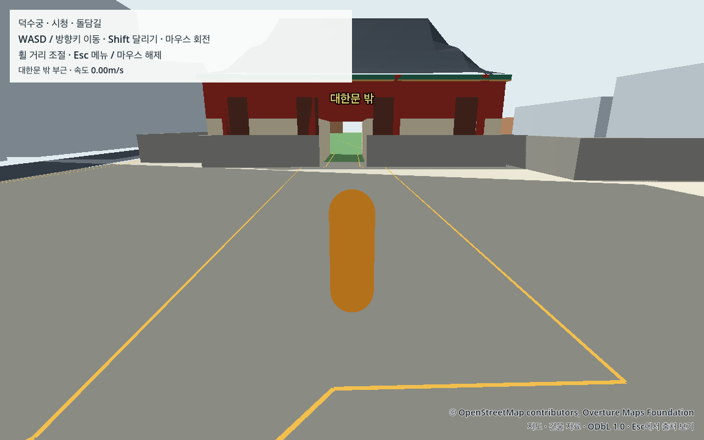

# Sim2Seoul 개인용 앱 실행 안내

2026-10-16 · M1 Pro에서 오프라인 기동과 전체 동선·보행자·차량을 검증한 개인용 첫 탐험 버전이다. [실제 검증과 한계](../data/reports/package_check.md), [기기별 인수 판정](../data/reports/first_version_acceptance.md)을 함께 제공한다.

## 앱으로 시작하기

### 이 Mac의 최신 개발 탐험판

직접 플레이한 뒤의 건물·이동 피드백을 반영한 개발판은 [Sim2Seoul.command](../Sim2Seoul.command)를 더블클릭하거나 `sh tools/run_exploration.sh run`으로 연다. 기본은 **자유 탐험 + 빠르게**다. Esc 메뉴에서 걷기/달리기 `현실 속도`(1.4/3.5m/s), `빠르게`(2.24/5.6), `아주 빠르게`(2.8/7)를 선택하며 다음 실행에도 유지된다.

자유 탐험에서는 주변 도로와 잔디까지 이동한다. 건물·담장 충돌, 사유지와 지도 가장자리 제한은 유지한다. 자유 탐험을 끌 때 산책길 밖에 있으면 대한문 밖으로 돌아온다. 일반 건물 616개의 창문·층 구분·저층부 색 변화는 시각 표현이며 실제 개별 외관이나 실내 구현을 뜻하지 않는다. [이번 M5 검사](../data/reports/exploration/20261016/summary.json)는 아래 R03 ZIP과 별도다. 원래 V0 실행은 `sh tools/run_v0.sh run`으로 유지했다.

### 기존 R03 앱

검증된 `Sim2Seoul.zip`을 풀고 `Sim2Seoul.app`을 연다. 앱을 실행하는 데 Godot 편집기, Python, 지도 서버 연결은 필요하지 않다. 개발 저장소와 다른 폴더로 옮겨도 실행되도록 모든 게임 자료를 앱에 포함한다.

첫 위치는 대한문 밖이다. 대한문을 통과해 경내 길과 중화전 앞마당을 걷거나, 확인한 횡단 연결을 따라 서울광장·시청 전면, 남쪽 돌담길로 이동한다. 전각 실내·계단·잔디는 탐험 범위에 포함하지 않는다. 경계 밖으로 나가려 하면 안내와 차단이 동작한다.

검증한 파일은 `builds/macos/v0.1.0-fc348ad45c71-20261015T182258776232Z/Sim2Seoul.zip`이며 64,884,999 bytes다. Git에 앱/ZIP을 넣지 않으므로 다른 Mac에는 이 파일을 별도로 옮긴다. 같은 ZIP을 풀어 사용하며 다른 파일이나 새 빌드의 결과와 합치지 않는다.

```text
SHA-256 feb939b72ecd9d077b563e77aeacf0b2b8d4892dc0a00800eadc68cd65d8facb
```

## 조작

| 조작 | 동작 |
|---|---|
| WASD 또는 방향키 | 카메라를 기준으로 걷기 |
| Shift와 이동키 | 달리기 |
| 마우스 이동 | 주변 둘러보기 |
| 마우스 휠 | 카메라 거리 조절 |
| Esc | 메뉴 열기, 마우스 해제, 다시 누르면 계속하기 |
| 메뉴의 대한문 밖으로 복귀 | 시작 위치로 돌아가기 |
| 메뉴의 종료 | 앱 닫기 |

메뉴가 열리면 사람·차량과 플레이어가 멈춘다. 보행자 이동과 차량 이동을 각각 끄거나 켤 수 있다. 출처 창에서 Esc나 닫기를 누르면 메뉴로 돌아가며, 한 번 더 Esc를 누르면 탐험을 계속한다.

## 화면 품질과 저장

‘기본’은 원래 해상도 배율과 그림자를 유지한다. ‘가볍게’는 3D 해상도 배율을 0.75로 줄이고 그림자를 끈다. 두 설정 모두 실제 배치·축척·충돌·보행자 2명·차량 2대를 유지한다. 가볍게의 성능 개선 폭은 별도 측정 전에는 보장하지 않는다.

메뉴에서 고른 품질은 다음 실행에도 적용된다. 잘못된 설정 파일은 기본으로 복구하고 안내한다. 현재는 위치나 생활 진행을 저장하지 않으며, 앱을 다시 열면 대한문 밖에서 시작한다.

## 출처와 현실의 차이

화면 아래 지도 출처와 메뉴의 ‘출처 보기’를 확인할 수 있다. 상세 출처·엔진/자산 라이선스·자료와 변경 방법 안내는 앱 안에서 오프라인으로 읽는다. 공식 웹 링크를 직접 누르는 경우에는 웹 브라우저를 연다.

도로·건물의 수평 배치와 미터 축척은 공개 지도에서 왔다. 높이·세부 외형·임시 평면 지면·문 폭·통행 연결에는 추정과 수동 보정이 있다. 현재 현장 출입 허가나 정밀 측량 결과를 표현한 앱은 아니다. 경내 입장은 구현했지만 개별 건물의 방·복도·엘리베이터는 구현하지 않았다.

## 다른 Mac에서

2026-10-16 새로 준비한 **Apple M5·RAM 16GB·macOS 26.6.2**에는 공식 Godot 4.7.2를 `/Applications/Godot.app`에 설치했고 Python 환경과 V0 자료도 생성했다. [최초 Mac 기동 기록](../data/reports/m5_startup_20261016.json)은 원래 V0의 GUI·준비 로그·Esc 메뉴 복귀 확인 범위다. 이후 기본 실행은 위 최신 개발 탐험판으로 바뀌었다. 기존 R03 ZIP 재검수나 전체 동선·성능 재측정은 포함하지 않는다.

동일한 ZIP의 SHA-256을 비교한 뒤 옮긴다. 앱은 로컬 ad-hoc 서명 검사를 통과했으며 배포용 Developer ID 서명·공증은 하지 않았다. 다른 Mac으로 옮긴 뒤 Gatekeeper의 최초 실행과 M4 실행은 아직 미검증이다. macOS가 실행을 막으면 표시한 앱 이름과 사유를 확인한다. 시스템 전체 보안 설정을 끄지 않는다.

M1 Pro에서의 검증을 M4 Pro 실행 결과로 보지 않는다. M4에서는 먼저 칩·RAM·OS를 확인하고 같은 앱의 기동·조작·동선·보행자·차량을 별도로 기록한다. 개발을 이어갈 때는 [다른 Mac 준비](CROSS_MAC.md)와 [현재 상태](WORK_STATUS.md)를 따른다.


현재 Mac이 잠겨 있어 실제 OS 키보드·마우스/초점 시험은 미실행이다. 앱 자체의 합성 입력·전체 동선 검수와 구분하며, 사람 조작감의 확인을 완료 조건으로 대신하지 않았다.


