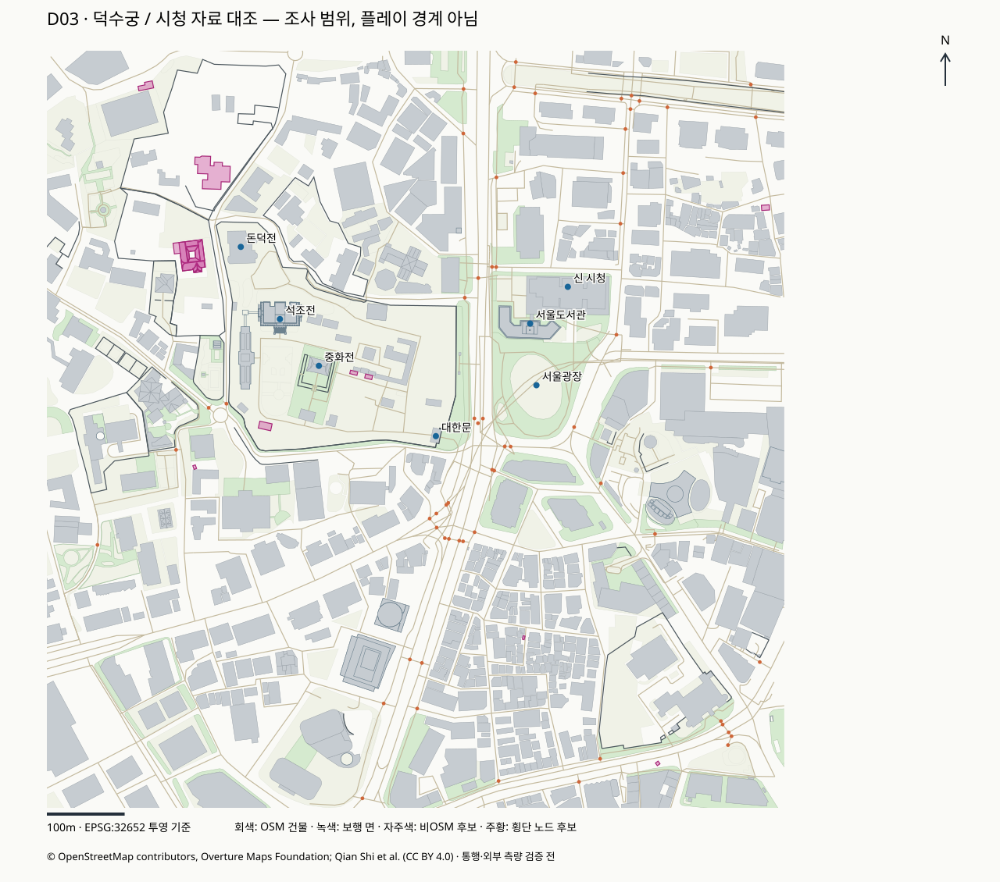

# D03 보완 자료 확보와 검증

판정: **자료 확보·상태 분류 작업 완료** · 2026-10-12. 국내 상세 건물·지형 원본은 미수신이며, 실제 높이·지면·현재 통행 가능성이 모두 검증된 상태는 아니다. 다음은 D04 사용 범위와 결손 확정이다.

## 받은 자료와 받지 못한 자료

| 대상 | 실제 결과 | 다음 용도 / 한계 |
|---|---|---|
| Overture Buildings 2026-09-23.1 | 지역 GeoJSON 497,524 bytes, 수신 736개 | 실제 도형 교차 대상 733개. 기존 OSM 대조·윤곽 보완 후보 |
| Copernicus GLO-30 AWS 타일 | 원본 29,862,574 bytes, 지역 38×32 픽셀 5,356 bytes | 지표 고도 참고용. 건물·수목 포함 DSM, 보행 지면 아님 |
| 국내 GIS건물통합정보 | 최신 컬럼 정의서 확보. 서울 SHP 본체 미수신 | 다운로드 로그인과 전송 도구 요구. 현재 파일의 높이·층수·PRJ 실물 검사는 못함 |
| NGII 연속수치지형도 | 공식 접근 요구 조사, 지역 파일 미수신 | 로그인/다운로드 환경 필요. 상세 도로폭·단차·지형은 결손 |
| 덕수궁 공식 안내 | HTML 10개와 지도 식별 메타데이터 3개 로컬 확보, 지도 화면 확인 | 명칭·경내 도식·관람/공사 근거. 측량 좌표나 게임 재사용 이미지가 아님 |
| OSM 횡단시설 | v2에서 crossing 노드 후보 60개 추출 | 지상/지하와 연속 보행 연결·현재 운영 확인은 별도 |

국내 접근과 컬럼 확인은 [국내 자료 조사](D03_KOREAN_SOURCE_ACCESS.md), 경내·돌담길 근거는 [덕수궁 공식 출처 조사](D03_PALACE_ROUTE_SOURCES.md)를 따른다. 파일별 확보/권한 필요/후보는 [supplemental_status](../../data/reports/supplemental_status.json)에 구분했다.

## 건물 자료에서 발견한 점

공식 도구의 bbox 조회는 도형 외접 상자가 겹치는 건물도 반환했다. 처음에는 736개 모두 실제 조사 상자와 교차해야 한다고 검사해 실패했다. 범위 밖 3개를 정확한 도형 교차 검사로 분리하고 원본을 수정하지 않은 채 사용 대상에서 제외했다. [수정 전 검사](../../data/reports/d03_before_review.json)를 보존했다.

- **선택 대상 733개:** OSM 원천 711개, Qian Shi 등의 동아시아 건물 자료 원천 22개. 받은 전체 736개와 분모를 구분한다.
- OSM 원천 711개는 현재 OSM 건물 미리보기의 ID와 대응한다. Overture의 OSM 기준은 2026-09-06, 현재 OSM 원본은 2026-10-09 기준으로 시점이 다르다.
- 추가 윤곽 후보 22개는 현재 OSM `building` 도형과 교차하지 않았다. 실제 건물 여부·건물 부분 도형·현행 배치 검토 전이므로 **누락 건물 22개를 확정한 결과가 아니다**. G02에서 개별 검토하며 자동 병합하지 않는다.
- 선택 대상의 높이는 **100/733개**, 층수는 **134/733개**이며 숫자·유한값·양수 및 층수 정수 검사를 통과했다. 높이 범위 3–150m, 층수 1–37이다. 현실 측량값의 정확도 검사가 아니다.
- 높이 100개는 모두 OSM 원천이다. 현재 OSM에 없던 독립적인 높이 값을 얻지는 못했다. 현재 OSM `r/15100454`의 높이 태그는 이 Overture 파일에 없으므로 Overture로 기존 원본을 일괄 교체하면 정보가 줄 수 있다.

도형과 출처를 함께 보존한 [지역 원본](../../data/raw/supplemental/overture/2026-09-23.1/buildings.geojson), [취득 기록](../../data/reports/overture_acquisition-2026-09-23.1.json), [현재 검사 결과](../../data/reports/d03_supplemental_review.json).

## 지표 고도 자료의 확인 범위

공개 AWS 경로에서 한 타일을 완전 수신하고 로컬 SHA-256을 기록했다. 조사 상자를 둘러싼 원래 픽셀만 잘라 내며 보간이나 높이 변환은 하지 않았다. 현재 기기에서 전체 타일과 지역 사본의 픽셀·변환 행렬이 일치했다.

지역 사본은 WGS84 수평 좌표, EGM2008 수직 기준의 미터 값이다. 1각초 간격이며 이 구역에서 약 **동서 24.54m·남북 30.83m**다. 1,216픽셀에 마스킹·비유한 값이 없고 지표값 범위는 약 19.49–62.07m다. 이 범위에는 건물·수목 영향이 있으므로 건물 높이나 맨땅 높이로 해석하지 않는다.

**문턱·계단·보도 턱·대한문 전후 지면에는 사용할 수 없다.** 게임의 수직 기준도 이 자료를 받았다는 이유로 확정하지 않았다. 상세 지형 확보 또는 출처 있는 수동 보완이 필요하다. 공급자 체크섬은 별도 확보하지 못했으며 HTTP 수신 크기·로컬 해시·픽셀 동일성의 검사다.

[지역 DSM 참고 사본](../../data/raw/supplemental/copernicus/20261012/deoksugung_cityhall-dsm-reference.tif), [원본·지역 취득 기록](../../data/reports/copernicus_acquisition-20261012.json). 전체 타일은 Git에서 제외한다.

## 보행 공간에 영향을 주는 공식 근거

공식 도식은 대한문·금천교·중화문/중화전 앞·석조전 앞 외부 공간을 경내 동선 후보로 삼을 근거다. 석조전 실내는 별도 제한 관람이며 사용자 요구의 경내 보행과 구분한다. 오래된 중화전 월대 통제는 2024-08-20 재개 공지로 갱신됐다.

2026-10-12 조사에서 남측 담장 공사와 10-25~11-19 예정 평성문 통제를 확인했다. 남측 돌담길 전체 폐쇄라고 확대 해석하지 않는다. 공식 제한의 유효 기간과 실제 가림막/보행 폭을 따로 확인해야 하며, 기간이 지나면 현재 공지를 다시 확인한다.

R2의 지상 횡단 연결과 R3 전체 순환·북측 연결의 현재 상태는 미확정이다. crossing 후보 60개는 원본의 태그 위치일 뿐 완성 경로가 아니다. [횡단 노드 후보](../../data/reports/d03_crossing_candidates.json)와 공식 근거를 D04/G04의 검토 입력으로 넘긴다.

## 지도 형태의 대조



미터 투영 좌표의 조사 지도다. 대한문·중화전·석조전·돈덕전·신 시청·서울도서관·서울광장 위치를 표시하고, 추가 윤곽 후보와 보행 면·담장·횡단 노드를 구분했다. 공식 관람 지도와 정성적으로 대조했으며 원본 기관의 지도 이미지를 복제하지 않았다. 도형·레이블·축척 표기의 렌더를 확인했지만 외부 측량 정확도나 경로 완주 검증은 아니다.

## 실행한 검사와 다른 Mac 재현

현재 M1 Pro에서 **17개 검사 통과:** 현재 OSM와 보완 자료 해시, 미리보기/설정 연결, 비어 있지 않은 수신물, ID 중복, 도형·교차 대상 분류, 출처 보존, 높이/층수 값, DSM 좌표·범위·픽셀, 로컬 전체 타일 대조. 원본·가공·게임 검증을 구분한다. 최초 검사 도구의 감사 JSON 키 참조 오류는 실제 `extract_sha256` 키로 수정했고, 범위 밖 반환 객체도 실패 기록 후 분리했다. 별도 검토에서 미리보기 자체의 출처 연결 누락을 발견해 감사 보고서에 미리보기와 설정 해시를 추가했다.

공유 파일의 무결성 확인은 기본 준비 환경만으로 실행된다.

```sh
python3 tools/check_checkout.py
```

상세 보완 검사를 재실행할 때만 추가 의존성을 설치한다. 국가 전체 PBF와 전체 DSM 타일 없이도 지역 파일 검사는 가능하다. 원본 전체 타일 비교 2개는 없으면 미실행으로 명시된다.

```sh
.venv-data/bin/python -m pip install -r requirements-supplemental.txt
.venv-data/bin/python tools/review_supplemental.py --report /tmp/sim2seoul-d03-review.json --no-map
```

`tools/acquire_supplemental.py`는 명시한 릴리스/영역으로 새 원본을 취득하는 도구다. 이미 받은 파일은 덮어쓰지 않는다. 평소 재개에는 공유된 지역 자료를 재사용하며 원본을 다시 받을 필요가 없다. Overture 과거 릴리스의 원격 보존 기간도 영구라고 가정하지 않는다.

별도 파일 사본에서도 국가 지도·전체 DSM 없이 15개 지역 검사를 통과했고, 전체 DSM 비교 2개는 미실행으로 남았다. 미리보기나 공유 원본을 바꿨을 때 해시 불일치를 검출하는 것도 확인했다. 공유 파일은 재현 후 바뀌지 않았다. [파일 사본 재현 검사](../../data/reports/d03_portability_check.json)는 현재 M1의 기존 도구 환경을 사용한 검증이며 새 의존성 설치나 M4 실행 결과가 아니다.

## 다음 작업 D04

이번 보고서·출처·필수 세 동선 근거를 입력으로 `docs/data_gaps.md`를 만든다. 사용할 원천, 제외/후보 22개, 높이 추정과 상세 지면 결손, 국내 자료 재개 조건, 이미지 재사용 미확인을 확정한다. D03은 자료 취득 작업이며 G02 중복 정리·G04 경로 연결·W0/V0 플레이 시험은 아직 수행하지 않았다.
